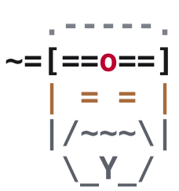
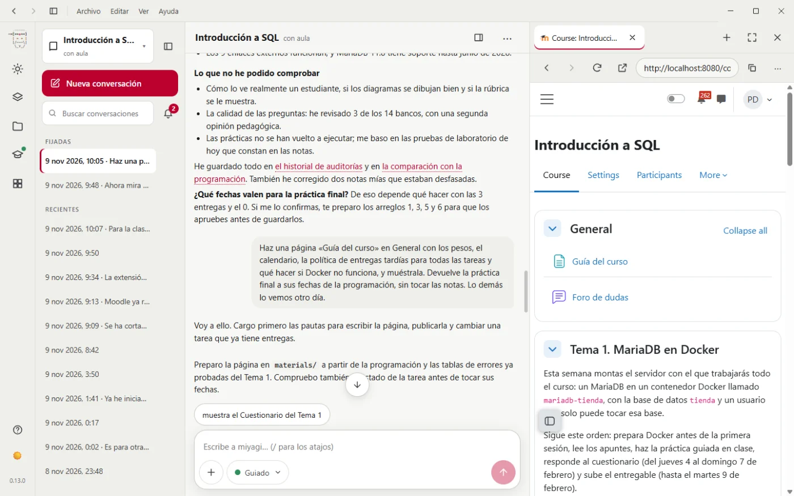
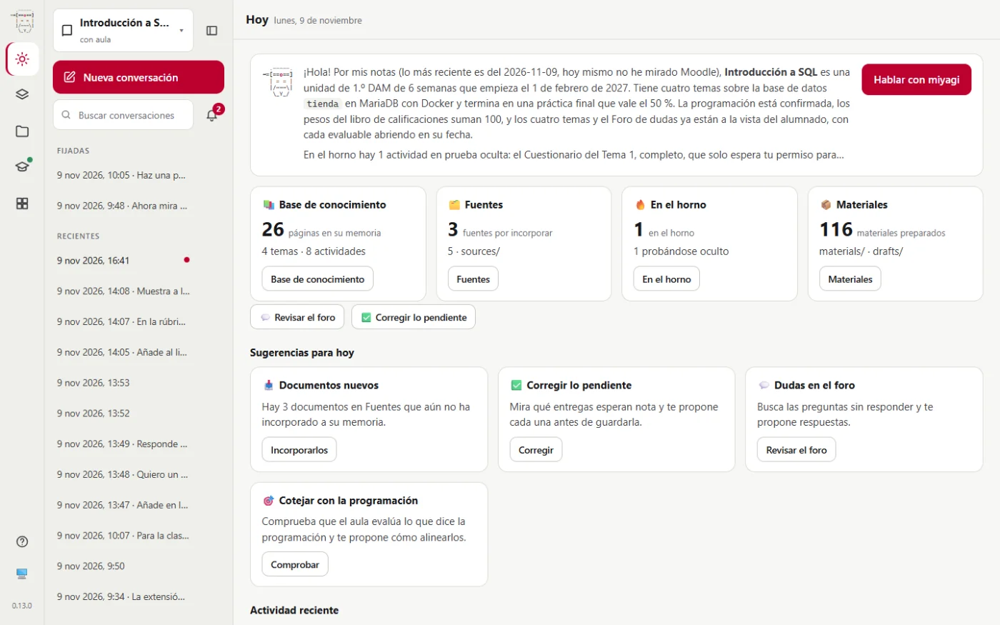
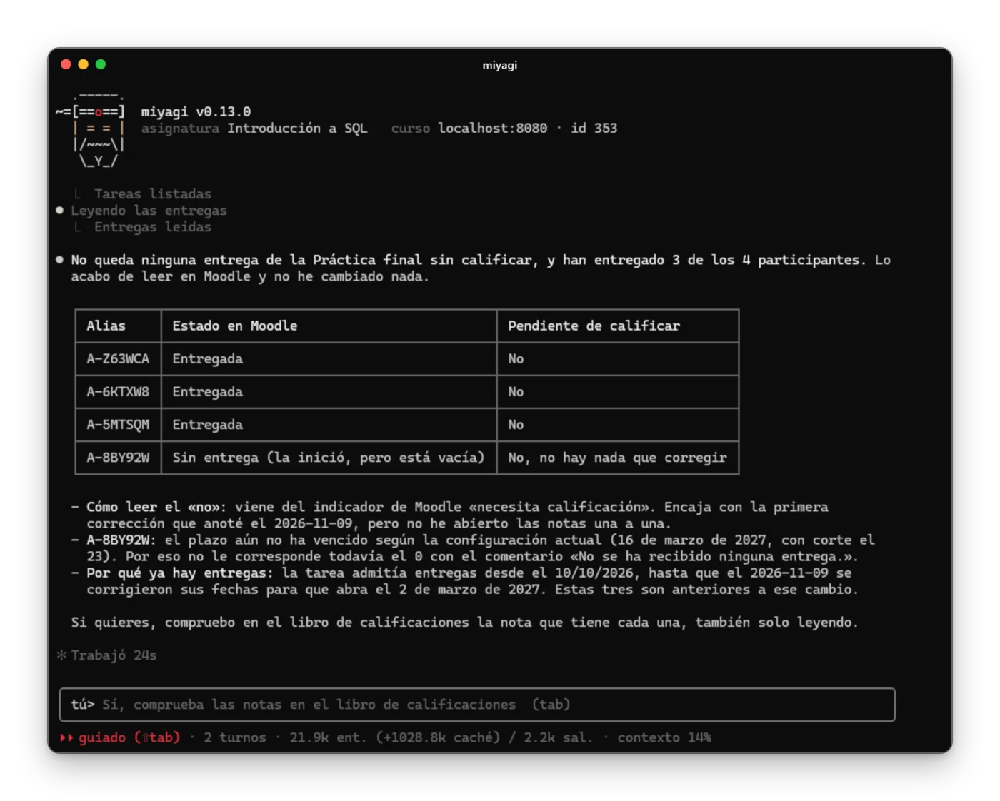

<div align="center">



# miyagi

**You teach, and miyagi takes care of the rest.**<br/>
An AI assistant for teachers that prepares your subject with you and, in your Moodle course, asks before anything reaches your students.

[](https://github.com/falkenslab/miyagi/releases/latest)
[](https://github.com/falkenslab/miyagi/releases)
[](https://github.com/falkenslab/miyagi/releases/latest/download/miyagi-setup.exe)
[](https://nodejs.org)
[](https://docs.claude.com/en/api/agent-sdk/overview)
[](https://github.com/falkenslab/moodle-sandbox)
[](LICENSE)

**[📖 Documentación](https://falkenslab.github.io/miyagi/)** · [📖 Documentation in English](https://falkenslab.github.io/miyagi/en/)

</div>

miyagi is an assistant for teachers. It helps you prepare a subject (teaching plan, units, materials, rubrics, quizzes) and, if you connect your Moodle course, run it too: it grades with your rubric, looks after the forum, publishes what it prepares and tells you how the class is doing. It comes in three versions, a **desktop app for Windows** (the main one), a web version and a terminal, all on the same subjects. In Moodle it works with your own teacher session through the moodle-teacher extension, so it never sees your password, your students reach it as an alias, and everything they would see waits for your approval.

## ✨ Why miyagi

- 🖥️ **A desktop app, not a terminal.** Install it on Windows with a double click and talk to it in a window, with Moodle open beside the conversation.
- 🎚️ **You approve what students see.** Every grade, forum reply and resource is shown before it's published, and a guard stops anything you didn't approve.
- 🕶️ **Your students stay private.** They reach the model as an alias, and its notes never keep a page about an individual student.
- 🧠 **It remembers your course.** It keeps notes on your criteria, rubrics, recurring doubts and how the class evolves, in plain text files you can edit.
- 🧩 **Nothing to install on the server.** It works with your Moodle and your teacher session, and it doesn't need a classroom to help you prepare a subject.
- 🧪 **Practices tried before they're published.** With the docker-lab extension it runs a practice in an isolated Docker lab first.

## 🚀 Quick start

You need a Claude Pro or Max subscription (or an API key). On **Windows (x64)**, download the installer and open it:

**[⬇️ Download miyagi for Windows](https://github.com/falkenslab/miyagi/releases/latest/download/miyagi-setup.exe)**

The installer isn't signed yet, so Windows will warn you: choose **More info** and **Run anyway**. The app opens on its own, connects your Claude account and shows a guided tour. Create a subject, link your course from **Your classroom** if you want, and ask.

<details>
<summary>Web version or terminal (Windows, Mac, Linux)</summary>

They need [Node.js](https://nodejs.org/) 20 or later and a browser such as Chrome or Edge:

```
npm install -g https://github.com/falkenslab/miyagi/releases/latest/download/miyagi.tgz
miyagi web                 # the same page as the app, in a browser tab on this computer
miyagi init                # or, in the terminal: create a subject, then
miyagi ingest -w <name>    # read what you left in sources/, and
miyagi chat -w <name>      # talk to it
```

To update, repeat the first line; to uninstall, `npm uninstall -g miyagi`. Details in [Install](https://falkenslab.github.io/miyagi/en/guia/instalar/).

</details>

## 💬 What you can ask

👩‍🏫 Day to day:

- *What's waiting to be graded, and since when?*
- *Grade Assignment 2 with the rubric I left you.*
- *Is there anything new in the forum?*
- *Which students are falling behind?*

🧱 Building:

- *Build a unit on SQL queries, with its practice and a quiz.*
- *Help me with my teaching plan and tell me if the classroom matches it.*

More ideas in [What to ask it](https://falkenslab.github.io/miyagi/en/guia/ideas/).

## 📸 See it at work

The desktop app, with the conversation and the Moodle course side by side:

<div align="center">

</div>

The web version, the same page in a browser tab:

<div align="center">

</div>

And the terminal:

<div align="center">

</div>

A whole **Introducción a SQL** course, built step by step with real screenshots, is in the [use cases](https://falkenslab.github.io/miyagi/en/casos-de-uso/).

## 🧰 What's inside

| Area | For example |
| --- | --- |
| 🖥️ Three versions | Desktop app for Windows, `miyagi web`, terminal chat and one-shot `miyagi run` |
| ✅ Grading | Rubrics, feedback, the same yardstick for everyone (file submissions, under default privacy, have to be handed over by the teacher) |
| 💬 Forum | Finding what's unanswered, replying in your tone, noticing recurring doubts |
| 📚 Content | Units, books and pages, quizzes imported in bulk, assignments, workshops, SCORM games |
| 🗺️ Teaching plan | Written with you and checked against the classroom |
| 🧠 Memory | A knowledge base of your course, in text files; your sources stay untouched |
| 🧩 Extensions | moodle-teacher, docker-lab, more from a catalog; your own skills and commands |

The [reference](https://falkenslab.github.io/miyagi/en/guia/referencia/) has every command and shortcut.

## 📚 Documentation

- **[Guide](https://falkenslab.github.io/miyagi/en/guia/)**: what it is, choosing a version, the desktop app from zero, the web version, the terminal and the FAQ.
- **[Use cases](https://falkenslab.github.io/miyagi/en/casos-de-uso/)**: an Introducción a SQL course built from zero in the desktop app, step by step, plus the web and the terminal.
- **[Advanced](https://falkenslab.github.io/miyagi/en/avanzado/)**: your own skills, the knowledge base, configuration, approvals, Docker practices and security.

## 🛠️ Developing

miyagi is built on [`@falkenslab/agent-kit`](https://github.com/falkenslab/agent-kit), and works in Moodle with the moodle-teacher extension from [agent-extensions](https://github.com/falkenslab/agent-extensions). Design decisions are in [`.minispec/`](.minispec/README.md), how to work on the repo (including the Claude Code skills in `.claude/skills/`) is in [CLAUDE.md](CLAUDE.md), and every end-to-end test leaves its report in [`tests/`](tests/README.md).

```
git clone https://github.com/falkenslab/miyagi.git
cd miyagi
npm install
npm start -- chat --dir <subject-folder>
npm run typecheck && npm run lint
npm run build                    # dist/, needed for npm link
cd docs && npm ci && npm start   # the documentation site
```

<div align="center">

Made with 💖 by Falken's Lab Team

</div>
