# miyagi tips

## Change the mode with Shift+Tab {#01-shift-tab}

In the text box, Shift+Tab goes from Guided to Interactive and Plan. The mode pill does the same, and explains each one.

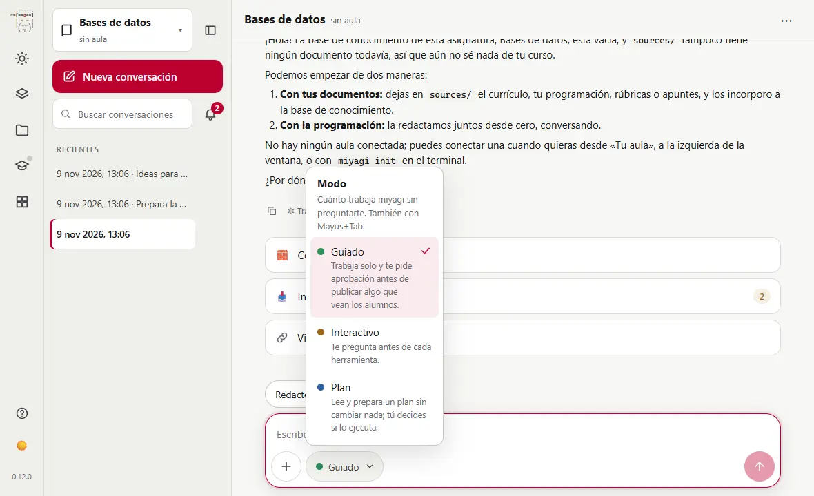

[Learn more](guia/chat)

## The / menu has all its commands {#02-slash-menu}

Type `/` in an empty box and you'll see miyagi's shortcuts: grading, quizzes, whole units... Keep typing to filter them.

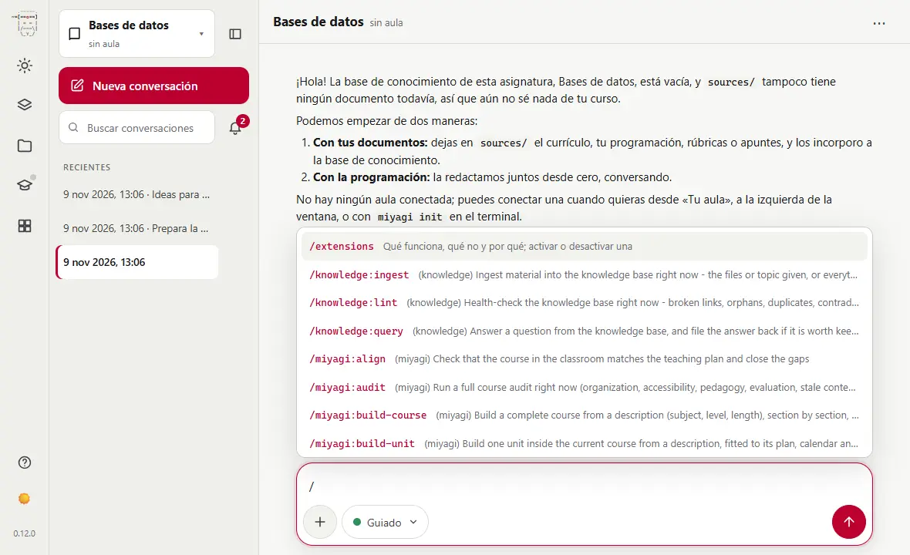

[Learn more](guia/chat#atajos)

## The ＋ holds much more than files {#03-plus-menu}

From ＋ you add a file to your sources, see what miyagi can do here and launch its actions, grouped by what you want to get done.

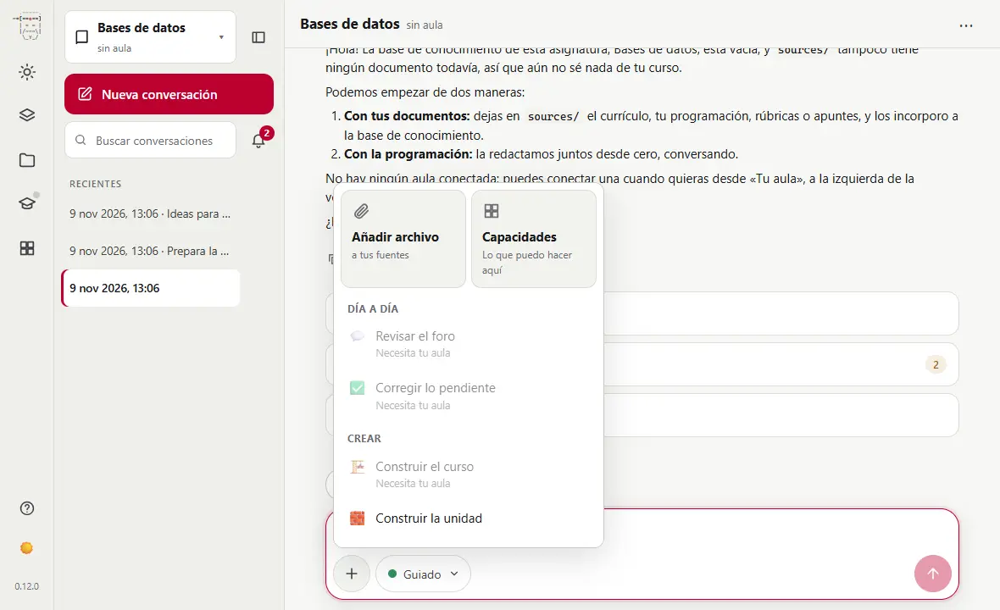

[Learn more](avanzado/navegador)

## Write at your own pace {#04-enter-newline}

Enter sends and Shift+Enter starts a new line. With the box empty, ↑ and ↓ bring back what you wrote before.

[Learn more](avanzado/navegador)

## Stop miyagi with Esc {#05-esc-stop}

While it works, Esc in the text box or the ■ button stops what it's doing. Then tell it what to do instead.

[Learn more](guia/chat)

## Accept the suggestion with Tab {#06-tab-suggestion}

miyagi sometimes suggests what to ask next above the box. Click it to send it, or press Tab with the box empty to leave it written and tweak it.

[Learn more](avanzado/navegador)

## Drag files into the chat {#07-drag-files}

Drop a document on the text box and it joins the subject's sources, ready to be taken into its memory.

[Learn more](guia/memoria)

## Extensions give it more abilities {#08-extensions}

Extensions shows its capabilities, what's installed and a catalog to add more; they start working in the open conversation, without a restart.

[Learn more](avanzado/extensiones)

## Select text in a reply {#09-selection-menu}

Selecting text in a reply brings up a menu: "Research this", "Questions about this" and "Quote in the chat".

[Learn more](avanzado/navegador)

## Act on a topic from its ⋯ {#10-item-actions}

Each topic has a menu with what can be done with it: build it, make a quiz, research it. It also opens with a right click or Shift+F10.

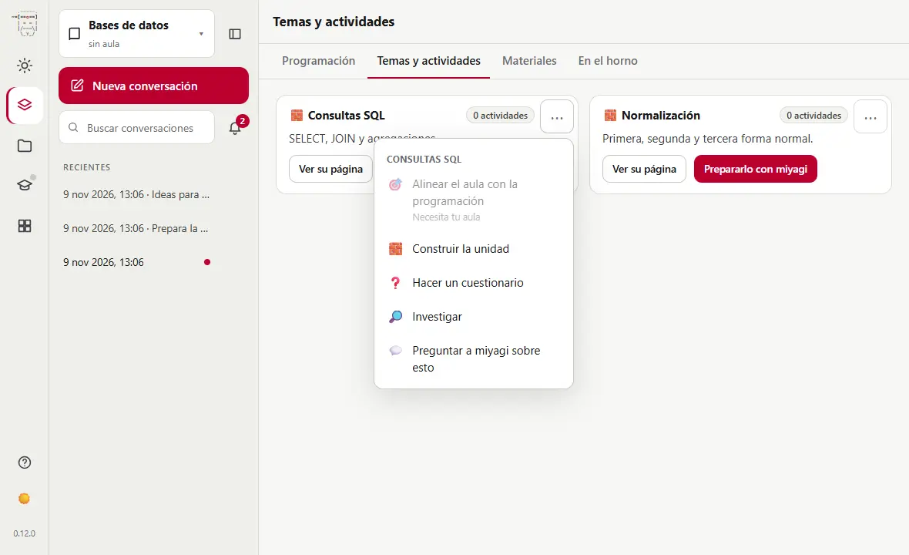

[Learn more](avanzado/navegador)

## Ask about what you're looking at {#11-ask-about}

"Ask miyagi about this", in a topic's ⋯ menu, leaves what you're talking about written in the text box: you just finish the sentence.

[Learn more](avanzado/navegador)

## Approvals take the box's place {#12-approvals-dock}

When miyagi needs your go-ahead, the question appears where you write. The conversation stays in view above it in case you want to reread something.

[Learn more](avanzado/aprobaciones-y-borradores)

## Approve, Reject or Stop all {#13-approve-reject}

"Reject" doesn't publish, and you can tell it why in your next message. "Stop all" halts what it was doing.

[Learn more](guia/chat)

## What's new is tested before students see it {#14-hidden-first}

What miyagi creates is uploaded hidden, tested as a teacher, and only shown to students after another yes from you.

[Learn more](avanzado/aprobaciones-y-borradores)

## There are things it never does {#15-what-never}

It doesn't delete what it didn't create, doesn't change enrolments or groups, doesn't touch Moodle's settings and doesn't leave your course.

[Learn more](avanzado/aprobaciones-y-borradores)

## Ask for a plan before a big job {#16-plan-mode}

In Plan mode it only reads and prepares a plan, changing nothing. When it has one, you choose whether it runs it, you keep planning, or you cancel.

[Learn more](guia/chat)

## Today tells you what's next {#17-today}

The Today view sums up what miyagi knows of your subject and suggests the next step: take in documents, write the plan, link the classroom...

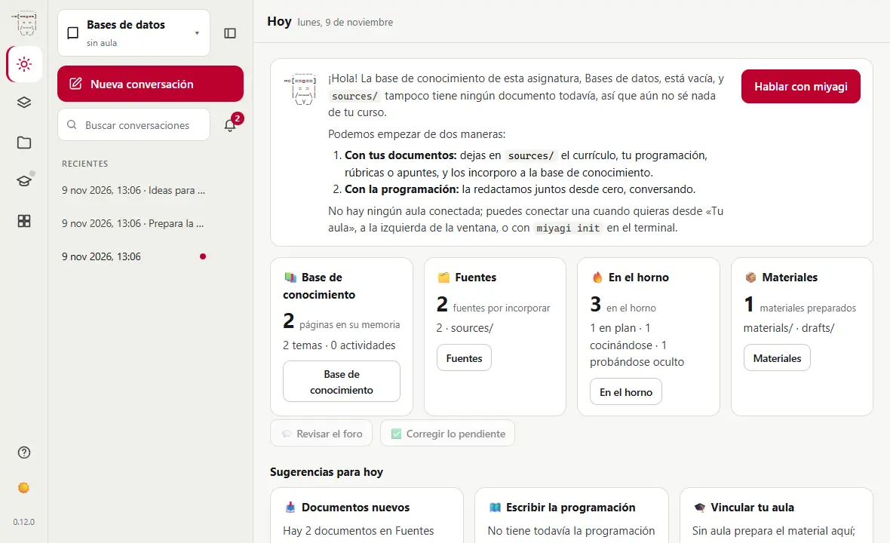

[Learn more](avanzado/navegador)

## Your teaching plan, always at hand {#18-teaching-plan}

`/miyagi:teaching-plan` writes it with you from your material and asks what only you can decide, such as weights or the calendar.

[Learn more](guia/ideas)

## Every topic has its page {#19-topics}

Topics shows the subject's topics, with what it knows of each and the actions you can launch from there.

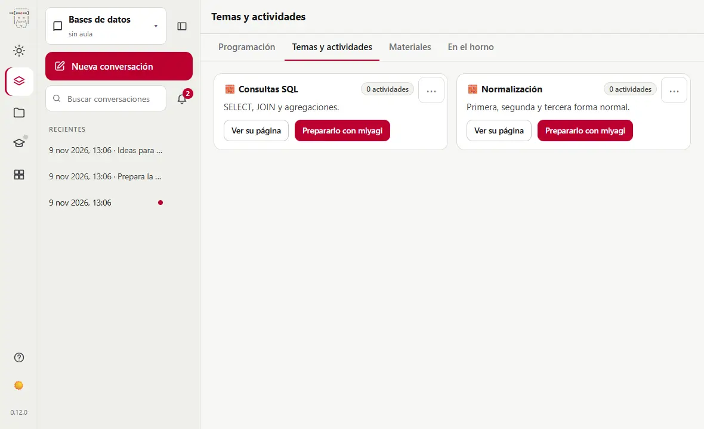

[Learn more](guia/ideas)

## See a material without leaving the chat {#20-materials-beside}

In Materials, "Open beside the chat" shows a file in the side panel, in a tab, with the conversation next to it.

[Learn more](avanzado/materiales)

## The oven shows what's under way {#21-oven}

Each activity appears in its phase: planned, being built, hidden for testing or just served to students.

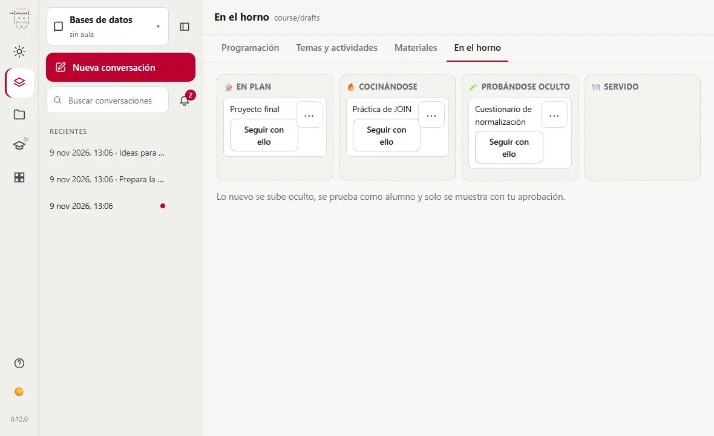

[Learn more](avanzado/aprobaciones-y-borradores)

## Read its memory {#22-knowledge-view}

In Knowledge you can browse the pages miyagi writes about your course, and search them.

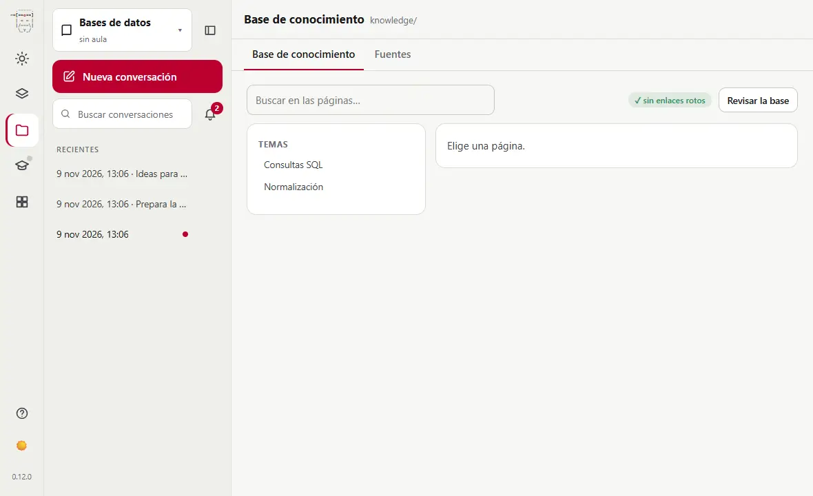

[Learn more](guia/memoria)

## Sources: your documents {#23-sources-view}

Leave the teaching plan, syllabuses or rubrics here. miyagi reads them, never changes them, and tells you which ones it hasn't taken in yet.

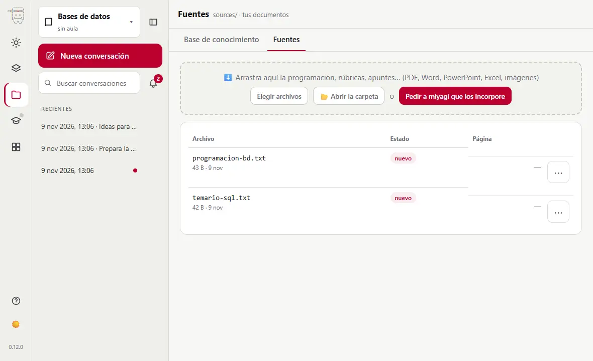

[Learn more](guia/memoria)

## Conversations forget, its memory doesn't {#24-memory-persists}

Each conversation starts from scratch, but miyagi reads its course notes when it starts. What it learned on Monday it still has on Thursday.

[Learn more](guia/memoria)

## Correct its memory {#25-fix-memory}

If it remembers something wrong, tell it in the chat and it updates the page, or edit the file yourself in the `knowledge` folder: they're ordinary text files.

[Learn more](guia/memoria)

## No student files {#26-no-student-files}

Its memory only holds the class's trends, never a record per student with their name.

[Learn more](guia/memoria)

## Give it your syllabus and it learns it {#27-ingest-docs}

`/knowledge:ingest` takes the new documents in Sources into its memory: a PDF, some notes, a rubric.

[Learn more](avanzado/base-de-conocimiento)

## Check its notes without opening Moodle {#28-knowledge-query}

`/knowledge:query` answers from what it has written down, with links to the pages it got it from.

[Learn more](guia/memoria)

## Give it standing instructions {#29-instructions-file}

In `instructions.md`, in the subject's folder, write what it should always keep in mind: "grade out of 10 with one decimal". It applies from the next session.

[Learn more](avanzado/atajos-e-instrucciones)

## The classroom is optional {#30-classroom-optional}

Without a classroom, miyagi prepares the plan, topics and materials with you. With one, it also grades, answers in the forum and publishes, always with your approval.

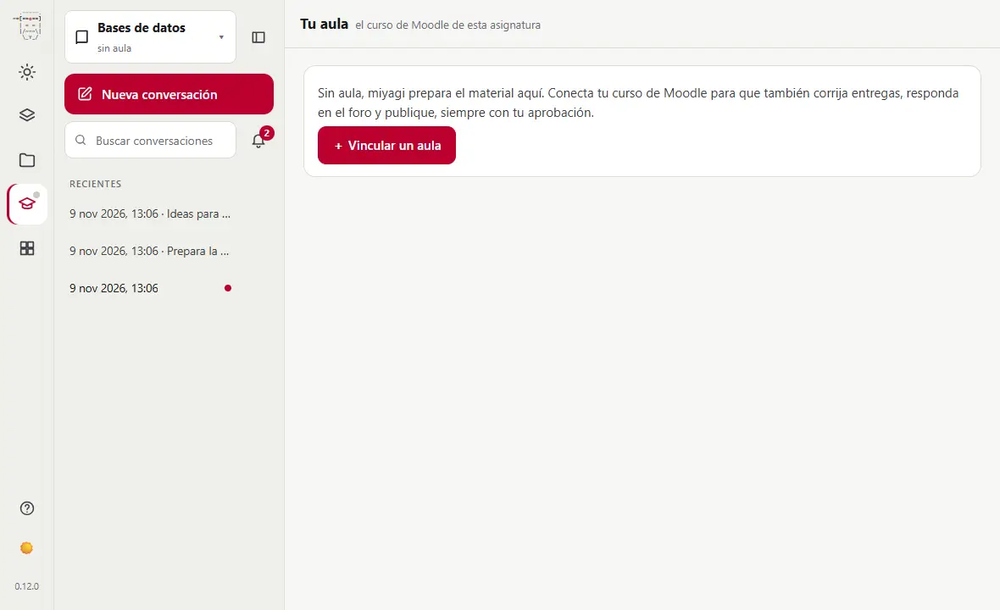

[Learn more](avanzado/configuracion)

## Linking your classroom {#31-link-classroom}

With "Link a classroom" miyagi installs moodle-teacher. The first time, your campus opens for you to sign in yourself: miyagi never sees your password.

[Learn more](avanzado/configuracion)

## Your students reach it under a pseudonym {#32-pseudonyms}

With moodle-teacher, students reach miyagi under an alias, not their name.

[Learn more](guia/memoria)

## Catch up in one sentence {#33-catch-up}

Try: "What's happened in the course since Monday? New submissions, forum messages and what's due this week." It only reads, changing nothing.

[Learn more](guia/ideas)

## The window's bar {#34-title-bar}

In the desktop app, ← and → go through the views you've visited, and Alt plus a menu's initial opens it.

[Learn more](guia/instalar#aplicacion-windows)

## Grade with your rubric {#35-grade-rubric}

Try: "Grade the Assignment 2 submissions with the rubric I left in sources." It shows you each grade before saving it.

[Learn more](guia/ideas)

## Your own commands, with a form {#36-own-commands}

Tell it "I want a command to make word searches with the theme and the number of words". It writes it with you; later you can change it in Extensions, under My commands.

[Learn more](avanzado/atajos-e-instrucciones)

## Keep up with the forum {#37-forum}

`/miyagi:forum` goes through the recent threads and decides whether the teacher needs to step in. Each reply is published with your approval.

[Learn more](guia/ideas)

## Who's falling behind? {#38-progress}

`/miyagi:progress` separates those doing fine from those falling behind and suggests what to do.

[Learn more](guia/ideas)

## A quiz in one sentence {#39-quiz}

`/miyagi:quiz unit 3, SQL queries with JOIN, 12 questions, for review` writes the questions and shows them all to you before importing them.

[Learn more](guia/ideas)

## A whole unit {#40-build-unit}

`/miyagi:build-unit` reads the course and its plan, plans the unit, builds it and tells you what's worth reviewing.

[Learn more](guia/ideas)

## Audit the course {#41-audit}

`/miyagi:audit` checks organisation, accessibility, assessment, dates and out-of-date resources, and gives you recommendations by priority.

[Learn more](guia/ideas)

## Research before teaching {#42-research}

`/miyagi:research` delegates to its helper, checks the sources against each other and saves what it finds with its links.

[Learn more](guia/ideas)

## Recycle your materials {#43-recycle}

Try: "In sources you have my notes from last year for unit 5 as a PDF. Turn them into an up-to-date Moodle page and add three exercises at the end."

[Learn more](guia/ideas)

## Search your conversations {#44-search}

The side column's search finds a word in all of the subject's conversations, whatever its case or accents.

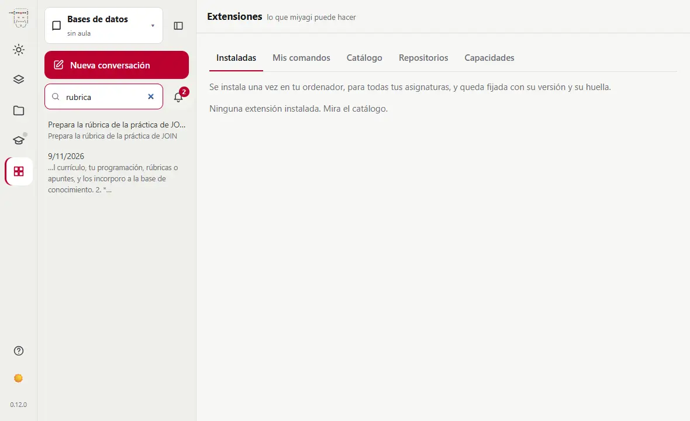

[Learn more](avanzado/navegador)

## The bell counts what's waiting for you {#45-bell}

An approval, a question, sources not taken in, activities in the oven. Each notice takes you where it's dealt with.

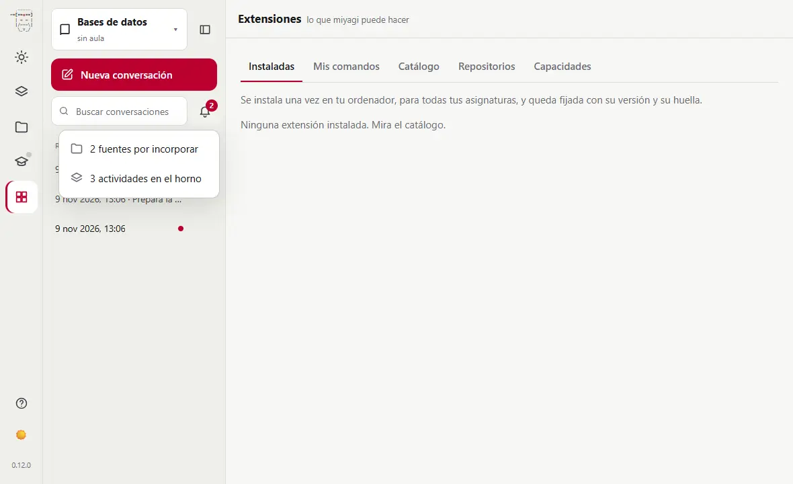

[Learn more](avanzado/navegador)

## Pin the important conversations {#46-pin}

A kept conversation's ⋯ pins it: it stays at the top of the list, even after closing miyagi.

[Learn more](avanzado/navegador)

## Adjust the side column {#47-sidebar-resize}

Drag its edge or use the arrows with the focus on it; a double click puts it back to its width. Its button folds it, and it stays that way next time.

[Learn more](avanzado/navegador)

## The side panel: next to the conversation {#48-side-panel}

Click a turn's activity line to see each action in the side panel. You can widen it, expand it or close it; Esc closes the activity.

[Learn more](avanzado/navegador)

## A browser inside the app {#49-web-browser}

In the desktop app, links in the chat open in a tab of the panel. It's your session, kept apart from miyagi: it doesn't see it.

[Learn more](guia/instalar#aplicacion-windows)

## Practices that really work {#50-docker-lab}

With the docker-lab extension, miyagi follows a practice step by step in a Docker lab, as a student would, and fixes what fails before publishing it.

[Learn more](avanzado/practicas-docker)
