# Trucos de miyagi

## Cambia el modo con Mayús+Tab {#01-shift-tab}

En el cuadro de texto, Mayús+Tab pasa de Guiado a Interactivo y a Plan. La píldora del modo hace lo mismo, y te explica cada uno.

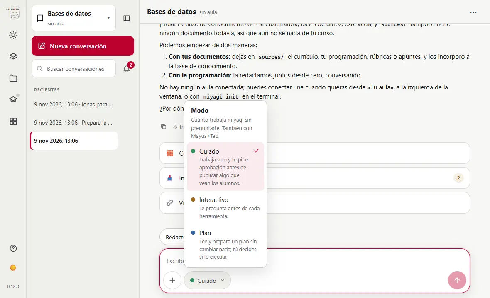

[Más información](guia/chat)

## El menú / tiene todos sus comandos {#02-slash-menu}

Escribe `/` en un cuadro vacío y verás los atajos de miyagi: corregir, cuestionarios, temas enteros... Sigue escribiendo para filtrarlos.

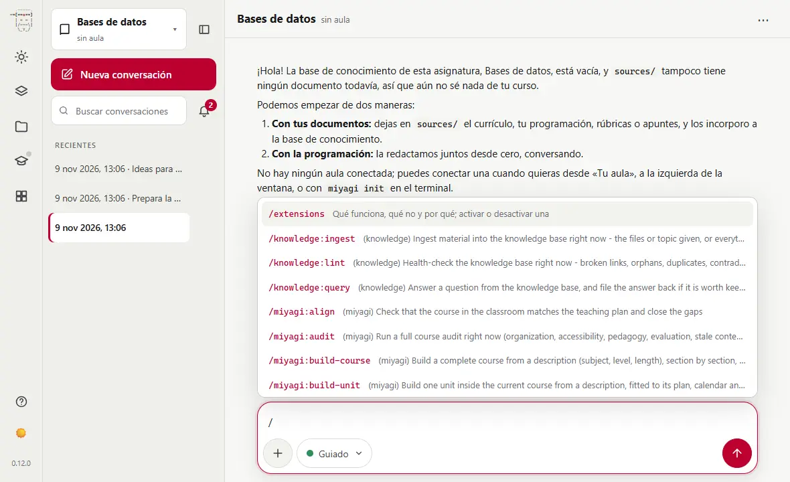

[Más información](guia/chat#atajos)

## El ＋ guarda mucho más que archivos {#03-plus-menu}

Desde ＋ añades un archivo a tus fuentes, ves lo que miyagi puede hacer aquí y lanzas sus acciones, agrupadas por lo que quieres conseguir.

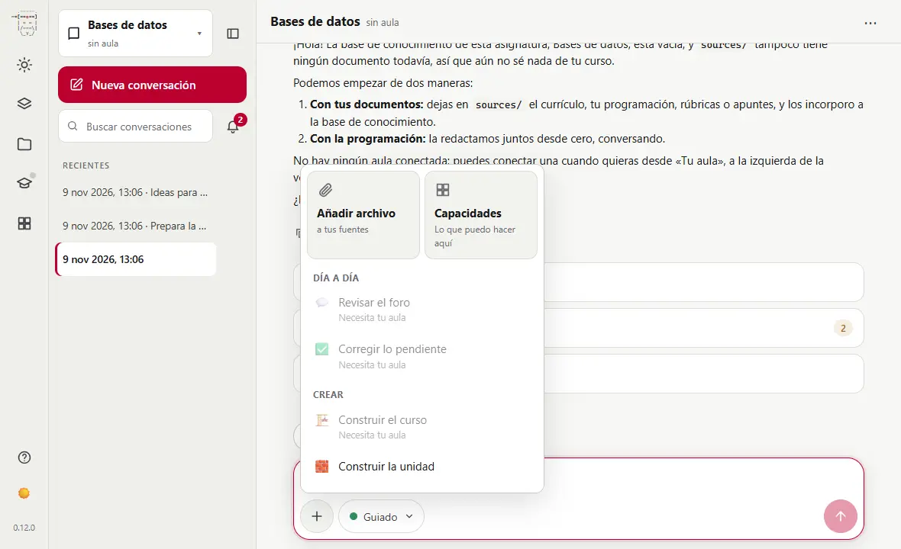

[Más información](avanzado/navegador)

## Escribe sin prisas {#04-enter-newline}

Intro envía y Mayús+Intro salta de línea. Con el cuadro vacío, ↑ y ↓ recuperan lo que ya escribiste.

[Más información](avanzado/navegador)

## Para a miyagi con Esc {#05-esc-stop}

Mientras trabaja, Esc en el cuadro de texto o el botón ■ cortan lo que está haciendo. Después dile qué hacer en su lugar.

[Más información](guia/chat)

## Acepta la sugerencia con Tab {#06-tab-suggestion}

A veces miyagi sugiere qué pedirle a continuación encima del cuadro. Púlsala para enviarla, o usa Tab con el cuadro vacío para dejarla escrita y retocarla.

[Más información](avanzado/navegador)

## Arrastra archivos al chat {#07-drag-files}

Suelta un documento en el cuadro de texto y se añadirá a las fuentes de la asignatura, listo para incorporarlo a su memoria.

[Más información](guia/memoria)

## Las extensiones le dan más capacidades {#08-extensions}

En Extensiones están sus capacidades, lo instalado y un catálogo para añadir más; se ponen en marcha en la conversación abierta, sin reiniciar.

[Más información](avanzado/extensiones)

## Selecciona texto de una respuesta {#09-selection-menu}

Al seleccionar texto en una respuesta aparece un menú: «Investigar esto», «Preguntas sobre esto» y «Citar en el chat».

[Más información](avanzado/navegador)

## Actúa sobre un tema desde su ⋯ {#10-item-actions}

Cada tema tiene un menú con lo que se puede hacer con él: construirlo, un cuestionario, investigarlo. También se abre con clic derecho o Mayús+F10.

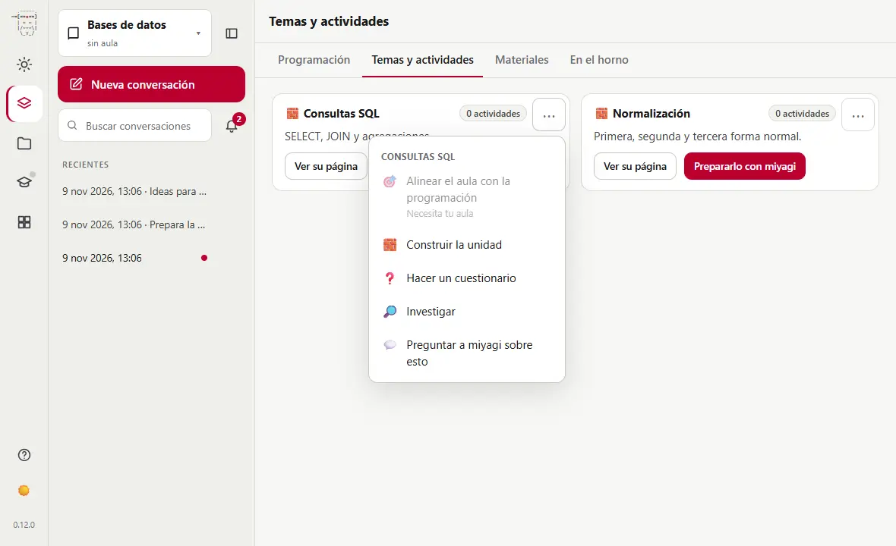

[Más información](avanzado/navegador)

## Pregúntale por lo que estás viendo {#11-ask-about}

«Preguntar a miyagi sobre esto», en el menú ⋯ de un tema, deja escrito en el cuadro de texto de qué hablas: tú solo terminas la frase.

[Más información](avanzado/navegador)

## Las aprobaciones ocupan el sitio del cuadro {#12-approvals-dock}

Cuando miyagi necesita tu visto bueno, la pregunta aparece donde escribes. La conversación sigue a la vista encima por si quieres releer algo.

[Más información](avanzado/aprobaciones-y-borradores)

## Aprobar, Rechazar o Parar todo {#13-approve-reject}

«Rechazar» no publica y puedes explicarle por qué en tu siguiente mensaje. «Parar todo» detiene lo que estaba haciendo.

[Más información](guia/chat)

## Lo nuevo se prueba antes de que lo vean {#14-hidden-first}

Lo que miyagi crea lo sube oculto, lo prueba como profesor y solo lo muestra a los alumnos con otro sí tuyo.

[Más información](avanzado/aprobaciones-y-borradores)

## Hay cosas que nunca hace {#15-what-never}

No borra lo que no haya creado él, no cambia matrículas ni grupos, no toca la configuración de Moodle y no sale de tu curso.

[Más información](avanzado/aprobaciones-y-borradores)

## Pídele un plan antes de un encargo grande {#16-plan-mode}

En modo Plan solo lee y prepara un plan, sin cambiar nada. Cuando lo tiene, eliges si lo ejecuta, si seguís planificando o si lo cancelas.

[Más información](guia/chat)

## Hoy te dice por dónde seguir {#17-today}

La vista Hoy resume lo que miyagi sabe de tu asignatura y te sugiere el siguiente paso: incorporar documentos, escribir la programación, vincular el aula...

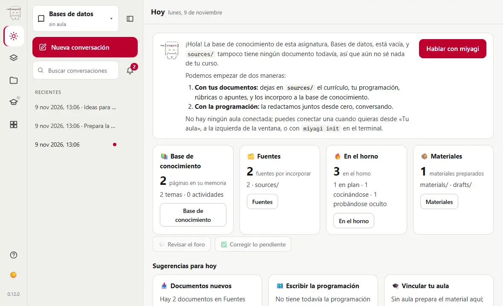

[Más información](avanzado/navegador)

## Tu programación didáctica, siempre a mano {#18-teaching-plan}

`/miyagi:teaching-plan` la escribe contigo a partir de tu material y te pregunta lo que solo tú puedes decidir, como pesos o calendario.

[Más información](guia/ideas)

## Cada tema tiene su página {#19-topics}

En Temas ves los de la asignatura, con lo que sabe de cada uno y las acciones que puedes lanzar desde ahí.

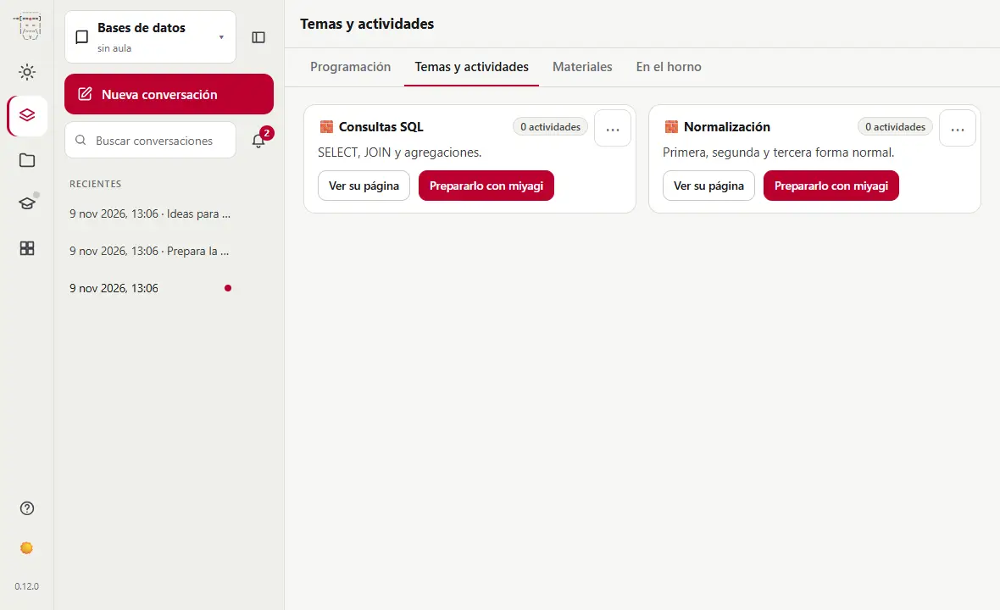

[Más información](guia/ideas)

## Mira un material sin salir del chat {#20-materials-beside}

En Materiales, «Abrir junto al chat» muestra un archivo en el panel lateral, en una pestaña, con la conversación a su lado.

[Más información](avanzado/materiales)

## El horno enseña lo que está en marcha {#21-oven}

Cada actividad aparece en su fase: en plan, construyéndose, oculta para probarla o recién servida a los alumnos.

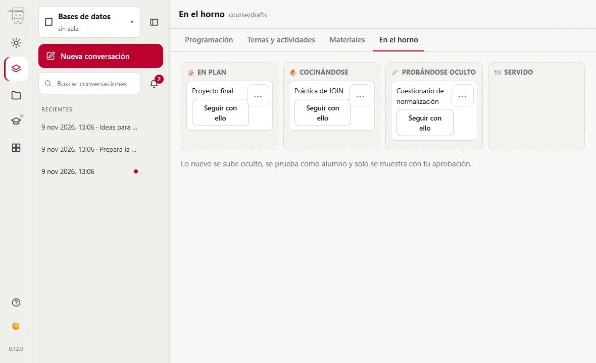

[Más información](avanzado/aprobaciones-y-borradores)

## Lee su memoria {#22-knowledge-view}

En Conocimiento puedes consultar las páginas que miyagi escribe sobre tu curso, y buscar en ellas.

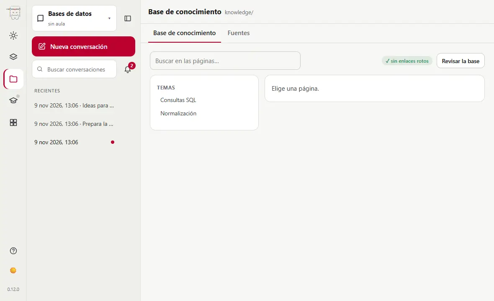

[Más información](guia/memoria)

## Fuentes: tus documentos {#23-sources-view}

Deja aquí la programación, los temarios o las rúbricas. miyagi los lee, nunca los cambia, y te avisa de los que aún no ha incorporado.

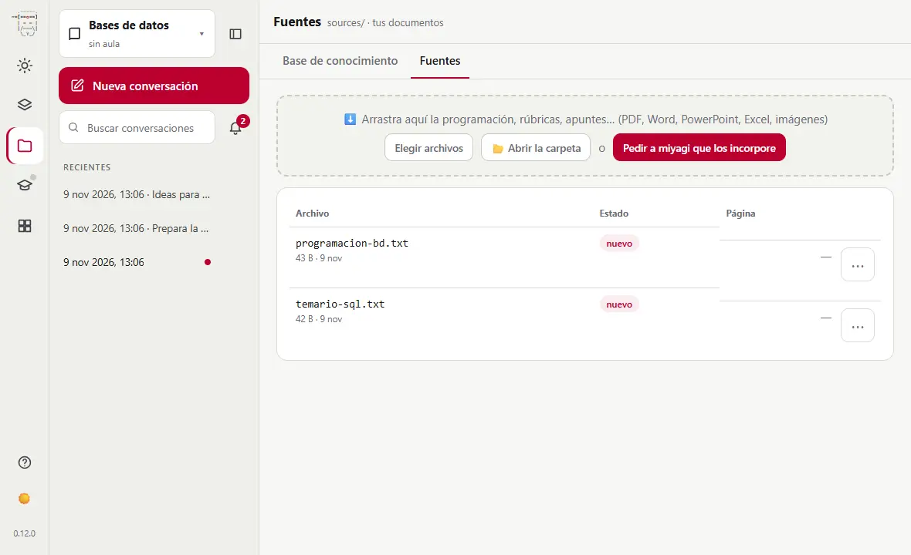

[Más información](guia/memoria)

## Las conversaciones se olvidan, su memoria no {#24-memory-persists}

Cada conversación empieza de cero, pero miyagi lee sus apuntes del curso al empezar. Lo que aprendió el lunes lo tiene el jueves.

[Más información](guia/memoria)

## Corrige su memoria {#25-fix-memory}

Si recuerda algo mal, díselo en el chat y actualiza la página, o edita tú el archivo en la carpeta `knowledge`: son archivos de texto normales.

[Más información](guia/memoria)

## Ninguna ficha de alumnos {#26-no-student-files}

En su memoria solo hay tendencias de la clase, nunca un registro por estudiante con su nombre.

[Más información](guia/memoria)

## Dale tu temario y lo aprende {#27-ingest-docs}

`/knowledge:ingest` incorpora a su memoria los documentos nuevos de Fuentes: un PDF, unos apuntes, una rúbrica.

[Más información](avanzado/base-de-conocimiento)

## Consulta sus apuntes sin abrir Moodle {#28-knowledge-query}

`/knowledge:query` responde a partir de lo que tiene apuntado, con enlaces a las páginas de donde lo saca.

[Más información](guia/memoria)

## Dale instrucciones fijas {#29-instructions-file}

En `instructions.md`, en la carpeta de la asignatura, escribe lo que debe tener siempre en cuenta: «puntúa sobre 10 con un decimal». Se aplica en la siguiente sesión.

[Más información](avanzado/atajos-e-instrucciones)

## El aula es opcional {#30-classroom-optional}

Sin aula, miyagi prepara la programación, los temas y los materiales contigo. Con aula, también corrige, responde en el foro y publica, siempre con tu aprobación.

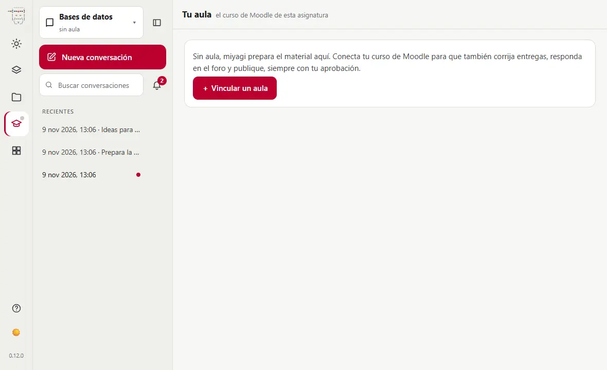

[Más información](avanzado/configuracion)

## Vincular tu aula {#31-link-classroom}

Con «Vincular un aula» miyagi instala moodle-teacher. La primera vez se abre tu campus para que inicies sesión tú: miyagi nunca ve tu contraseña.

[Más información](avanzado/configuracion)

## Tus alumnos le llegan con seudónimo {#32-pseudonyms}

Con moodle-teacher, los estudiantes le llegan a miyagi con un alias, no con su nombre.

[Más información](guia/memoria)

## Ponte al día en una frase {#33-catch-up}

Prueba con: «¿Qué ha pasado en el curso desde el lunes? Entregas nuevas, mensajes en el foro y lo que vence esta semana.» Solo lee, no cambia nada.

[Más información](guia/ideas)

## La barra de la ventana {#34-title-bar}

En la aplicación de escritorio, ← y → recorren las vistas visitadas, y Alt más la inicial de un menú lo abre.

[Más información](guia/instalar#aplicacion-windows)

## Corrige con tu rúbrica {#35-grade-rubric}

Prueba con: «Corrige las entregas de la Tarea 2 con la rúbrica que te dejé en sources.» Te enseña cada nota antes de guardarla.

[Más información](guia/ideas)

## Tus propios comandos, con formulario {#36-own-commands}

Dile «Quiero un comando para hacer sopas de letras con la temática y el número de palabras». Lo escribe contigo; luego puedes cambiarlo en Extensiones, en Mis comandos.

[Más información](avanzado/atajos-e-instrucciones)

## Atiende el foro {#37-forum}

`/miyagi:forum` revisa los hilos recientes y decide si hace falta intervenir. Cada respuesta se publica con tu aprobación.

[Más información](guia/ideas)

## ¿Quién se queda atrás? {#38-progress}

`/miyagi:progress` separa a quien va bien de quien se está descolgando y te propone qué hacer.

[Más información](guia/ideas)

## Un cuestionario en una frase {#39-quiz}

`/miyagi:quiz tema 3, consultas SQL con JOIN, 12 preguntas, de repaso` escribe las preguntas y te las enseña todas antes de importarlas.

[Más información](guia/ideas)

## Un tema entero {#40-build-unit}

`/miyagi:build-unit` lee el curso y su programación, planifica el tema, lo construye y te dice qué conviene que revises.

[Más información](guia/ideas)

## Audita el curso {#41-audit}

`/miyagi:audit` revisa organización, accesibilidad, evaluación, fechas y recursos caducados, y te da recomendaciones por prioridad.

[Más información](guia/ideas)

## Investiga antes de enseñar {#42-research}

`/miyagi:research` delega en su ayudante, contrasta fuentes y guarda lo encontrado con sus enlaces.

[Más información](guia/ideas)

## Recicla tus materiales {#43-recycle}

Prueba con: «En sources tienes mis apuntes del año pasado del tema 5 en PDF. Conviértelos en una página de Moodle actualizada y añade tres ejercicios al final.»

[Más información](guia/ideas)

## Busca en tus conversaciones {#44-search}

La búsqueda de la columna lateral encuentra una palabra en todas las conversaciones de la asignatura, sin importar mayúsculas ni acentos.

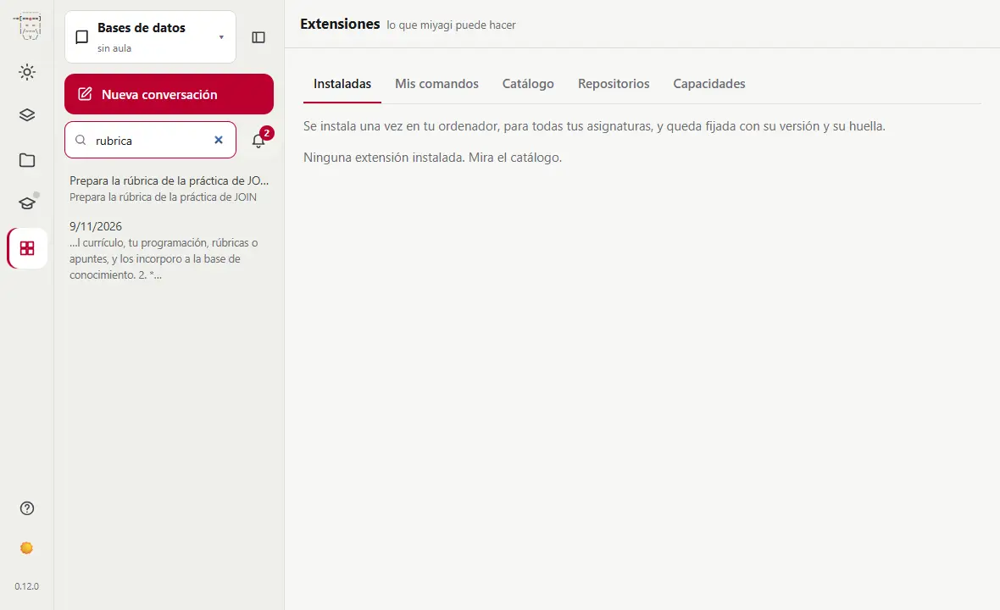

[Más información](avanzado/navegador)

## La campana cuenta lo que te espera {#45-bell}

Una aprobación, una pregunta, fuentes sin incorporar, actividades en el horno. Cada aviso te lleva a donde se atiende.

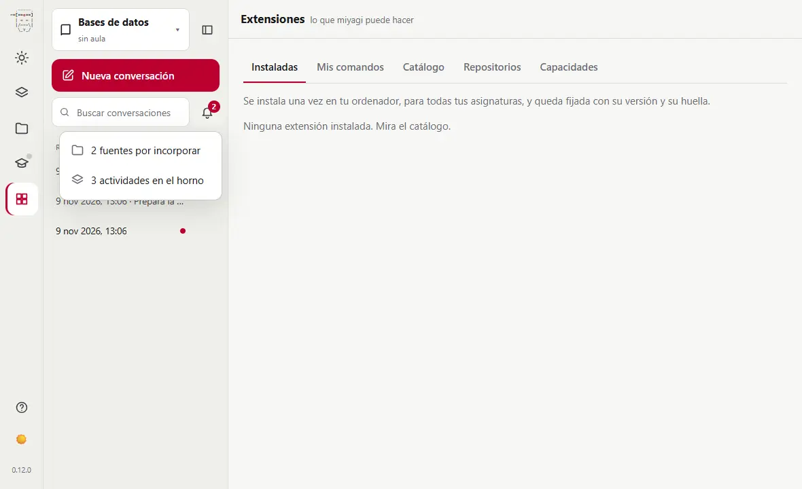

[Más información](avanzado/navegador)

## Fija las conversaciones importantes {#46-pin}

Con el ⋯ de una conversación guardada la fijas: queda arriba de la lista, también después de cerrar miyagi.

[Más información](avanzado/navegador)

## Ajusta la columna lateral {#47-sidebar-resize}

Arrastra su borde o usa las flechas con el foco en él; un doble clic la devuelve a su ancho. Su botón la pliega y se queda así la próxima vez.

[Más información](avanzado/navegador)

## El panel lateral: junto a la conversación {#48-side-panel}

Pulsa la línea de actividad de un turno para ver cada acción en el panel lateral. Se puede ensanchar, ampliar o cerrar; Esc cierra la actividad.

[Más información](avanzado/navegador)

## Un navegador dentro de la aplicación {#49-web-browser}

En la aplicación de escritorio, los enlaces del chat se abren en una pestaña del panel. Es tu sesión, separada de miyagi: él no la ve.

[Más información](guia/instalar#aplicacion-windows)

## Practicas que funcionan de verdad {#50-docker-lab}

Con la extensión docker-lab, miyagi sigue una práctica paso a paso en un laboratorio de Docker, como un alumno, y corrige lo que falle antes de publicarla.

[Más información](avanzado/practicas-docker)
