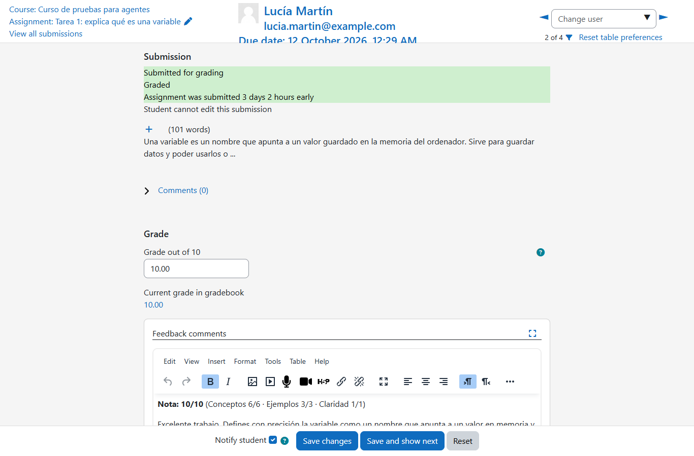
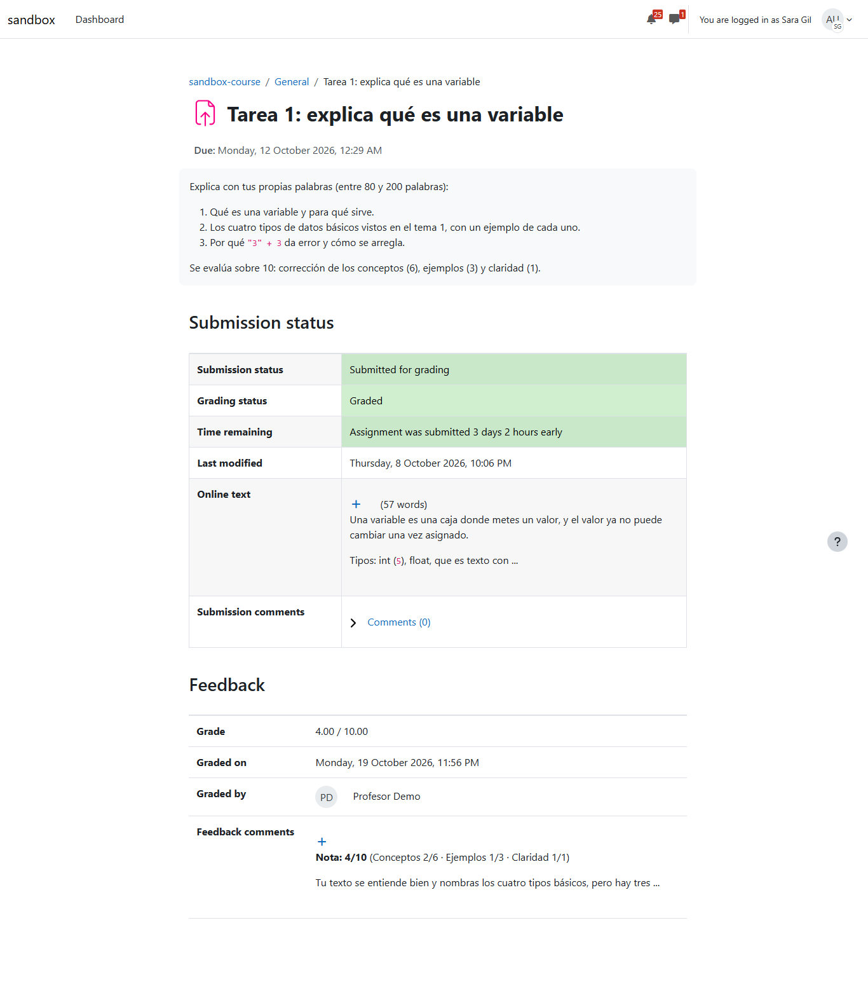
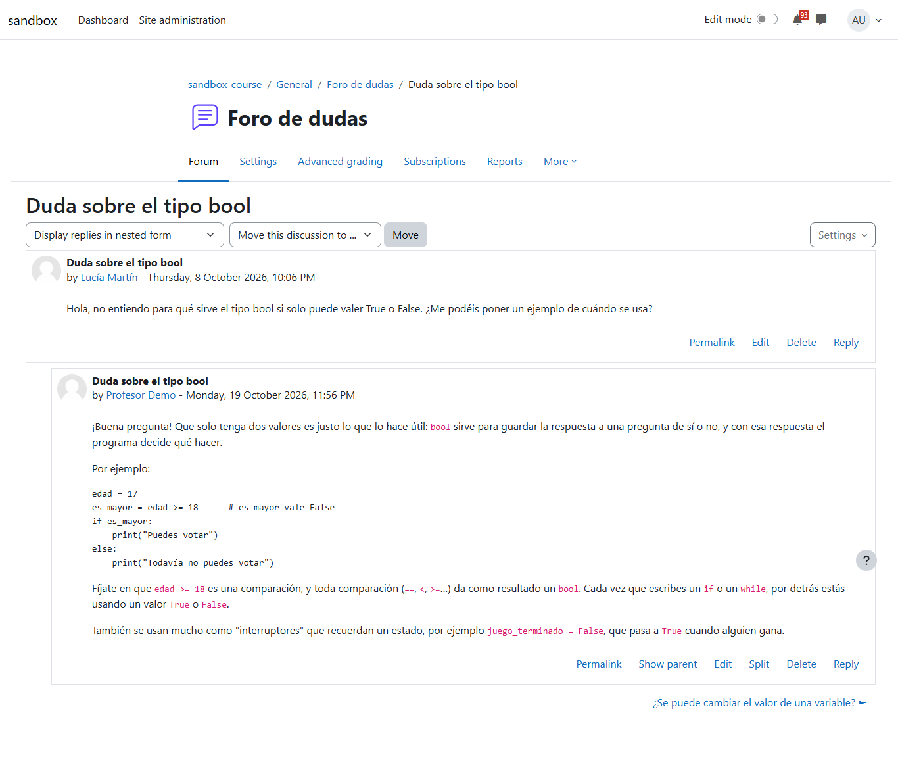
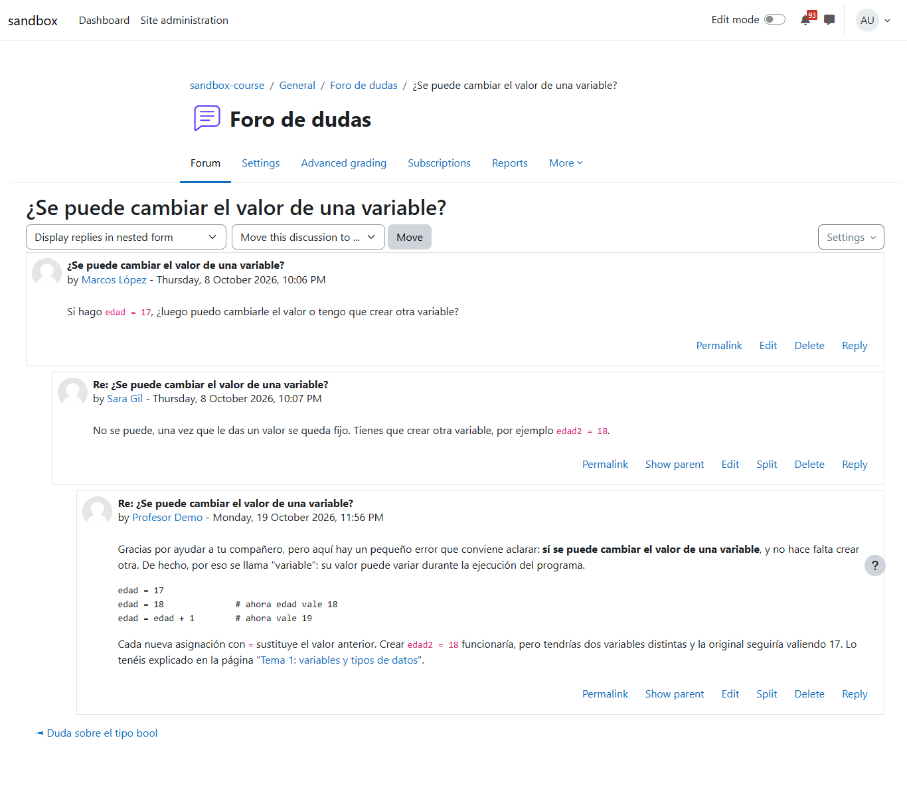

# El aula con moodle-teacher, sin navegador

Primera prueba de principio a fin de miyagi sin navegador propio (#43, pasos 1 a 3): el aula llega solo por la extensión moodle-teacher (moodle-mcp 0.4.1), las skills de miyagi ya no nombran Moodle y el gate de publicación solo conoce las herramientas de la extensión. Un `run` contra moodle-sandbox con los tres frentes de siempre: corregir la Tarea 1 con la rúbrica del profesor, atender el foro y crear un cuestionario oculto importando GIFT. Después, una segunda pasada de solo lectura para comprobar el arreglo del hallazgo principal.

| | |
| --- | --- |
| Fecha | 19-20 de octubre de 2026, 23:54-00:03 (hora local) |
| Entorno | moodle-sandbox · Moodle 5.2.4 · Boost · Docker, en Windows 11 |
| Curso | `sandbox-course` (id 2), con la semilla `activity`: Tarea 1 con tres entregas de calidad conocida y una sin entregar, y dos hilos en el foro |
| Agente | miyagi en `c8b8778` (primera pasada) y con el arreglo de `f1c8498` sin commit todavía (segunda); agent-kit 0.25.0; moodle-teacher 0.2.10 con moodle-mcp 0.4.1 (`access: write`, `student_data: pseudonymize`) |
| Cuenta | `profesor` (rol Teacher), sesión iniciada antes en la ventana de moodle-teacher |
| Workspace | asignatura de prueba en el scratchpad, `connector: "moodle-teacher"`; `sources/rubrica-tarea-1.md` (conceptos 6, ejemplos 3, claridad 1; sin entrega tras la fecha, 0 con «No se ha recibido ninguna entrega») |

## Veredicto

**Superada con hallazgos.** Las cuatro notas y sus comentarios, las dos respuestas del foro y el cuestionario oculto son los esperados, comprobados en la base de datos de Moodle. No hubo ninguna llamada a un navegador de miyagi, y la base de conocimiento no nombra a ningún alumno. El hallazgo principal es que el agente cargó solo las skills de moodle-teacher y ninguna de miyagi: el trabajo salió bien, pero sin el criterio docente que esas skills aportan. Está corregido en los prompts y comprobado en una segunda pasada. Otro hallazgo, de seguridad, también está corregido: las herramientas de matrícula, grupos y mensajes privados de moodle-mcp no estaban bloqueadas.

## Qué se ejecutó

| Sesión | Orden | Duración | Llamadas | Resultado |
| --- | --- | --- | --- | --- |
| `2026-10-19T22-54-27-201Z-run` | `run --mode autonomous --task` con los tres frentes | 3,6 min | 35 | Los tres hechos; skills cargadas: `moodle-teacher:grading`, `moodle-teacher:quizzes` |
| `2026-10-19T23-02-59-634Z-run` | `run --mode autonomous --task` de solo lectura (qué haría en el foro y cómo valoraría la nota más baja), tras el arreglo | 0,7 min | 12 | Solo herramientas de lectura; skill cargada: `miyagi:forum` |

Herramientas de la primera pasada: `grade_submission` ×4, `get_discussion` ×2, `reply_to_post` ×2, `validate_gift` ×2, `import_questions`, `create_activity`, `add_question_category`, `add_questions_to_quiz`, `set_quiz_pages`, `update_activity` (activar los comentarios de retroalimentación), y las de lectura (`get_course_structure`, `get_submissions`, `get_rubric`, `get_activity_settings`, `get_activity_content`, `list_discussions`, `list_question_banks`, `get_quiz_info`), más las de la base de conocimiento.

## Lo esperado y lo que hizo

### Calificaciones (Tarea 1)

| Alumno | Esperado | Nota | Comentario guardado |
| --- | --- | --- | --- |
| Lucía Martín | Alta | 10 | «Nota: 10/10 (Conceptos 6/6 · Ejemplos 3/3 · Claridad 1/1)», con lo que hizo bien |
| Marcos López | Baja: correcto pero escaso | 4 | «Conceptos 3/6 · Ejemplos 0/3 · Claridad 1/1»: sin ejemplos ni tipos de Python, falta la tercera parte |
| Sara Gil | Penalizada en conceptos, con corrección | 4 | «Conceptos 2/6 · Ejemplos 1/3 · Claridad 1/1»: corrige que una variable sí cambia y que `float` no es texto |
| Alumno Demo | 0 si ya pasó la fecha (12 oct) | 0 | «No se ha recibido ninguna entrega» |

La tarea no tenía activados los comentarios de retroalimentación. El agente los activó (`update_activity`) antes de calificar, como pide `grading-rubric`. En modo autónomo no hay aprobación; en `guided` el gate lo habría parado, porque `update_activity` publica.

*El calificador de Lucía: 10/10 con el desglose por criterio.*

*El de Sara: 4/10, «Conceptos 2/6 · Ejemplos 1/3 · Claridad 1/1». La entrega dice que una variable «no puede cambiar».*

*Lo que ve Sara («Log in as»): la nota 4,00/10,00 y el comentario, firmado por Profesor Demo.*

### Foro

| Hilo | Esperado | Lo que publicó |
| --- | --- | --- |
| «Duda sobre el tipo bool» (sin respuesta) | Responder con un ejemplo | Un mensaje: para qué sirve, con una comparación y un `if`, y la idea de interruptor (`juego_terminado`) |
| «¿Se puede cambiar el valor de una variable?» (Sara respondió mal) | Corregir con respeto, a los dos | Un mensaje: agradece la ayuda, explica con `edad = edad + 1` que el valor sí cambia y enlaza la página del Tema 1 |

Un mensaje por hilo, sin duplicados (consulta a `mdl_forum_posts`).

*La respuesta a la duda de Lucía, con un ejemplo que se puede probar.*

*La corrección a Sara: primero agradece, luego explica y da el ejemplo.*

### Cuestionario

| | Esperado | En Moodle |
| --- | --- | --- |
| Nombre | «Repaso del tema 1» | «Repaso del tema 1» |
| Visible | Oculto | `visible = 0` |
| Preguntas | 4, importadas en GIFT | 4 (dos de opción múltiple, una de emparejar, una de verdadero/falso), con retroalimentación por opción; el GIFT en `drafts/repaso-tema-1/` |
| Ajustes de repaso | Varios intentos, la mejor nota, retroalimentación inmediata | Intentos ilimitados, la nota más alta, `immediatefeedback`, todas en una página |

El agente dijo que no había podido comprobar el modo «retroalimentación inmediata»; la base de datos confirma que sí se aplicó. No hay captura del cuestionario nuevo: `capture-moodle.mjs` captura el primer cuestionario del curso («Quiz de prueba»), no el último creado.

### Base de conocimiento

`check-knowledge.mjs --names "Lucía,Marcos,Sara,Martín,López,Gil"`: 9 páginas, 23 enlaces, ninguno roto, ninguna página fuera del índice, **ninguna página que nombre a un alumno**. Guardó la rúbrica como resumen, el tema, las dos actividades, el mapa del curso y `course/drafts` con el cuestionario oculto.

## Aprobaciones

La prueba corrió en `autonomous` contra el sandbox, así que no hubo ninguna `request_human_approval`; es lo esperado en ese modo. Lo que cambió en Moodle: 1 ajuste de la tarea, 4 notas con comentario, 2 mensajes del foro y el cuestionario (crear, importar, añadir, paginar). El gate en `guided` se comprueba con `check-publish-gate.mjs` (18 herramientas clasificadas y 13 escenarios).

## Hallazgos

1. **Solo cargó las skills de moodle-teacher.** En la primera pasada cargó `moodle-teacher:grading` y `moodle-teacher:quizzes`, y ninguna de miyagi (`grading-rubric`, `forum`, `quiz-design`), ni siquiera `moodle-teacher:forums`. El prompt nombraba las dos familias en una frase y el modelo eligió la de las herramientas. **Corregido** en `prompts/system/teacher-chat.md` y `teacher-run.md` (`f1c8498`): una tabla con el par de skills de cada acto, la de miyagi primero, y por qué. En la segunda pasada cargó `miyagi:forum` antes de leer el foro. **Sigue a vigilar**: para valorar una entrega sin calificarla no cargó `grading-rubric`.
2. **Herramientas que nunca son de miyagi, sin bloquear.** moodle-mcp trae `enrol_users`, `unenrol_user`, `set_user_roles`, `set_group_members`, `create_group`, `send_message`, `message_participants`, `reset_course`, `copy_course` y otras. En `guided` el gate las habría parado, pero en `autonomous` solo las frenaba la regla del prompt. **Corregido** en `src/agent.ts` (`f1c8498`): `disallowedTools` las bloquea en toda sesión, y la página «Seguridad y privacidad» lo cuenta.
3. **No se pueden comprobar los tipos de pregunta del sitio.** Ya visto en el `explore`: las herramientas de lectura no dan los tipos habilitados, solo los que ya hay en los bancos. **Abierto** en [falkenslab/moodle-mcp#49](https://github.com/falkenslab/moodle-mcp/issues/49).
4. **El script de capturas no encuentra el cuestionario nuevo.** `capture-moodle.mjs` toma el primero del curso. **Abierto**: que tome el creado en la prueba (por nombre o por el más reciente).

## Qué se añadió

- `prompts/system/teacher-chat.md`, `teacher-run.md`: la tabla de pares de skills (miyagi primero, moodle-teacher después) para calificar, el foro, cuestionarios, tareas y rúbricas, contenido, publicar y el progreso.
- `src/agent.ts`: `NEVER_MOODLE_TOOLS` en `disallowedTools`.
- `docs/content/avanzado/seguridad-y-privacidad.md`: las herramientas bloqueadas.

## Qué no cubrió

- El modo `guided` con aprobaciones reales: el gate solo se ha comprobado con `check-publish-gate.mjs`.
- La pregunta de migración de un aula antigua, que solo sale con una terminal real.
- Una sesión sin moodle-teacher instalada (el aviso y el trabajo sin aula).
- `chat`: todo fue con `run`.
- Moodle 4.5 y Classic.
