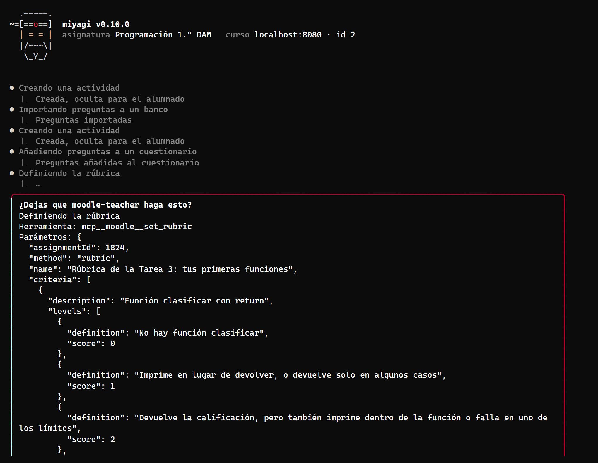

# Dos temas en un solo encargo, con moodle-teacher

Verificación del arreglo de la #25. En la prueba del curso de SQL (`tests/2026-10-01T19-03-docs-sql-course/`), los temas 2 y 3, pedidos en un mismo encargo, se guardaron visibles: 22 paneles «Publicación sin aprobación previa» y solo 2 aprobaciones. Aquí se pide lo mismo con moodle-teacher, sin navegador: dos temas con sus apuntes, una tarea con rúbrica y un cuestionario cada uno, todo oculto.

| Dato | Valor |
| --- | --- |
| Fecha | 24 oct 2026, 15:15–15:33 (hora de Canarias, UTC+1) |
| Entorno | moodle-sandbox · Moodle 5.2.4 · Docker, en Windows 11 |
| Curso | `sandbox-course` (id 2): las secciones 1 y 2 ya se llamaban «Tema 2: estructuras de control» y «Tema 3: funciones», vacías |
| Versiones | miyagi `main` en a0c831a, con los cambios sin commit de #32 y #44; agent-kit 0.29.0; moodle-teacher 0.4.0 |
| Cuenta | el profesor del sandbox, con su sesión en la ventana de moodle-teacher |
| Espacio | asignatura nueva en el scratchpad, `connector: moodle-teacher`, `language: español`, sin base de conocimiento |
| Cómo | `miyagi chat` en un pseudoterminal; todas las aprobaciones respondidas «Sí» por un script que anotaba cada panel |

## Veredicto

**Superada con hallazgos.**

- Las seis actividades nuevas (dos páginas, dos tareas y dos cuestionarios) se crearon ocultas desde el primer guardado, y ninguna se ocultó después.
- Hubo una aprobación por tema, cada una con todas sus piezas nombradas, y ningún paso hizo falta aprobarlo a posteriori.
- `unit-building` y `publish-check` se cargaron una sola vez y siguieron vigentes en los dos temas: se ve en las dos aprobaciones, que dicen «TODO OCULTO» y nombran cada pieza.
- El hallazgo es del kit: el panel de una herramienta con parámetros largos no cabe en la pantalla, y sus opciones quedan fuera de la vista.

## Qué se ejecutó

| Sesión | Encargo | Duración | Llamadas | Resultado |
| --- | --- | --- | --- | --- |
| chat | «Construye en un solo encargo los temas 2 (…) y 3 (…). En cada tema: unos apuntes en una página, una tarea corta con su rúbrica y un cuestionario de 5 preguntas. Déjalo todo oculto» | 17,7 min | 90 (skills `unit-building`, `resource-authoring`, `assignment-building`, `rubric-design`, `quiz-design`, `publish-check`, y las de moodle-teacher `read-a-course`, `publishing`, `course-content`, `assignments`, `quizzes`) | 6 actividades ocultas; espera el visto bueno para mostrarlas |

## Lo esperado y lo que hizo

| Esperado | Hecho |
| --- | --- |
| Cada pieza nueva, oculta al crearla | `visible = 0` en las seis (1819–1824). Ninguna llamada posterior cambió la visibilidad: la única `edit_activity` fue sobre los ajustes del cuestionario |
| Un tema acabado antes del siguiente | Tema 2 completo (14:23–14:24), luego tema 3 (14:26–14:27) |
| Una aprobación por pieza, o una por tema que las nombre todas | Una por tema: «Subir a la sección "Tema 2: estructuras de control" (curso 2), TODO OCULTO para que lo revises, sin notificar…», y lo mismo para el tema 3 |
| Ninguna publicación sin aprobación | Ninguna. El kit solo preguntó antes de cada `set_rubric` (2), que moodle-mcp marca como destructiva porque reemplaza la rúbrica |
| Mostrarlo, con su propia aprobación | Pendiente, como se pidió: al final propone mostrar las seis de una vez cuando el profesor dé el visto bueno |

Antes de subir nada validó con moodle-teacher el GIFT de los dos cuestionarios y el HTML de las páginas y los enunciados (`validate_gift`, `validate_html`).

## Aprobaciones, en orden

1. Subir el tema 2, todo oculto, con cada pieza nombrada (14:22).
2. Panel del kit: `set_rubric` de la Tarea 2 (14:23).
3. Subir el tema 3, todo oculto, con cada pieza nombrada (14:26).
4. Panel del kit: `set_rubric` de la Tarea 3 (14:27).

## Hallazgos

1. **El panel del kit no cabe en la pantalla.** Los parámetros de `set_rubric` (la rúbrica entera en JSON) ocupan más que la altura del terminal, y las opciones «Sí / No» quedan fuera. El docente no ve qué responder hasta que agranda la ventana. *Abierto*, en agent-kit: el panel debería recortar los parámetros, o mostrar la etiqueta de la herramienta y un resumen, y dejar las opciones siempre a la vista.

   

   *El panel «¿Dejas que moodle-teacher haga esto?» de `set_rubric`. Con 42 filas, la pantalla acaba en mitad del JSON, sin las opciones.*

2. **`set_rubric` pregunta aunque el lote esté aprobado.** moodle-mcp la marca como destructiva porque reemplaza la rúbrica que hubiera, también en una tarea recién creada que aún no tiene ninguna. Es un panel de más, no un riesgo. *Sin cambio* en miyagi; se le puede proponer a moodle-mcp que solo la confirme cuando ya existe una rúbrica.

## Lo que no cubrió

- Mostrar las actividades y revisarlas como alumno.
- Más de dos temas, o una sesión larga que llegue al límite de turnos, como en la prueba original.
