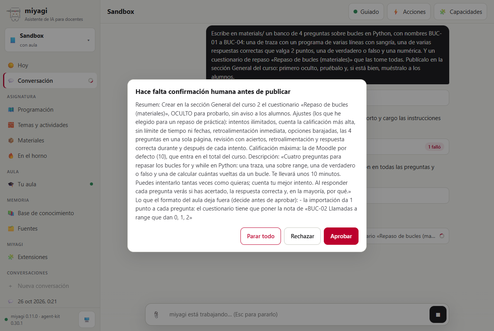
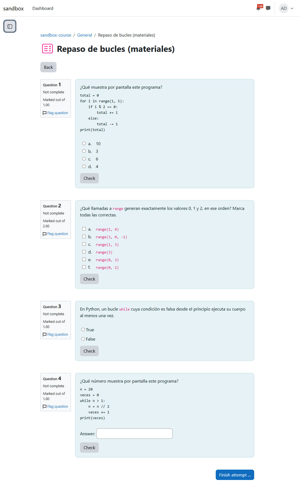
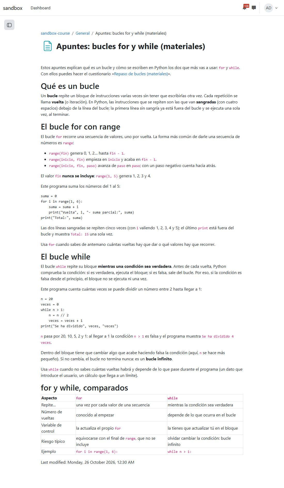
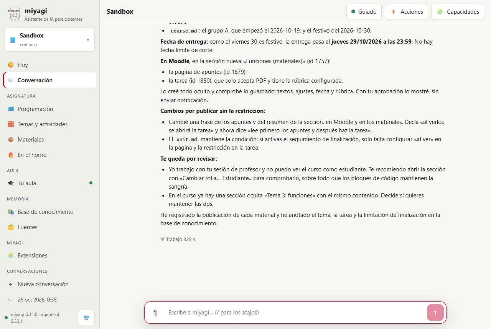
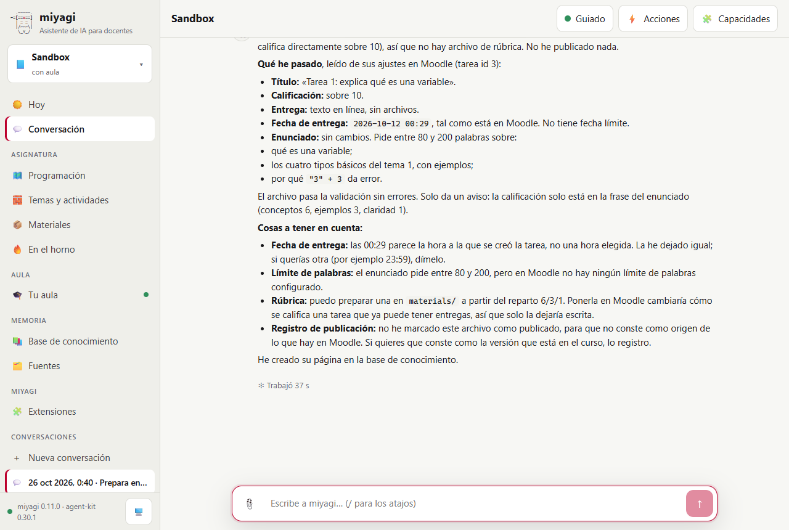

# Los materiales de la asignatura, escritos una vez en materials/

Prueba de #34 (materiales neutros, ADR-015). miyagi escribe los materiales en `materials/` como Markdown y los convierte con código al formato del aula. Se probaron tres casos desde `miyagi web`:

- un banco de preguntas y un cuestionario, exportados a GIFT;
- unos apuntes, exportados a HTML accesible;
- un tema completo con su calendario.

El tema tenía apuntes, una tarea con rúbrica, un `unit.md` con la condición de apertura y un `course.md` con un festivo puesto a propósito. También se pasó a `materials/` una tarea que ya existía en el curso. Lo que se dio por bueno se miró en la base de datos de Moodle, no en lo que dijo el agente.

| | |
| --- | --- |
| Fecha | 26 oct 2026, 01:21–01:46 (hora peninsular) |
| Entorno | moodle-sandbox · Moodle 5.2.4 · Docker; el sitio usa la zona horaria Europe/London |
| Curso | `sandbox-course` (id 2) |
| Agente | miyagi 0.11.0 sobre el commit `ed04866` más los cambios de #34, aún sin commit; agent-kit 0.30.1; moodle-teacher |
| Cuenta | el profesor del sandbox |
| Workspace | `~/.miyagi/workspaces/sandbox` (asignatura «Sandbox», con aula), modo guiado; sin `sources/` nuevas |

## Veredicto

**Superada con hallazgos.** Los tres casos llegaron al aula tal como se escribieron:

- el GIFT conserva la sangría del código;
- la nota de la pregunta de 2 puntos se avisa en la aprobación, por código;
- los apuntes salen con encabezados desde h2 y cabeceras de tabla;
- la fecha relativa «semana 2 viernes 23:59» cae en festivo y pasa al jueves 29;
- la rúbrica llega al formulario de calificación;
- cada publicación queda registrada con su hash.

El curso no tenía activado el seguimiento de finalización, así que la restricción «la tarea se abre al ver los apuntes» no se pudo poner. miyagi preguntó qué hacer, que es lo correcto, pero lo descubrió después de la primera aprobación, que ya prometía esa restricción. Ese hallazgo se ha convertido en regla.

## Qué se ejecutó

| Sesión | Encargo | Duración | Herramientas | Resultado |
| --- | --- | --- | --- | --- |
| `2026-10-26T00-21-52` (chat web) | Banco de 4 preguntas BUC-01…04 y cuestionario «Repaso de bucles (materiales)», publicado oculto, probado y mostrado | 3,0 min | 43 (3 `materials_export`, 2 `materials_validate`, 2 `record_publication`, 3 aprobaciones) | 11/11 comprobaciones |
| `2026-10-26T00-27-16` (chat web) | Apuntes «bucles for y while» en `materials/`, publicados como página | 3,4 min | 33 (2 `materials_export`, 1 `record_publication`, 2 aprobaciones) | 8/8 |
| `2026-10-26T00-35-18` (chat web) | Tema «Funciones (materiales)» con `course.md` y `unit.md`, publicado; después, la «Tarea 1» existente pasada a `materials/` | 5,8 min | 68 (7 `materials_validate`, 5 `materials_export`, 2 `materials_resolve`, 4 `record_publication`, `set_rubric`, 2 aprobaciones y 1 pregunta) | 9/11 en el script; las 2 FAIL se explican abajo |

Cada caso se mandó desde la interfaz web con Playwright. Los paneles se contestaron con la primera opción y después «Aprobar».

## Esperado y obtenido

### Banco y cuestionario

| Esperado | Obtenido |
| --- | --- |
| El banco en `materials/` como Markdown, con el código en un bloque, no en GIFT | `bucles/bucles.questions.md` y `bucles/repaso-bucles.quiz.md` |
| GIFT exportado por código a `drafts/materials/` | `drafts/materials/bucles/repaso-bucles/bucles.gift` |
| Lo que GIFT no guarda (la nota de 2 puntos) dicho en la aprobación, por código | El resumen de la primera aprobación termina con «Lo que el formato del aula deja fuera… la importación da 1 punto a cada pregunta: el cuestionario tiene que poner la nota de BUC-02» |
| Las preguntas en el banco de Moodle, con la sangría del código | 4 preguntas (ids 1006-1009); el `<pre>` de la traza lleva `&nbsp;` |
| El cuestionario con la nota de BUC-02 a 2 | cmid 1877, sumgrades 5,00000, visible al final |

*El panel de aprobación. El último párrafo («Lo que el formato del aula deja fuera…») no lo escribió el modelo: lo añade el hook de miyagi a partir de lo que devolvió `materials_export`.*

*El cuestionario publicado. Fíjate en la sangría de los programas de las preguntas 1 y 4, en «Marked out of 2.00» de la pregunta 2 y en el código en línea de las opciones de `range`.*

### Apuntes

| Esperado | Obtenido |
| --- | --- |
| Apuntes en `materials/` como Markdown (código cercado, una tabla), no HTML | `bucles/apuntes-bucles.notes.md` |
| HTML accesible exportado | `drafts/materials/bucles/apuntes-bucles.html` |
| En Moodle con encabezados desde h2, `th` y el código sangrado | página cmid 1878 |

*La página publicada: los encabezados empiezan en h2 bajo el título de la actividad, los programas mantienen la sangría y la tabla comparativa tiene su fila de cabecera.*

### Tema, calendario e importación

| Esperado | Obtenido |
| --- | --- |
| `funciones/` con apuntes, tarea, rúbrica y `unit.md`; `course.md` con el grupo A y el festivo | Sí. `unit.md`: `2. tarea-funciones.assignment.md · after: apuntes-funciones.notes.md viewed` |
| «semana 2 viernes 23:59» (grupo A, desde el 19/10) cae el 30, que es festivo, y pasa al jueves 29 | `materials_resolve` → 2026-10-29 23:59. En Moodle, `duedate` es 2026-10-29 23:59 UTC, que con Europe/London en horario de invierno son las 23:59 locales. El FAIL del script venía de convertir a Europe/Madrid en la comprobación, no del agente |
| La tarea en Moodle con su rúbrica de 2 criterios en el formulario de calificación | assign 110 (cmid 1880), 2 criterios, visible al final |
| La tarea se abre después de ver los apuntes | **No puesta.** `enablecompletion = 0` en el curso. miyagi lo vio al crear la tarea y preguntó: publicar sin la restricción o parar para que el profesor activara el seguimiento. Se eligió la primera opción y el `unit.md` mantiene la condición |
| Publicaciones registradas | 4 entradas de `funciones/` en `materials/.publications.json` (más las 3 de los casos anteriores) |
| La «Tarea 1» existente pasada a `materials/` sin publicar nada | `tema-1/tarea-1.assignment.md` con título, nota, entrega en texto, fecha y enunciado. Como no tiene rúbrica en Moodle, no hay `.rubric.md`. No la registró como publicada, a propósito, y avisó del límite de palabras que no está en los ajustes y de una hora de entrega que parece la de creación |

*El cierre del agente: dice que la entrega pasa al jueves 29 por el festivo y que publicó sin la restricción. También cuenta qué cambió por ello (el resumen ya no dice «al verlos se abrirá la tarea») y que `unit.md` conserva la condición.*

*La importación: lee los ajustes de Moodle, valida el archivo, no publica nada y no marca el archivo como publicado.*

## Aprobaciones en orden

1. 01:23 Crear oculto el cuestionario «Repaso de bucles (materiales)» con sus ajustes. Incluía la pérdida de la exportación añadida por código.
2. 01:24 Importar las 4 preguntas en el banco del cuestionario.
3. 01:24 Mostrar el cuestionario. Dice que no pudo hacer un intento como alumno y recomienda la vista previa.
4. 01:28 Crear oculta la página de apuntes.
5. 01:30 Mostrar la página.
6. 01:37 Crear oculta la sección «Funciones (materiales)», con la página y la tarea con su rúbrica. Prometía «restringida hasta haber visto los apuntes».
7. 01:37 *(pregunta, no aprobación)* El curso no tiene el seguimiento de finalización. ¿Publicar sin la restricción o parar?
8. 01:40 Mostrar la sección, la página y la tarea, «sin restricción de acceso», con la fecha del 29/10.

Revisé en los transcripts y en la base de datos los cambios en Moodle entre aprobaciones. Fueron las ediciones de la sección y de la tarea para quitar la frase de la restricción, dentro del lote ya aprobado del paso 6. No hubo nada publicado sin aprobación. La importación de la Tarea 1 no escribió en Moodle.

## Hallazgos

| # | Qué | Estado | Dónde |
| --- | --- | --- | --- |
| 1 | La aprobación 6 prometía una restricción que el curso no permitía. miyagi lo descubrió al crearla, después de aprobado, y tuvo que preguntar y reescribir el resumen | Convertido en regla: comprobar el seguimiento de finalización antes de la primera aprobación cuando el tema tiene condiciones, y preguntar entonces | `plugin/skills/unit-building/SKILL.md` |
| 2 | No hace un intento como alumno: lo dice y recomienda la vista previa al profesor | Sin cambio: es un límite de la cuenta de profesor que ya se conocía, y la aprobación lo dice | — |
| 3 | El script de la prueba comprobaba la fecha en Europe/Madrid y el sitio está en Europe/London | Corregido en la comprobación (fuera del repo); el agente acertó | — |

## Qué se añadió a las skills

- `unit-building`: las restricciones de visto o completado necesitan el seguimiento de finalización del curso. Hay que comprobarlo antes de la primera aprobación y, si está desactivado, preguntar al profesor si lo activa o se publica sin ellas.

El resto del comportamiento probado (formatos, caja de herramientas, registro de publicaciones, hook de pérdidas) es lo que #34 añade en `plugin/skills/materials-format/` y en el servidor `materials`.

## Qué no cubrió

- `/miyagi:exam`, el examen en papel con versiones y hoja de respuestas. Solo se probó en los tests unitarios.
- `materials_import` de un GIFT del docente. Solo se probó en los tests unitarios.
- La tarea con restricción real, en un curso con el seguimiento de finalización activado.
- Varios grupos con fechas distintas en `course.md`, y `grading.md` con su hoja de cálculo. Solo se probaron en los tests unitarios.
- Avisar al corregir cuando la rúbrica se editó después de publicarla (`publication_status` en `grading-rubric`).
- Ver el curso con una sesión de alumno: las capturas son del curso abierto con la sesión de administrador.
