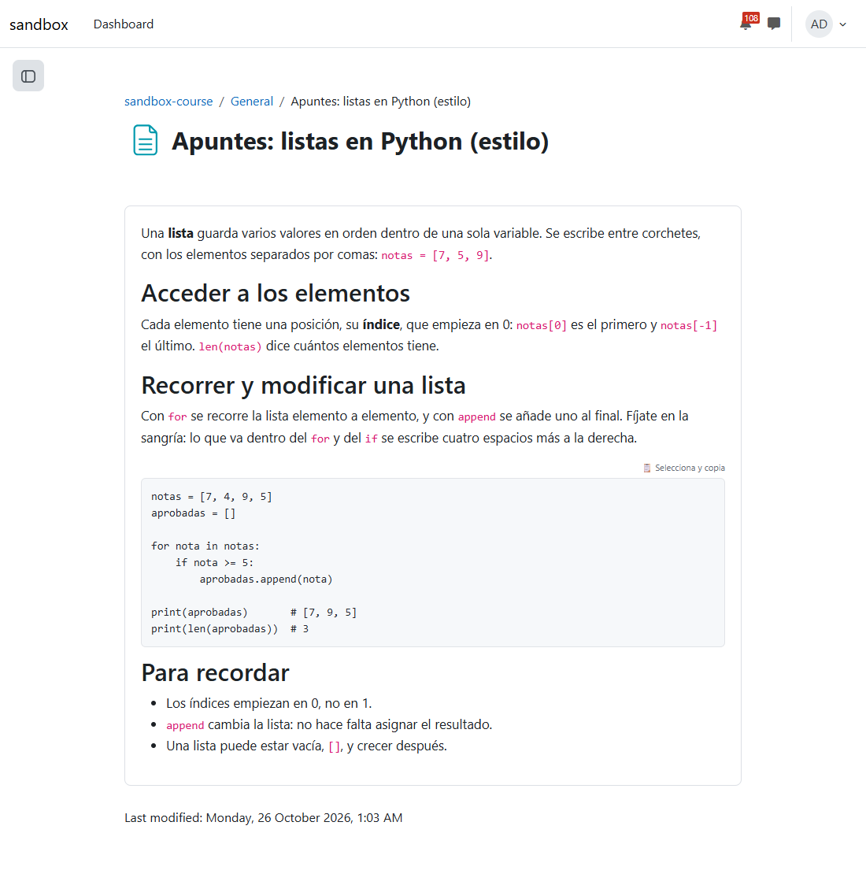
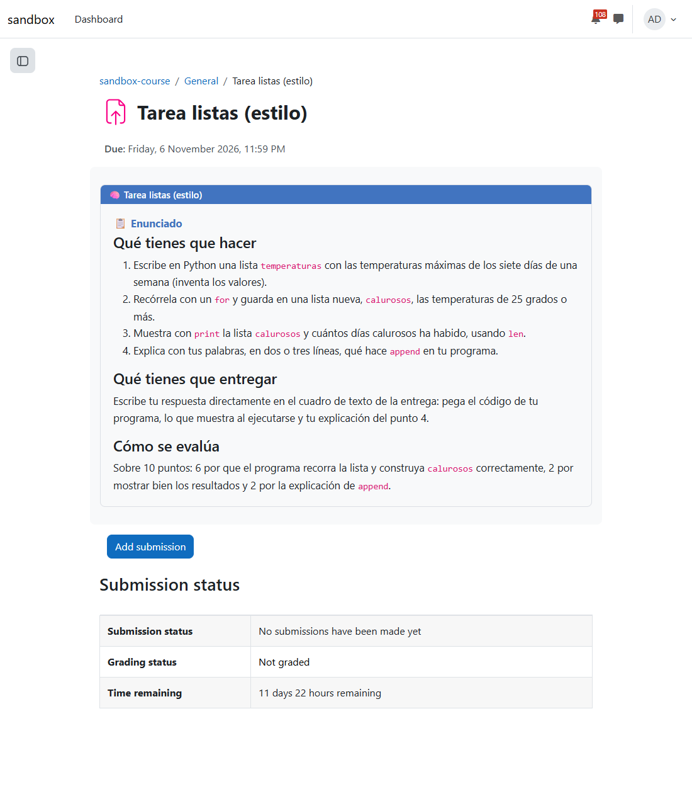
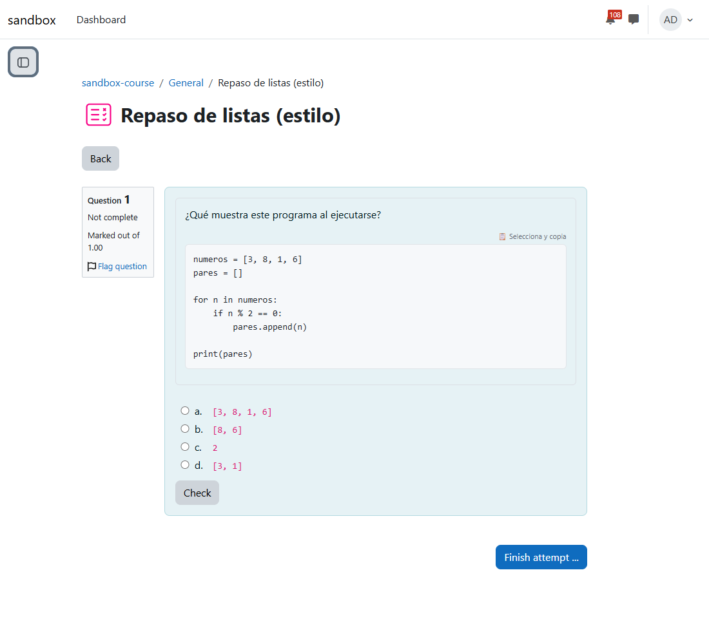
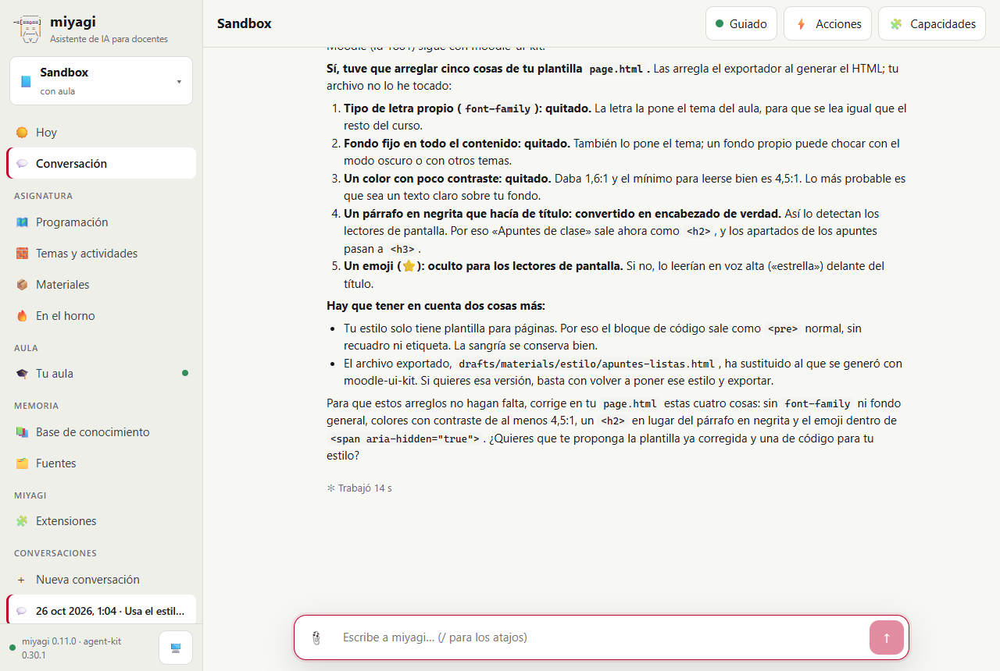
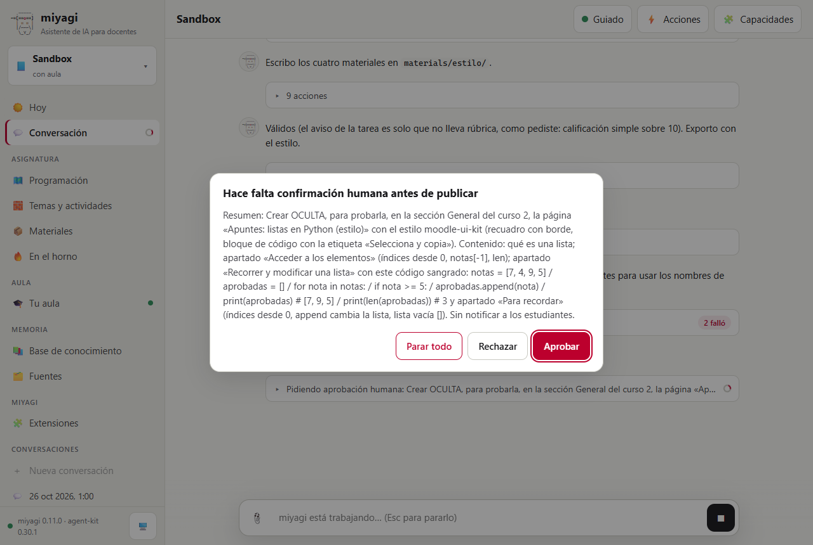

# Un estilo para lo que publica, siempre accesible

Prueba de #21 (estilos visuales). Se probaron tres cosas, en una conversación de `miyagi web` con la asignatura Sandbox:

- con el estilo oficial `moodle-ui-kit` elegido, miyagi publica unos apuntes, una tarea y una pregunta de cuestionario con retroalimentación;
- un estilo propio del docente con una plantilla rota se arregla al rellenarla, y se avisa al docente;
- se vuelve al tema del aula.

Lo que se dio por bueno se miró en la base de datos de Moodle, también si conserva los estilos en línea.

| | |
| --- | --- |
| Fecha | 26 oct 2026, 02:00–02:04 (hora peninsular) |
| Entorno | moodle-sandbox · Moodle 5.2.4 · Docker |
| Curso | `sandbox-course` (id 2) |
| Agente | miyagi 0.11.0 sobre el commit `0839367` más los cambios de #21, aún sin commit; agent-kit 0.30.1; moodle-teacher |
| Estilos | `moodle-ui-kit` 0.2.0 enlazado desde agent-extensions (sin publicar, con su nueva carpeta `style/`) y `estilo-propio`, una extensión de prueba con una sola plantilla de página rota a propósito; los dos en el ámbito de la asignatura |
| Cuenta | el profesor del sandbox |
| Workspace | `~/.miyagi/workspaces/sandbox`, modo guiado |

## Veredicto

**Superada con hallazgos.** Moodle conserva los estilos en línea de la página, del enunciado de la tarea y del texto y la retroalimentación de la pregunta, y el alumno los ve. Los encabezados quedan en orden (h2 de la plantilla, h3 y h4 del contenido) y los emojis, ocultos al lector de pantalla. La plantilla rota del docente se arregló en la exportación, sin tocar el archivo, y miyagi explicó los cinco arreglos. El único hallazgo es visual: en la tarea, el rótulo «Enunciado» de la plantilla oficial se veía más pequeño que los apartados que tenía debajo. Se corrigió en la plantilla después de la prueba.

## Qué se ejecutó

| Sesión | Encargo | Duración | Herramientas | Resultado |
| --- | --- | --- | --- | --- |
| `2026-10-26T01-00-34` (chat web, 3 turnos) | 1) Usar `moodle-ui-kit` y publicar apuntes, tarea y cuestionario «(estilo)», ocultos, probados y mostrados. 2) Poner `estilo-propio` y exportar de nuevo los apuntes sin publicar. 3) Volver al estilo del aula | 3,6 min | 71 (4 `materials_style`, 4 `materials_export`, 4 `materials_validate`, 4 `record_publication`, 2 `export_questions` para comprobar los estilos guardados, 5 aprobaciones) | 13/13 comprobaciones |

## Esperado y obtenido

| Esperado | Obtenido |
| --- | --- |
| La asignatura cambia de estilo cuando se le pide | `agent.appearance` pasó a `moodle-ui-kit`, después a `estilo-propio` y al final a `course` |
| Página con el estilo y los estilos en línea conservados | cmid 1881. El contenido guardado empieza con `
` y el código lleva el fondo `#f6f8fa` y el rótulo «Selecciona y copia» con su emoji en `aria-hidden` |
| Enunciado de la tarea con su cabecera | cmid 1882. `<h2 style="… background-color: #4174c0; color: #ffffff …">`, con los apartados del enunciado en h3 y h4 |
| Pregunta en su recuadro y retroalimentación en el marco verde | `questiontext` con el recuadro de la plantilla, y la retroalimentación con el encabezado `#0c7c59`. El GIFT validó. miyagi exportó las preguntas para comprobar que los estilos seguían ahí |
| Plantilla rota arreglada al rellenarla y explicada | El HTML exportado tiene `<h2 style="font-weight: bold">⭐ Apuntes de clase</h2>`, sin Comic Sans ni el fondo `#fffbe6`, y sin el amarillo `#f5c518` (1,6:1 de contraste). miyagi dijo los cinco arreglos y que el archivo no lo había tocado |
| Lo publicado no cambia al cambiar de estilo | La página 1881 sigue con `moodle-ui-kit`, y miyagi lo dijo |

*Los apuntes con el estilo: el recuadro, el código sobre fondo gris con «Selecciona y copia» y la sangría intacta. Los encabezados son los del contenido (h2), con el tamaño que les da el tema.*

*El enunciado con la cabecera azul y el título. Fíjate en que «Enunciado» (h3 de la plantilla, a 1,05rem) se ve más pequeño que «Qué tienes que hacer» (h4, al tamaño del tema): ese es el hallazgo 1.*

*La pregunta en un intento de alumno: el texto en su recuadro y el código con su plantilla, dentro del recuadro azul de Moodle.*

*La respuesta al docente. Cuenta los cinco arreglos (fuente, fondo, color con poco contraste, título en negrita convertido en h2 y emoji oculto), que su estilo no tiene plantilla de código y qué corregir en `page.html`.*

*La aprobación nombra el estilo y lo que se va a ver («recuadro con borde, bloque de código con la etiqueta…»).*

## Aprobaciones en orden

1. 02:01 Crear oculta la página «Apuntes: listas en Python (estilo)» con el estilo `moodle-ui-kit`.
2. 02:01 Crear oculta la tarea «Tarea listas (estilo)»: texto en línea, sobre 10.
3. 02:01 Crear oculto el cuestionario «Repaso de listas (estilo)», sin preguntas.
4. 02:02 Importar una pregunta (GIFT con el estilo) en el banco del cuestionario.
5. 02:03 Mostrar los tres.

Los turnos 2 y 3 no publicaron nada: solo cambiaron `config.json` y `drafts/`. Entre aprobaciones solo hubo las ediciones del paso 5, dentro de su lote.

## Hallazgos

| # | Qué | Estado | Dónde |
| --- | --- | --- | --- |
| 1 | En la plantilla oficial de tarea, el rótulo «Enunciado» (h3 pequeño) quedaba por encima de apartados h4 que se ven más grandes | Corregido: la plantilla ya no lleva ese rótulo, y los apartados del enunciado son h3 bajo la cabecera con el título | agent-extensions, `extensions/moodle-ui-kit/style/assignment.html` |
| 2 | Al cambiar de estilo y exportar de nuevo, el HTML de `drafts/materials/` se sustituye; miyagi lo avisó | Sin cambio: `drafts/materials/` es la exportación del estilo en uso, y lo publicado no cambia | — |

## Qué se añadió

- `src/materials/style.ts`: carga un estilo y lo hace accesible. Lo rellenan los exportadores de páginas, enunciados, preguntas, retroalimentación y código. También la herramienta `materials_style` y la clave `agent.appearance`.
- La skill `appearance`, y menciones en `materials-format`, `resource-authoring` y `assignment-building`.
- En agent-extensions, `moodle-ui-kit` 0.2.0 con su carpeta `style/`.

## Qué no cubrió

- Un aula que quita los estilos en línea: el sandbox los conserva. La skill dice que se compruebe leyendo lo guardado y que, si los ha quitado, se vuelva a `course`. En la prueba, miyagi lo comprobó con `export_questions`.
- Un libro con estilo (los capítulos solo usan la plantilla de código).
- El tema oscuro del aula con el estilo.
- Repetir la publicación con la plantilla de tarea corregida: se comprobó en los tests unitarios (sin avisos y con los apartados en h3).
