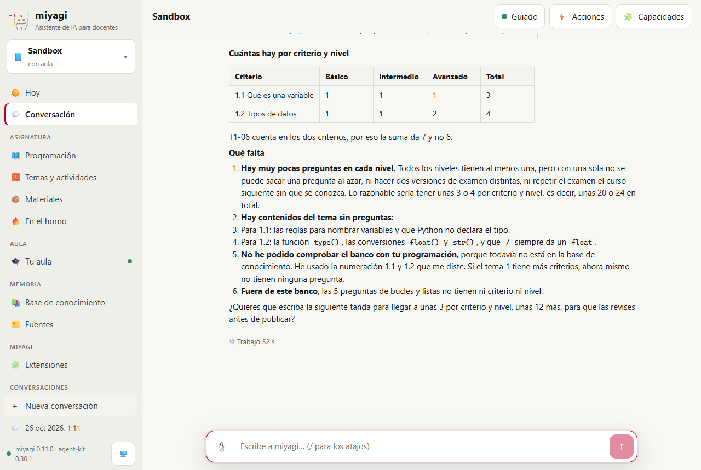
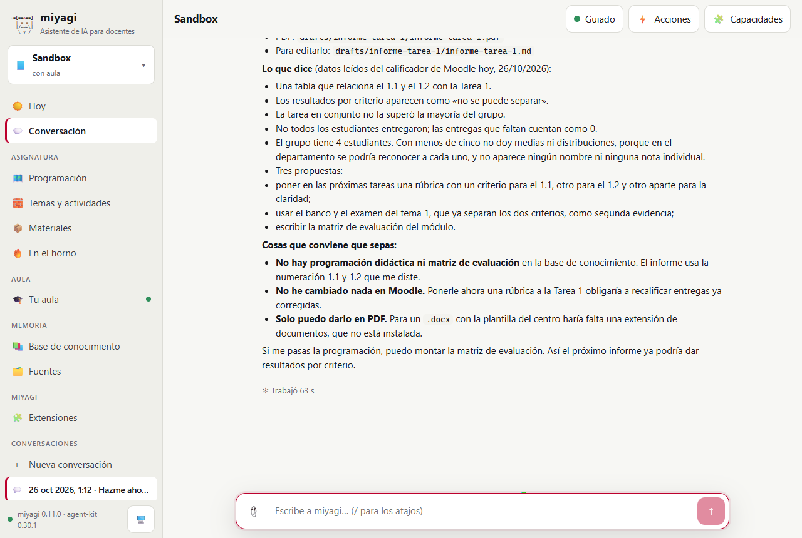

# Un banco de exámenes por criterio y nivel, y un informe sin alumnos

Prueba de #44 (skills de evaluación), con la asignatura Sandbox en `miyagi web`. Se probaron tres encargos:

- un banco de preguntas del tema 1 con criterio y nivel, y su cobertura;
- un examen que toma del banco por criterio y nivel;
- los resultados por criterio de la Tarea 1 para el departamento, sacados del calificador real, sin ningún dato de alumno.

No hay extensión de documentos, así que también se comprobó que el informe sale sin ella y que miyagi dice lo que falta.

| | |
| --- | --- |
| Fecha | 26 oct 2026, 02:11–02:16 (hora peninsular) |
| Entorno | moodle-sandbox · Moodle 5.2.4 · Docker, con la siembra `activity` (cuatro alumnos ficticios y la Tarea 1 corregida en pruebas anteriores) |
| Curso | `sandbox-course` (id 2) |
| Agente | miyagi 0.11.0 sobre el commit `0c8f22b` más los cambios de #44, aún sin commit; agent-kit 0.30.1; moodle-teacher |
| Cuenta | el profesor del sandbox |
| Workspace | `~/.miyagi/workspaces/sandbox`, modo guiado; sin programación ni matriz de evaluación en la base de conocimiento |

## Veredicto

**Superada con hallazgos.** El banco salió con criterio y nivel en cada pregunta, y `materials_coverage` dio la tabla por criterio y nivel. El examen toma del banco por criterio y nivel. Cuando pidió dos preguntas básicas del 1.1 y solo había una, la validación lo paró y miyagi preguntó en lugar de cambiar el examen. El informe no tiene nombres ni notas individuales. Con cuatro alumnos no da medias ni distribuciones, y explica por qué no se pueden separar los criterios: la Tarea 1 tiene una nota única. Lo deja en Markdown y PDF y dice que el `.docx` necesita una extensión de documentos. Hay un hallazgo abierto en la página (listas anidadas) y una corrección en el script de la prueba.

## Qué se ejecutó

| Sesión | Encargo | Duración | Herramientas | Resultado |
| --- | --- | --- | --- | --- |
| `2026-10-26T01-11-18` (chat web, 3 turnos) | 1) Banco del tema 1 con criterios 1.1 y 1.2 y niveles, y su cobertura. 2) Examen con dos básicas del 1.1 y una avanzada del 1.2, exportado sin publicar. 3) Resultados por criterio de la Tarea 1 para el departamento | 2,5 min según su transcript | 33 (`exam-bank`, `materials-format`, `course-reports`, `criterial-assessment` y `moodle-teacher:gradebook` cargadas; 1 `materials_coverage`, 4 `materials_validate`, 1 `materials_export`, `get_grader_report`, 2 `get_submissions`, `drafts_pdf`, 1 pregunta al docente) | 10/11 comprobaciones; la que falló era un falso positivo del script |

## Esperado y obtenido

| Esperado | Obtenido |
| --- | --- |
| Banco en `materials/banco/` con criterio y nivel en cada pregunta | `banco/tema-1.questions.md`: 7 preguntas (6, más una que añadió en el turno 2), 3 `basic`, 2 `intermediate` y 2 `advanced`, cada una con su criterio y la explicación de cada opción incorrecta |
| La cobertura por criterio y nivel, y qué falta | Una tabla 1.1/1.2 × básico/intermedio/avanzado, que avisa de que la pregunta T1-06 cuenta en los dos criterios. Lo que falta: pocas por nivel para sortear o hacer versiones, contenidos del tema sin pregunta, que no había programación con la que comparar y que los bancos de bucles y listas no tienen criterio ni nivel |
| Examen por criterio y nivel | `banco/examen-tema-1.quiz.md` con `pick: 2 · criteria: [1.1] · level: basic` y `pick: 1 · criteria: [1.2] · level: advanced`, exportado a `drafts/materials/banco/examen-tema-1/tema-1.gift` |
| Con preguntas insuficientes, no se cambia el examen por su cuenta | La validación dio «has 1 questions of criteria 1.1, level basic; the quiz draws 2» y miyagi preguntó con tres opciones. La prueba eligió escribir una más |
| Informe por criterio sin alumnos, imprimible | `drafts/informe-tarea-1/informe-tarea-1.md` y su `.pdf`. Sin nombres ni notas. Con cuatro estudiantes, solo el resultado del grupo, sin medias. Cada dato dice de dónde sale y en qué fecha se leyó |
| Sin extensión de documentos, lo dice | «Solo puedo darlo en PDF. Para un .docx con la plantilla del centro haría falta una extensión de documentos, que no está instalada.» |
| Nada de alumnos en la base de conocimiento | No hay ningún nombre. El script marcó «como alumno», escrito de forma genérica en una página de la prueba de #34: falso positivo |
| Nada publicado | Ninguna aprobación de publicación; solo la pregunta del turno 2 |

*La tabla por criterio y nivel y lo que falta. Los subapartados del punto 2 se ven numerados como 3 y 4 en lugar de anidados: es el hallazgo 1.*

*El resumen del informe: «no se puede separar» por criterio, sin medias con un grupo de cuatro, las propuestas y la falta de la extensión de documentos.*

## Aprobaciones en orden

Ninguna: nada se publicó. Hubo una pregunta (`ask_human`) en el turno 2, por las preguntas que faltaban en el banco.

## Hallazgos

| # | Qué | Estado | Dónde |
| --- | --- | --- | --- |
| 1 | En la conversación de la página, una lista numerada con subelementos se ve aplanada (los subelementos siguen la numeración) | Abierto: es el Markdown de la página o cómo sangra el modelo, no #44 | `gui/` |
| 2 | La comprobación de nombres del script contaba «alumno» genérico | Corregido en el script (fuera del repo); `check-knowledge.mjs --names` usa solo nombres propios | — |

## Qué se añadió

- `level` en las preguntas (`basic`, `intermediate`, `advanced`), y el filtro `criteria` y `level` en lo que toma un cuestionario de cada banco. Un número con filtro se sortea al exportar, igual para todos, y la validación lo dice. También la herramienta `materials_coverage`.
- Las skills `exam-bank` y `course-reports`, y su mención en `materials-format`.

## Qué no cubrió

- Un informe con la plantilla `.docx` del centro: no hay extensión de documentos.
- La memoria anual del módulo, que pide lo programado frente a lo dado y sin programación en el sandbox no tiene con qué comparar.
- Un grupo de cinco o más alumnos, con medias y distribución.
- Publicar el examen del banco en el aula: el filtro se comprobó en la exportación y en los tests unitarios.
