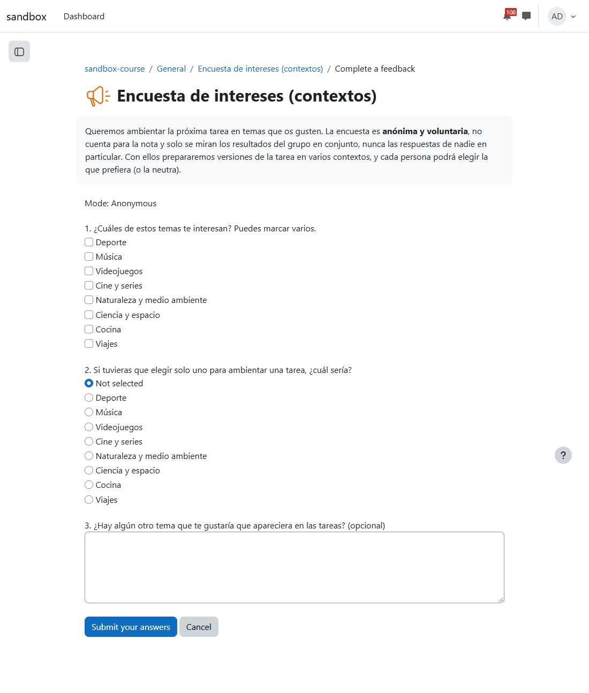
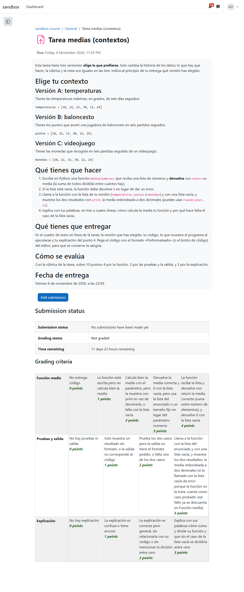
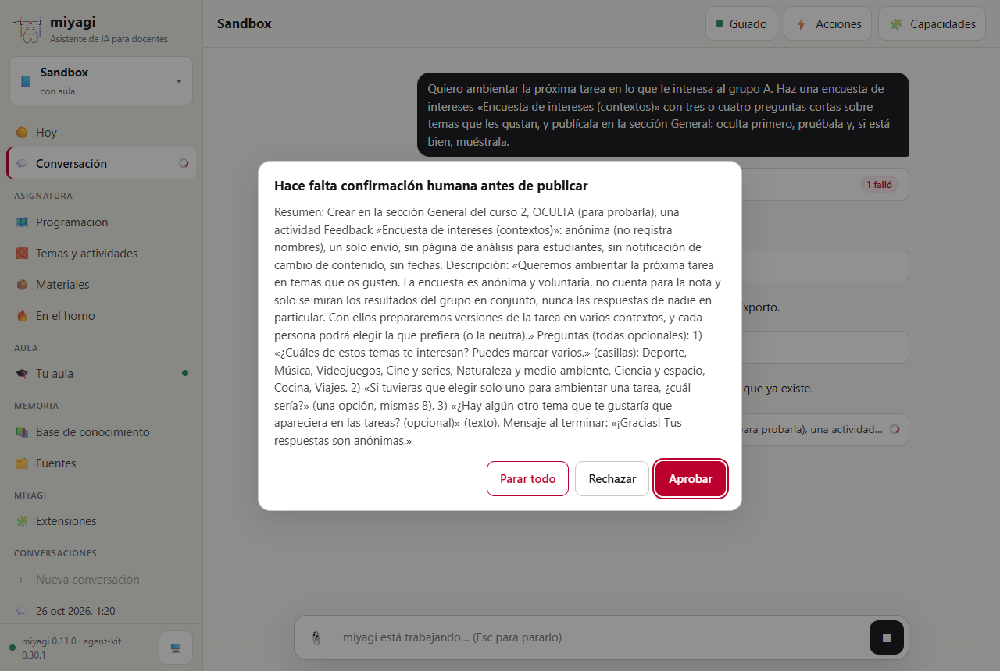
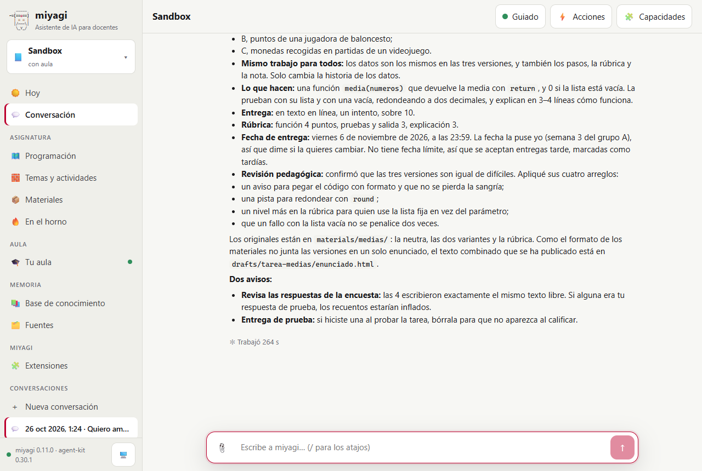

# Una tarea en lo que le interesa al grupo, sin datos de ningún alumno

Prueba de #39 (actividades personalizadas, ADR-018), con la asignatura Sandbox en `miyagi web`, en tres pasos:

1. miyagi escribió una encuesta de intereses anónima en `materials/` y la publicó en Moodle.
2. Los cuatro alumnos ficticios del sandbox la respondieron, con un script que entraba como cada uno.
3. miyagi leyó los resultados, guardó solo los totales permitidos en la página del grupo y publicó una tarea con dos contextos además de la neutra, para que cada alumno elija.

Lo que se dio por bueno se miró en la base de datos de Moodle y en los archivos de la asignatura.

| | |
| --- | --- |
| Fecha | 26 oct 2026, 02:21–02:29 (hora peninsular) |
| Entorno | moodle-sandbox · Moodle 5.2.4 · Docker, con la siembra `activity` (cuatro alumnos ficticios) |
| Curso | `sandbox-course` (id 2) |
| Agente | miyagi 0.11.0 sobre el commit `1ec3955` más los cambios de #39, aún sin commit; agent-kit 0.30.1; moodle-teacher |
| Cuenta | el profesor del sandbox; las respuestas, con las cuentas de alumno del sandbox (su contrato `info`), sin imprimir contraseñas |
| Workspace | `~/.miyagi/workspaces/sandbox`, modo guiado; `materials/course.md` con el grupo A |

## Veredicto

**Superada con hallazgos.**

- **Encuesta:** salió anónima en `materials/surveys/`, con un propósito que dice para qué es y que es voluntaria. Moodle la guardó como anónima (`anonymous = 1`) y el alumno ve «Mode: Anonymous». miyagi recordó que se consulte con el centro si hay que informar a las familias.
- **Totales:** con 4 respuestas, `survey_aggregate` solo dejó guardar las opciones con 3 o más. La página `interests/a` no tiene nombres ni citas.
- **Tarea:** es una sola, con la versión neutra y dos variantes (baloncesto y videojuego) a elegir. Las tres usan los mismos datos, pasos y rúbrica; `pedagogy-reviewer` revisó la dificultad y no hay restricciones por grupo ni por alumno.

Los dos hallazgos son de la prueba y del gate, no del comportamiento de miyagi.

## Qué se ejecutó

| Sesión | Encargo | Duración | Herramientas | Resultado |
| --- | --- | --- | --- | --- |
| `2026-10-26T01-21-02` (chat web, 2 turnos) | 1) Encuesta de intereses para el grupo A, publicada oculta, probada y mostrada. 2) Tras las respuestas: leer los resultados, guardar los intereses y publicar «Tarea medias (contextos)» con los contextos que más interesan | 7,5 min | 85 (`personalised-activities`, `materials-format`, `assignment-building` y dos de moodle-teacher; 3 `add_feedback_item`, `get_survey_results`, `survey_aggregate`, 5 `materials_validate`, 3 `materials_export`, 5 `record_publication`, `set_rubric`, 1 subagente, 5 aprobaciones y 2 preguntas) | 13/13 comprobaciones |
| Script con las 4 cuentas de alumno | Responder la encuesta en `mod/feedback/complete.php` | — | — | 4 respuestas en `mdl_feedback_completed` |

## Esperado y obtenido

| Esperado | Obtenido |
| --- | --- |
| Encuesta en `materials/surveys/`, anónima y con su propósito, sin nada que identifique ni delicado | `surveys/intereses-contextos.survey.md`: temas que te gustan (varios), tu tema favorito (uno) y otro tema (texto, opcional); `anonymous: true`, `group: A` |
| En el aula, anónima y sin resultados para los alumnos | Feedback cmid 1884, `anonymous = 1` y visible al final. El alumno ve «Mode: Anonymous» y el propósito arriba |
| El aviso de las familias | Dado al publicarla por primera vez |
| Solo los totales de 3 o más | `interests/a.md`: 4 respuestas. Temas con 3 o más, tema favorito Deporte (3) y «el resto, por debajo de 3: no se guardan», y del texto libre solo dos temas (videojuegos y deporte) sin citar. Fecha y curso escolar |
| Ningún nombre en la base de conocimiento ni en la respuesta | Ninguno |
| Neutra más 2-4 variantes, cada una en su archivo | `medias/tarea-medias.assignment.md` con `variants: [tarea-medias.deporte.assignment.md, tarea-medias.videojuegos.assignment.md]`, validadas (solo cambia el contexto) |
| «Elige tu contexto»: una actividad, la misma rúbrica | Tarea cmid 1885: «Elige tu contexto» con las versiones A (temperaturas, la neutra), B (baloncesto) y C (videojuego), los mismos seis números, los mismos pasos y una rúbrica de 3 criterios sobre 10. Sin restricción de acceso |

*Arriba, el propósito («anónima y voluntaria… solo se miran los resultados del grupo»), después «Mode: Anonymous» y tres preguntas opcionales, sin nada personal.*

*La tarea: «Elige tu contexto» y las tres versiones con los mismos datos (`[18, 22, 15, 30, 12, 24]`), lo que hay que hacer, la entrega y la rúbrica, iguales para todos.*

*La aprobación de la encuesta: oculta, anónima (no registra nombres), un solo envío y sin página de análisis para los alumnos.*

*Lo que cuenta miyagi al terminar: qué contextos eligió y por qué, y qué ha publicado.*

## Aprobaciones en orden

1. 02:21 Crear oculta la encuesta Feedback, anónima, de un solo envío y sin análisis para los alumnos.
2. 02:23 *(pregunta)* ¿Has probado la encuesta como estudiante?
3. 02:23 Mostrarla.
4. 02:27 Crear oculta la tarea «Tarea medias (contextos)».
5. 02:27 Definir su rúbrica, y después el panel del gate para `set_rubric` (hallazgo 2).
6. 02:28 *(pregunta)* ¿Has probado la tarea como estudiante?
7. 02:28 Mostrarla.

Nada se publicó sin aprobación. Las ediciones entre aprobaciones son las de visibilidad y ajustes de los lotes aprobados.

## Hallazgos

| # | Qué | Estado | Dónde |
| --- | --- | --- | --- |
| 1 | En la pregunta de varias opciones salieron 4 en todas las opciones: el script que respondía como alumnos marcó todas las casillas, no solo las previstas | Sin cambio en miyagi: es la siembra de la prueba. El umbral se vio igual en la pregunta de una opción (Deporte 3, el resto descartado) | script de la prueba |
| 2 | Tras aprobar la rúbrica, el gate volvió a preguntar por `set_rubric` | Sin cambio: moodle-mcp marca `set_rubric` como destructiva (sustituye la que hubiera), así que agent-kit siempre pregunta | moodle-mcp `src/tools/getRubric.ts` |

## Qué se añadió

- `src/materials/survey.ts`: el formato `.survey.md`, que rechaza una encuesta no anónima, sin propósito o que pide algo identificativo o delicado, y `aggregateSurvey` con el umbral de 3.
- `src/materials/variants.ts`: `variants:` en tareas y cuestionarios, comparadas con la neutra en nota, rúbrica, criterios, entrega, fechas, y tipo, puntos, criterios y nivel de cada pregunta.
- La herramienta `survey_aggregate`, el tipo de página `interests` y la skill `personalised-activities`.
- El texto de ejemplo para las familias en la guía.

## Qué no cubrió

- Una variante por grupo con restricción de acceso: solo «elige tu contexto».
- Variantes de un cuestionario: se comprobaron en los tests unitarios.
- Un rechazo real del validador en la sesión: el modelo no escribió preguntas identificativas. Se comprobó en los tests.
- Un grupo de más de cuatro alumnos.
