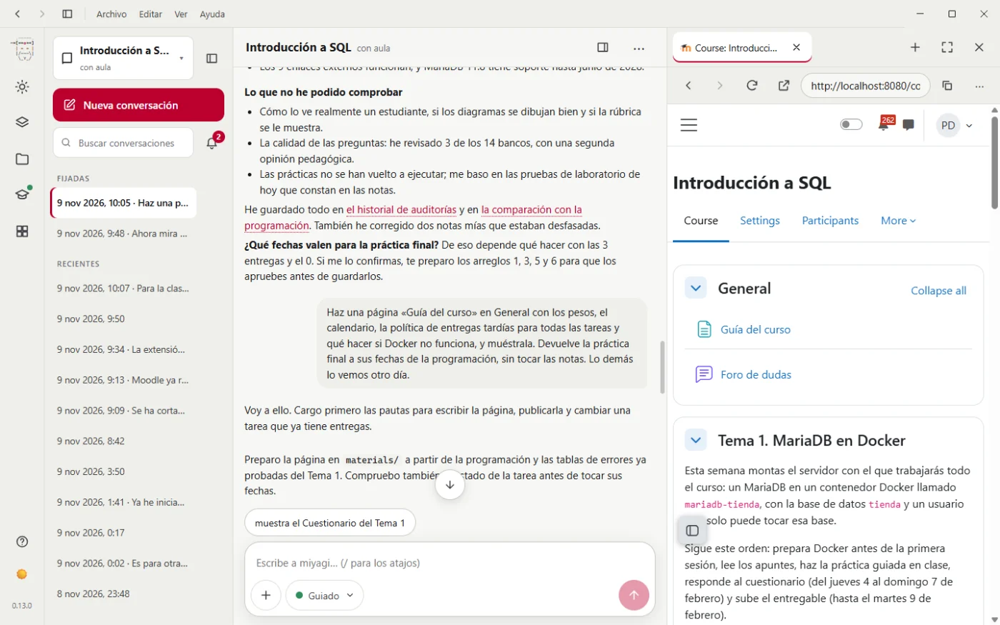
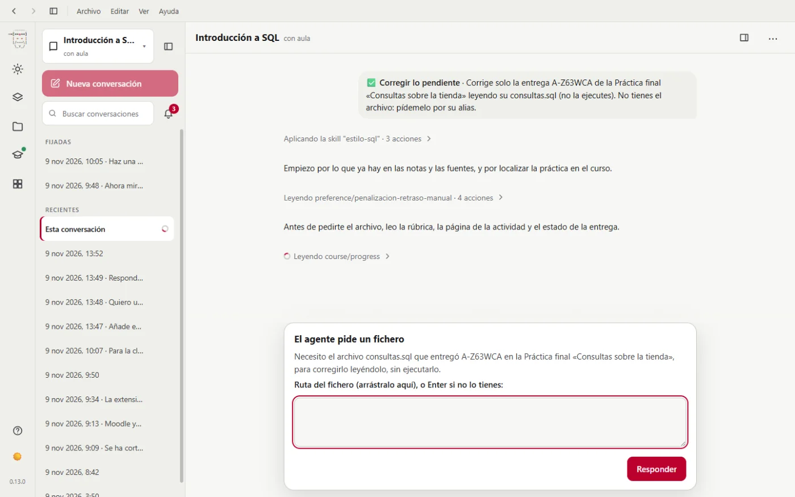
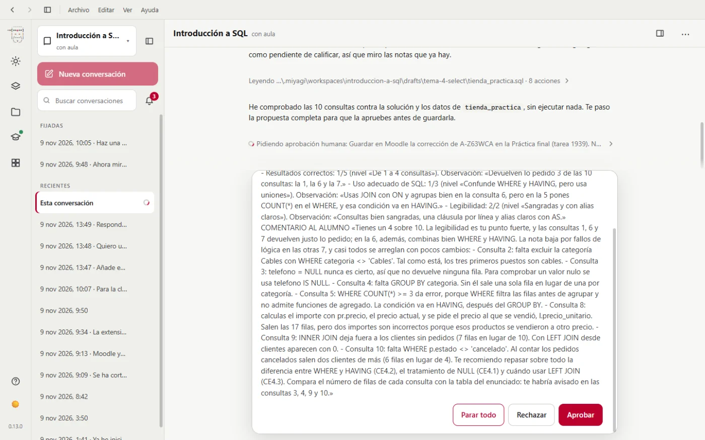
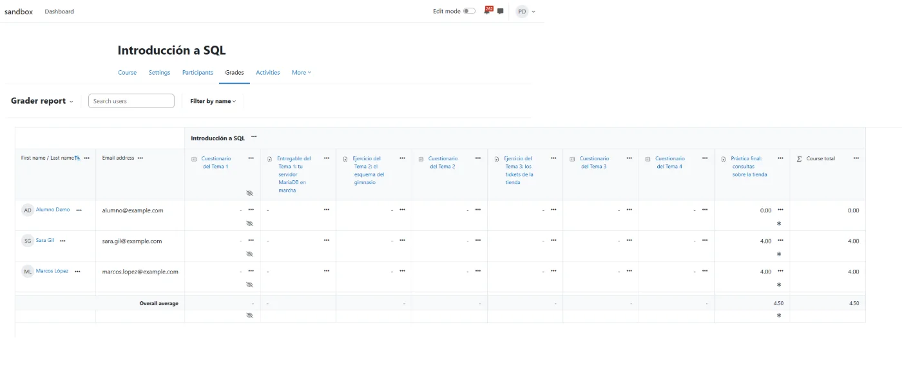

# Un curso de SQL entero en la aplicación de escritorio

Prueba de principio a fin hecha para rehacer la documentación desde la aplicación de escritorio: miyagi construye y lleva un aula de «Introducción a SQL» en moodle-sandbox, desde un curso vacío hasta corregir, atender el foro, auditar el curso y usar una habilidad propia. La aplicación se condujo por su puerto de depuración, respondiendo a cada aprobación.

| | |
| --- | --- |
| Fecha | Del 8 al 9 de noviembre de 2026 (23:45-10:00 UTC, con pausas) |
| Entorno | moodle-sandbox (Moodle 5.2.4, interfaz en inglés), Windows 11, Docker |
| Curso | `intro-sql-app`, id 353, «Introducción a SQL» |
| Versión | miyagi 0.12.0 empaquetada, agent-kit 0.33.0, moodle-mcp 0.8.0, docker-mcp 0.2.0 |
| Cuenta | `profesor`; alumnado ficticio: Lucía Martín, Marcos López, Sara Gil, Alumno Demo |
| Fuentes | Temario de 4 temas y rúbrica de la práctica final |
| Herramientas | `tools/` (conductor de la aplicación, pasos y acciones de alumno) |

## Veredicto

**Superada con hallazgos.** El curso quedó completo y coherente con la programación, y las notas coinciden con el nivel conocido de cada entrega. Por el camino aparecieron fallos reales: las caídas de Edge dejaron dos cuestionarios a medias hasta una ejecución posterior, y las entregas en archivo no llegan al agente con la protección de datos por defecto.

## Qué se ejecutó

30 sesiones, 1653 llamadas a herramientas, 71 peticiones de aprobación o de datos, unos 71 USD. Todas contra el sandbox, con las aprobaciones respondidas por el conductor, lo que solo es aceptable en un Moodle de pruebas.

| Fase | Resultado |
| --- | --- |
| Crear asignatura, vincular aula, incorporar fuentes | Hecho |
| Programación didáctica | Hecha, con calendario y pesos |
| Temas 1 a 4 con prácticas probadas en Docker | Hechos, tras varias interrupciones |
| Mostrar el curso | Hecho, con su aprobación |
| Corregir la práctica final | Hecho, pasando los archivos a mano |
| Foro, seguimiento, auditoría, guía del curso | Hechos |
| Habilidad propia `estilo-sql` | La aplicó sin nombrarla |

## Esperado y obtenido

Comprobado en la base de datos de Moodle, no por lo que dijo el agente.

| Área | Esperado | Obtenido |
| --- | --- | --- |
| Estructura | 4 temas, foro, guía | 4 secciones de 5 actividades cada una, foro y guía |
| Cuestionarios | 10 huecos cada uno | 10, 10, 10 y 10, tras repetir los de los temas 1 y 2 |
| Pesos | Cuestionarios 20 %, ejercicios 30 %, final 50 % | 5 % por cuestionario, 15 % por ejercicio, 50 %; entregable del Tema 1, 0 % |
| Nota de Lucía | Alta: filas correctas en las 10 consultas | 10 |
| Nota de Marcos | Baja: faltan 4 consultas, otra mal | 4 |
| Nota de Sara | Baja: un error y varias mal | 4 |
| Alumno Demo | Sin entrega con el plazo vencido | 0 |
| Foro | Una pista y una corrección respetuosa | Una respuesta en cada hilo |

Las entregas se ejecutaron antes en un MariaDB con los datos de la tienda para saber su nivel: Lucía devolvió las filas esperadas en las 10 consultas, Marcos entregó 6 y falló la 9, Sara dio error en la 5 y falló la 3, la 4, la 9 y la 10.

*El curso terminado, junto a la conversación (capturado después, en la 0.13.0).*

*La corrección pide cada archivo bajo un alias: el docente solo puede identificarlo por la hora de entrega.*

*Cada nota se enseña antes de guardarla.*

*El libro de calificaciones en Moodle.*

## Aprobaciones

Las 71 peticiones están registradas por orden en el conductor, sin datos de acceso. Incluyen arrancar y parar laboratorios, crear cada actividad oculta, mostrarla, los pesos, las notas en un único lote con cada alumno detallado, las respuestas del foro y la guía. No se detectó ninguna publicación sin aprobación.

## Hallazgos

| Hallazgo | Estado | Dónde |
| --- | --- | --- |
| Una conversación se quedó casi tres horas en «Arrancando miyagi…» | Corregido el bloqueo; causa desconocida | #88 |
| Edge se cayó 151 veces, y el agente culpó a Moodle de no importar preguntas | Abierto en otro repositorio | #89, moodle-mcp#57 |
| «Temas y actividades» tomaba la tabla de diversidad como temas | Corregido | #90 |
| Tras instalar docker-lab no se podía escribir en sus laboratorios | Corregido | #91 |
| Un formulario de confirmación caduca si se tarda en responder | Abierto en otro repositorio | #92, docker-mcp#10 |
| Edge no arranca con una ruta de perfil larga, y el agente cambió el perfil por su cuenta | Abierto en otro repositorio | #93, moodle-mcp#58 |
| El rechazo de `course.md` no decía el motivo | Corregido | #94 |
| Las entregas en archivo no llegan al agente | Abierto en otro repositorio | #95, moodle-mcp#59 |
| Editar `.mcp.json` a mano desactiva la extensión | Comportamiento correcto; impide elegir navegador | #89 |
| La visita sobre el asistente, conversaciones antiguas, saludo de Hoy, Esc, saludo interno | Corregidos | #96 a #100 |

Fallos de la propia prueba, sin efecto en el producto: el conductor enviaba los formularios sin marcar la casilla (de ahí los «no» al parar laboratorios), confundía «así» con «sí», y el portátil se suspendió de 06:52 a 08:40 UTC.

## Qué se añadió a las habilidades o prompts

Nada en esta prueba: lo aprendido sobre el navegador y las entregas está en moodle-mcp y sus issues. Los cambios en miyagi están en los commits de cada ficha.

## Qué no se cubrió

- El curso se corrigió con fechas adelantadas directamente en la base de datos, y se devolvieron después.
- Los intentos de cuestionario de los alumnos y las entregas de los temas 1 a 3.
- Una instalación desde el `miyagi-setup.exe` en un usuario limpio (#48).
- La ejecución real se hizo en la 0.12.0; las capturas de la documentación son de la 0.13.0.
