# El navegador integrado de la app de escritorio

Prueba de la función #86: el panel lateral de la app de escritorio como navegador web con pestañas, con la sesión del docente y sin que nada llegue al modelo. Se ejecutó en la ventana real de Electron, guiada con `MIYAGI_DESKTOP_SCRIPT`, a varios tamaños.

| Dato | Valor |
| --- | --- |
| Fecha | 9 nov 2026, 11:47–12:03 UTC, con reinicios de la app; las capturas son de la última ejecución, sobre el código final |
| Entorno | Windows 11, Electron 44.9.3 (`desktop/`, sin empaquetar), host en `127.0.0.1` |
| Sitio contra el que se probó | **Un sustituto local, no Moodle**: dos servidores HTTP en `127.0.0.1:18080` y `:18081`, con formulario de acceso, cookie de sesión sin caducidad (como `MoodleSession`) y `X-Frame-Options: DENY` |
| Moodle sandbox | No disponible: `http://localhost:8080` no respondía y sus contenedores estaban parados. No se levantó, por no ser parte del encargo ni un entorno propio |
| Curso | Ninguno real; página de curso ficticia en el sustituto (`Alumna ficticia: Ana Ejemplo`) |
| Agente y kit | miyagi 0.12.0 (sobre el commit `a2da38e`, con esta función sin confirmar), agent-kit 0.33.0 |
| Cuenta | Usuario de prueba del sustituto, sin relación con ninguna cuenta real |
| Carpeta de datos | Propia de la prueba (`MIYAGI_DESKTOP_DATA`), en el directorio temporal |

## Veredicto

**Superada con hallazgos.** Todo lo probado funciona en la ventana real: la vista sigue al panel, no tapa menús ni diálogos, los rechazos actúan, y un acceso sigue iniciado tras reiniciar. El criterio que quedó abierto el primer día, iniciar sesión **en el Moodle del sandbox** y seguir dentro tras reiniciar, se cumplió después contra el Moodle real (ver «Repetición contra el Moodle del sandbox»). La primera ejecución se hizo sobre un sustituto local porque el sandbox estaba parado.

## Repetición contra el Moodle del sandbox

Se repitió lo que faltaba el mismo 9 de noviembre, con el sandbox levantado: Moodle 5.2.4 en `http://localhost:8080`, cuenta `profesor` (docente), código en `57bea92`, agent-kit 0.33.0, Electron sin empaquetar, carpeta de datos propia. La contraseña llegó solo por el entorno del proceso y no está en los pasos ni en las capturas.

Dos arranques de la app sobre la misma carpeta de datos. No se escribió nada en Moodle ni se tocó ningún curso salvo abrir, en lectura, el curso de pruebas (id 2).

| Esperado | Obtenido |
| --- | --- |
| Iniciar sesión en una pestaña con el formulario real de Moodle | De `/login/index.php` (sin sesión) a `/my/`, «Dashboard», con `sesskey` y menú de usuario: «Hi, Profesor!» |
| Seguir dentro tras cerrar y volver a abrir la app | Pestaña nueva a `/my/` y a `/course/view.php?id=2`: con sesión, sin pasar por el acceso |
| La cookie de sesión no es visible para las páginas | `document.cookie` no contiene `MoodleSession` (es `HttpOnly`), tras reiniciar y con la sesión viva |
| Dos pestañas en sitios distintos, independientes | Moodle en una y `https://example.org/` en otra, cada una con lo suyo: navegar a `/my/`, recargar y volver atrás en una no cambió la dirección ni la sesión de la otra |

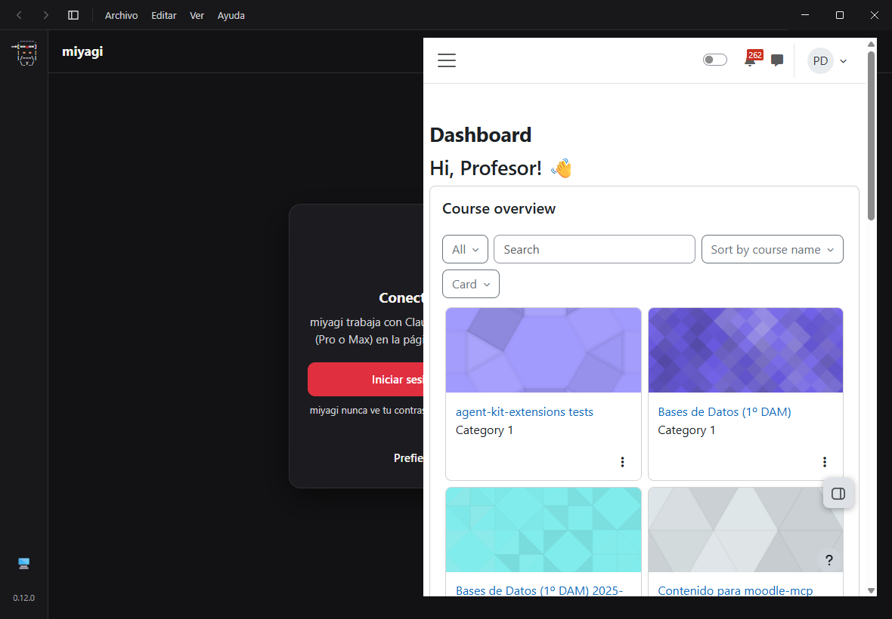

*El panel de Moodle del docente en la vista nativa.*

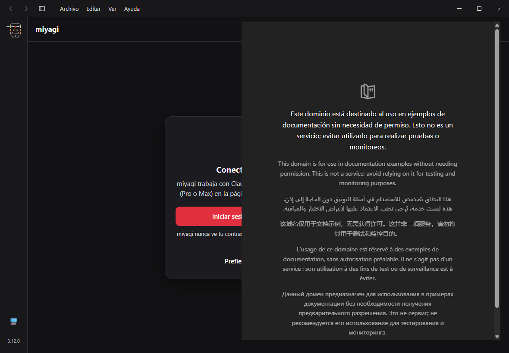

*La segunda pestaña en otro sitio, sin sesión, mientras la de Moodle sigue en la suya.*

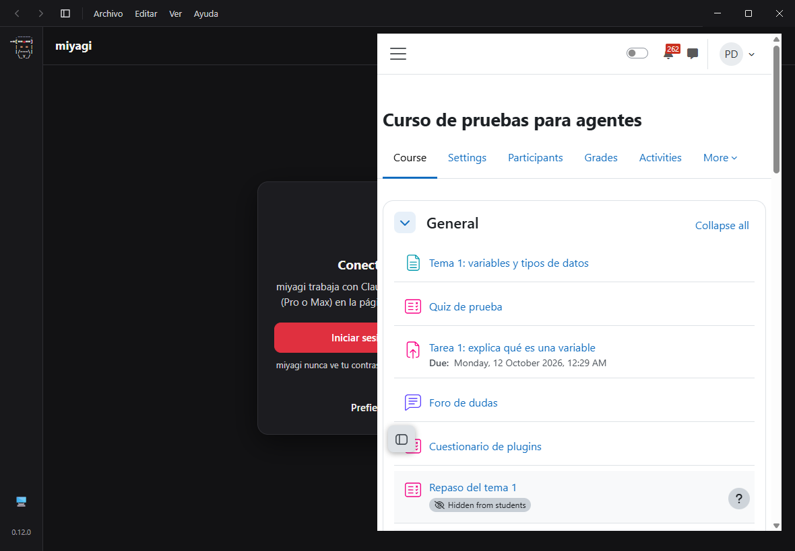

*Tras cerrar y volver a abrir la app, el curso de pruebas con la sesión del docente.*

**Límites de esta repetición.** La app corrió sin sesión de Claude (la carpeta de datos propia aísla `~/.claude`), así que no había conversación abierta y el panel lateral de la página no se dibujó: por eso, detrás, se ve la pantalla de conectar con Claude. Las pestañas se abrieron, eligieron y colocaron con las mismas acciones del host que usa el panel (`browser-open`, `browser-select`, `browser-bounds`, `browser-navigate`, `browser-reload`, `browser-back`); lo probado es la vista nativa y su sesión `persist:browser`, no los botones del panel, que sí cubrió la primera ejecución. El segundo sitio es público y sin acceso: no se probaron dos sesiones iniciadas en dos sitios a la vez.

## Qué se ejecutó

Los turnos de Claude fueron solo los de saludo y uno de prueba para tener un enlace en el chat; las cuatro sesiones se cuentan con su `transcript.jsonl`.

| Sesión | Qué hace | Llamadas | Resultado |
| --- | --- | --- | --- |
| `2026-11-09T11-51-48` | Saludo, abrir el panel, iniciar sesión, dos pestañas, rechazos, tamaños, enlace del chat, Ctrl+clic | 3 (`knowledge_index`, `knowledge_read`, `list_sources`) | Pasa |
| `2026-11-09T11-52-35` | Reinicio de la app sobre la misma carpeta de datos | 2 (`knowledge_index`, `knowledge_read`) | Pasa |
| `2026-11-09T11-54-38` | Otra apertura de saludo durante el diagnóstico del panel | 2 (`knowledge_index`, `knowledge_read`) | Pasa |
| `2026-11-09T11-55-19` | Reinicio final y captura definitiva | 2 (`knowledge_index`, `knowledge_read`) | Pasa |

## Esperado y obtenido

### Sesión y pestañas

| Esperado | Obtenido |
| --- | --- |
| Iniciar sesión en una pestaña | `document.body` pasa a `logged-in` en `/` tras enviar el formulario |
| Reiniciar la app y seguir con la sesión iniciada | Tras reiniciar, nueva pestaña a `:18080/`: `logged-in`, `Sesion iniciada`, sin pasar por `/login` |
| Dos pestañas en sitios distintos, independientes | `:18080` con sesión, `:18081` sin sesión, cada una con su título e icono; volver a la primera conserva su estado |
| Nada guardado salvo el acceso | Sin rastro de la página del curso (`CURSO-NOTA-353`, `Ana Ejemplo`, `18080/course`) en `Partitions/browser` ni en `~/.miyagi` |

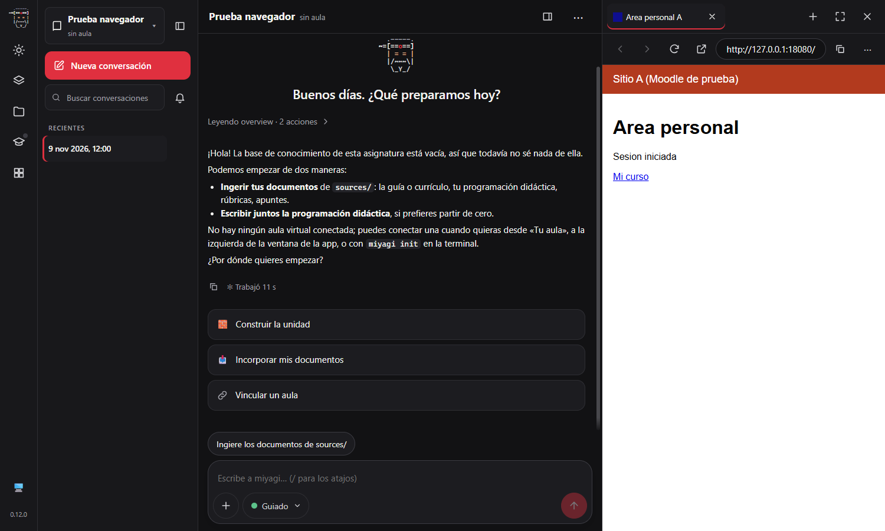

*La pestaña con su título e icono, la barra con la dirección, y la página a la derecha de la conversación.*

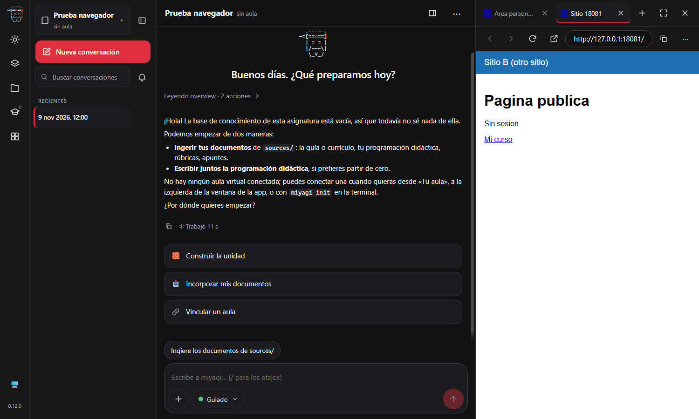

*Dos sitios a la vez, el segundo sin sesión: la cookie de cada sitio es suya.*

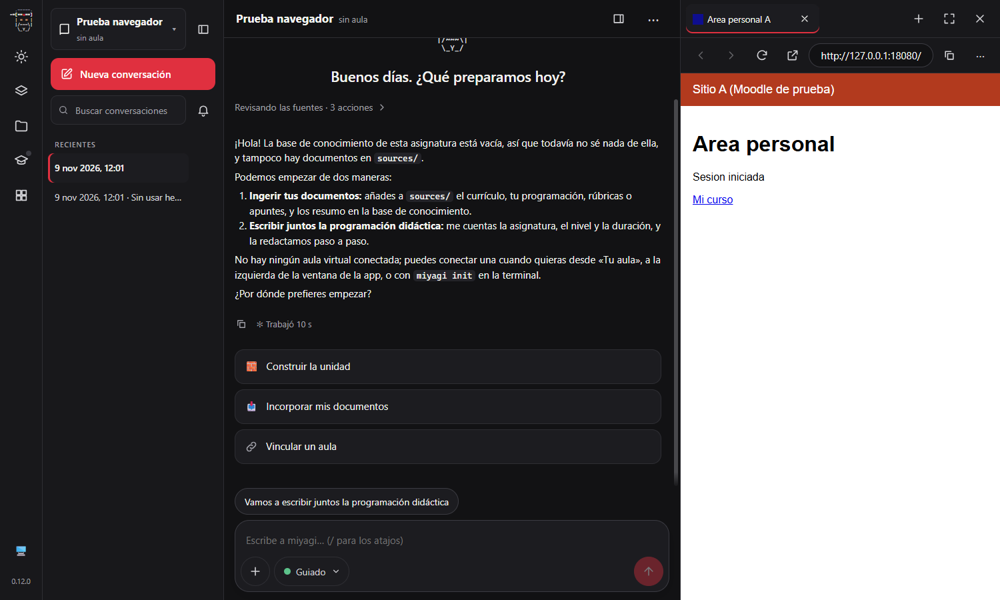

*La app reiniciada, ninguna pestaña recordada (el panel arranca vacío), y la sesión sigue iniciada al volver a la dirección.*

### Lo que no se abre

| Entrada | Obtenido |
| --- | --- |
| `file:///C:/Windows/win.ini` escrito | «Esa dirección no se puede abrir aquí.», sin navegar |
| Dirección del host, con su token, escrita | Mismo mensaje, sin navegar |
| Enlace a `file:` dentro de una página | La pestaña sigue en la misma dirección (lo corta Chromium antes de que llegue a la barra de miyagi) |
| Enlace al host (`http://localhost:<puerto>/`) dentro de una página | Aviso «Esa dirección no se puede abrir aquí.» y la pestaña no se mueve |
| Una palabra, `javascript:`, `about:blank` | «Eso no es una página web…», comprobado en `check-host` y en `check-page` |
| Ventana emergente (`target=_blank`) | Una pestaña nueva, no una ventana |

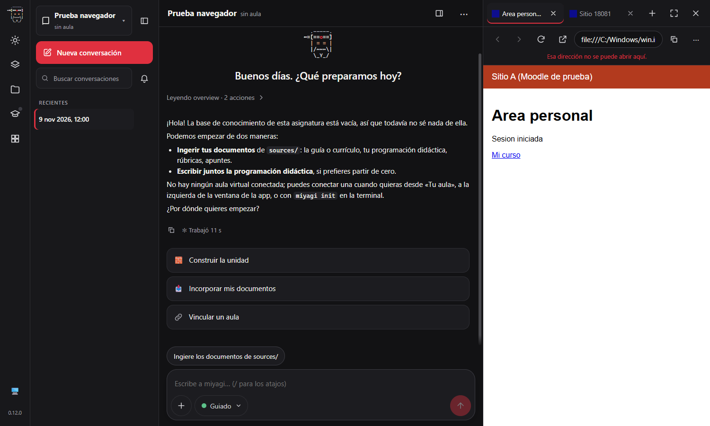

*`file:///` escrito en la barra, rechazado con su mensaje y la página anterior a la vista.*

### La vista nativa y lo que tiene encima

| Esperado | Obtenido |
| --- | --- |
| El menú ⋯ no queda tapado | Con el menú abierto, la vista se oculta y se ve una imagen fija en su lugar; al cerrar vuelve la vista |
| Un diálogo no queda tapado | Igual con el diálogo «Nueva asignatura» |
| La vista sigue al panel | Tamaño interior de la vista igual al del hueco en cada medida: 479×790 a 1500 px, 479×970 a 1920×1080, 703×610 a 1040×720, 420×590 a 420×700, 1163×790 ampliada |
| Ocultar y volver a mostrar el panel | La vista se oculta con él y vuelve igual (479×790) |

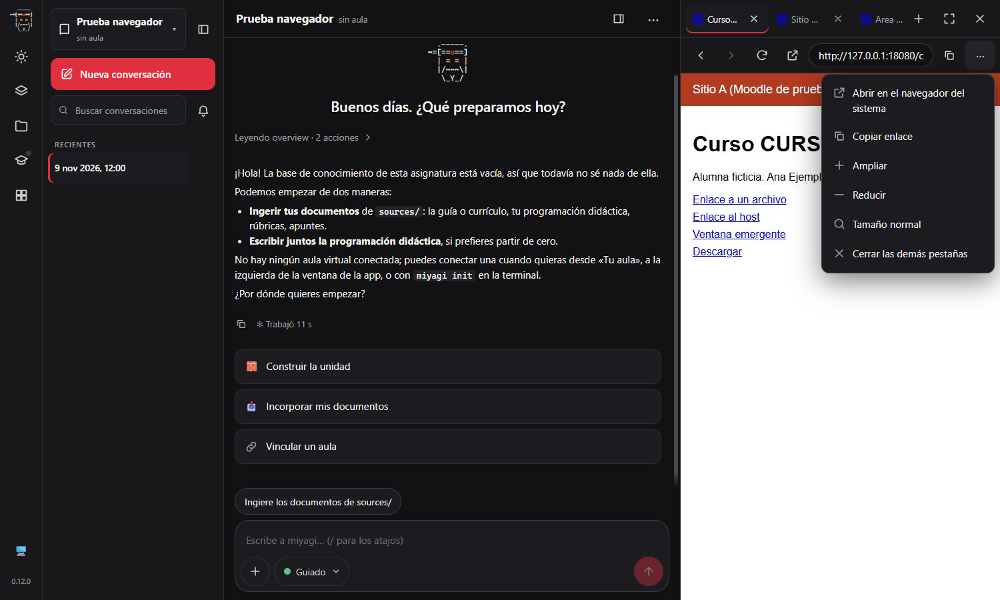

*El menú ⋯ encima de la página; lo que se ve detrás es la captura, no la vista.*

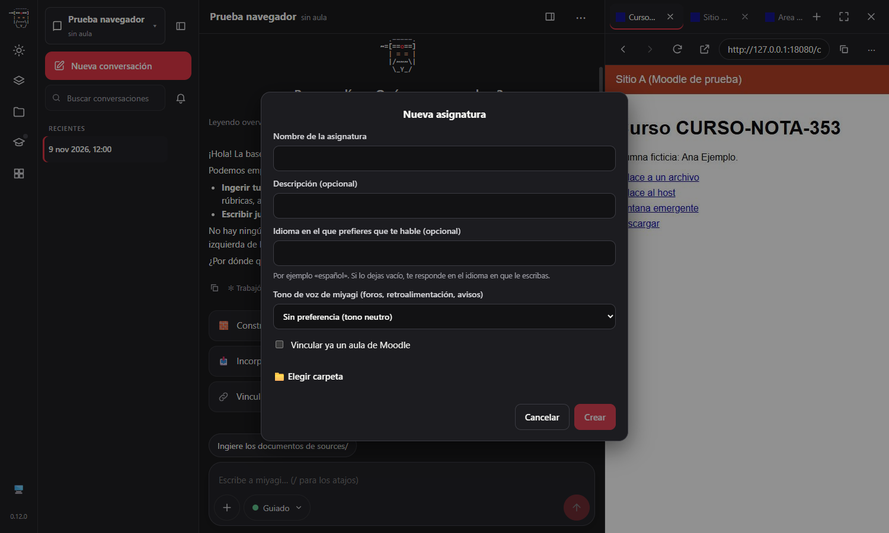

*Un diálogo de la página sobre la vista, en el mismo modo.*

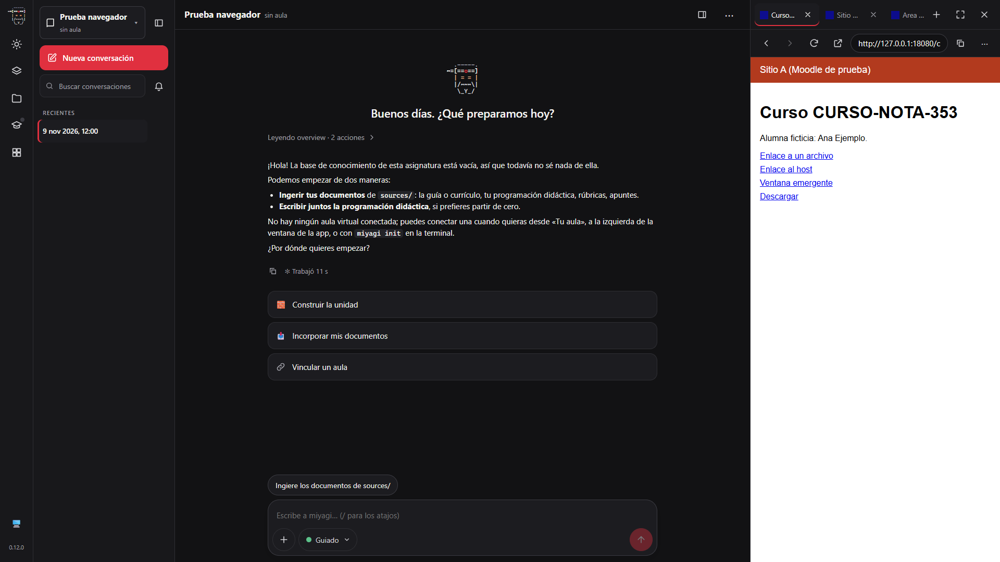

*A 1920×1080 el panel sigue junto a la conversación.*

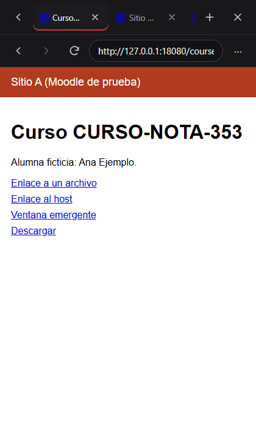

*A 420 px el panel ocupa toda la ventana, con los botones de la fila reducidos a los esenciales.*

### Enlaces del chat

| Esperado | Obtenido |
| --- | --- |
| Clic en un enlace del chat abre una pestaña | Se abre `http://127.0.0.1:18081/` en una pestaña del panel (de 3 a 4) |
| Ctrl+clic lo saca al navegador del sistema | El proceso principal registra `external: http://127.0.0.1:18081/` y el número de pestañas no cambia |
| «Abrir en el navegador del sistema» | Registra `external: http://127.0.0.1:18081/` en el proceso principal |

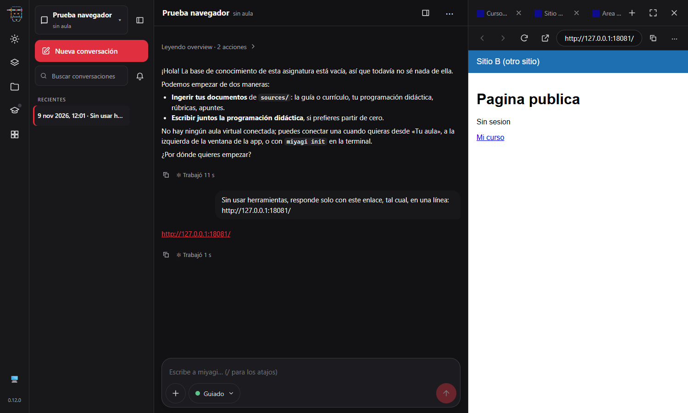

*Un enlace que devolvió miyagi en la conversación, abierto en una pestaña del panel.*

### Lo que no llega al modelo

- `sessions/` y toda la carpeta `~/.miyagi` de la prueba no contienen `CURSO-NOTA-353`, `18080/course` ni `Ana Ejemplo`. Solo aparece `127.0.0.1:18081` en la conversación porque el propio mensaje de la prueba la escribió.
- `check-host` comprueba que el estado del chat (`state`) no lleva ninguna dirección del navegador; las pestañas viajan en su propio evento `browser`.

## Aprobaciones

No hubo ninguna: esta función no publica nada en Moodle ni pasa por el agente. No se publicó nada sin aprobación, porque no se publicó nada.

## Hallazgos

1. **Las cookies de sesión se perdían al reiniciar.** Sin fecha de caducidad, Chromium no las conserva, y la de Moodle es de ese tipo. Corregido: la sesión del navegador les pone una caducidad de 30 días al recibirlas (`desktop/browser.mjs`). Una primera versión, que las reescribía por API al salir, las dejaba guardadas pero no se enviaban al sitio en el puerto 18080 tras reiniciar; no se investigó más la causa, y fijar la caducidad en la respuesta lo resolvió.
2. **Una pestaña emergente quedaba con la dirección vacía.** La barra autoenfocaba el campo y dejaba de seguir la dirección. Corregido: la pestaña nace ya con su dirección, y la barra solo deja de seguirla mientras se escribe (`gui/src/components/Browser.tsx`).
3. **El divisor del panel se tomaba por algo que tapaba la vista.** Solapa unos píxeles el borde del hueco y dejaba la vista oculta para siempre. Corregido: el divisor no cuenta y la muestra empieza 8 px hacia dentro.
4. **La barra ocultaba «Abrir en el navegador del sistema» y «Copiar enlace» con el panel a su anchura normal.** El umbral para la fila reducida estaba justo en los 480 px del panel. Corregido a 439 px; desde entonces la ejecución guiada comprueba que ese botón llega al proceso principal (`gui/src/styles.css`).
5. **La captura de la ventana podía devolver un fotograma viejo.** Afectaba a la primera captura de una ejecución guiada. Corregido en el gancho de capturas de `desktop/main.mjs`. No afecta a usuarios.

## Añadido a skills y prompts

Nada: es una función de la app, no un cambio de comportamiento del agente. Sí queda la decisión en `.minispec/decisions/ADR-027-embedded-browser.md`.

## Qué no cubrió

- El trabajo dentro de Moodle real en la pestaña (editores, selector de archivos, cuestionarios): el inicio de sesión y la navegación sí se probaron, ver «Repetición contra el Moodle del sandbox».
- Dos sesiones iniciadas a la vez en dos sitios distintos.
- El aviso de salida al abandonar un formulario con cambios (`beforeunload`) y el diálogo de guardar una descarga: están programados, pero no se han ejercitado (son diálogos nativos que la ejecución guiada no puede cerrar).
- La app empaquetada: la prueba corrió desde `desktop/`, sin instalador.
