# Simulación 1: un profesor de FP rehace su aula de Despliegue de Aplicaciones Web

Primera de cinco simulaciones de docentes de distintos niveles del sistema educativo español, todas en Canarias. Aquí un profesor del CFGS de Desarrollo de Aplicaciones Web (módulo 0614, Despliegue de aplicaciones web, 2.º curso) trae el aula del curso pasado como copia `.mbz` y le pide a miyagi, desde la aplicación de escritorio, que la reutilice para 2026-27. miyagi tiene que:

- redactar la programación didáctica según la normativa canaria y publicarla en página y PDF;
- montar las siete unidades con apuntes, chuletas, prácticas comprobadas en Docker, repasos, H5P, un juego SCORM, un taller entre iguales, pruebas e insignias;
- organizar el calificador por resultados de aprendizaje (RA);
- auditar el aula y arreglar lo que encuentre.

El aula queda lista para que padawan haga de alumno en una prueba posterior.

| | |
| --- | --- |
| Fecha | 10 nov 2026, 19:07–22:24 UTC |
| Entorno | moodle-sandbox (Moodle 5, Docker), Windows 11 |
| Aula | curso 355 `daw-despliegue-2627`, restaurado de la copia del curso 354 (2025-26) |
| Alumnado | 6 alumnos ficticios (`daw.*`), uno en FP dual y otro con discapacidad visual |
| miyagi | aplicación de escritorio 0.15.1 más los commits 7b66c60, 1155b3c, 5b7d182 y ad71f73 (sin publicar) |
| Extensiones | moodle-teacher 0.6.1 (moodle-mcp 0.9.0), docker-lab 0.2.3, moodle-ui-kit 0.1.6, recomendadas e instaladas por miyagi durante la prueba |
| Modo | guiado; un guion hace de profesor, aprueba cada publicación y responde con la opción recomendada (solo en el sandbox) |
| Fuentes | la copia `.mbz` adjunta en el chat; la normativa (RD 405/2023, decreto canario del título, Decreto 81/2010) la buscó miyagi |

## Veredicto

**Superada con hallazgos.** El aula final tiene 7 unidades y 56 elementos:

- 7 libros y 7 PDF de apuntes;
- 5 chuletas en página y en PDF;
- 5 prácticas con rúbrica, todas comprobadas en un laboratorio Docker;
- 6 repasos, 5 H5P y 1 SCORM;
- 1 taller entre iguales y 5 pruebas;
- 6 insignias, asistencia y 2 foros.

La programación está publicada en página y en PDF, y el calificador va por RA. miyagi trabajó con fuentes reales y detectó varios errores al probar las prácticas:

- versiones retiradas: Promtail, Gitea 1.x y Tomcat 9;
- imágenes Docker inestables;
- una rúbrica que contradecía el enunciado;
- una caché de Apache que haría creer al alumno que su configuración falla.

Los fallos de fondo fueron otros:

- construyó cada unidad sin cuadrarla con la programación, y la auditoría final encontró pruebas por RA sin crear y una matriz de evaluación con instrumentos retirados;
- dos veces pidió abrir otra conversación por ser larga.

Se encontraron 19 problemas: 6 se corrigieron en miyagi, 1 en moodle-teacher y el resto quedan abiertos en otros repositorios o se dan por buenos.

## Qué se ejecutó

Una sola conversación en la aplicación de escritorio, la sesión `2026-11-10T19-16-44`: 187 min, 1228 llamadas a herramientas y 61 aprobaciones. Antes hubo tres sesiones cortas al crear la asignatura y vincular el aula (7 llamadas como mucho).

| Turno | Lo que pidió el profesor | Duración | Lo que hizo miyagi |
| --- | --- | --- | --- |
| t1 | Presentarse y decir qué extensiones le faltan | — | Consultó el catálogo y recomendó docker-lab y moodle-ui-kit, con el comando para instalarlas (tras el arreglo #102) |
| t1e | Instalar las dos extensiones | — | Las instaló con `/extensions install` y recargó las extensiones |
| t2 | Reutilizar la copia del curso pasado | — | Leyó la copia `.mbz`, la restauró oculta en el curso 355 y listó lo desfasado (fig. 2) |
| t3–t4 | Programación didáctica | — | La redactó con las fuentes del BOE y el BOC, marcó lo pendiente de decidir, el profesor decidió y la publicó en página y PDF (fig. 3) |
| t5–t6 | UT3 completa | — | Libro de 9 capítulos y PDF, chuleta, práctica con rúbrica comprobada en Docker, 21 preguntas de repaso, prueba de RA2 y RA3, H5P, SCORM, finalización, asistencia y 6 insignias |
| t7–t8 | Mostrar la UT3, calificador y foro; la UT1 y la UT2 como material de consulta | — | Calificador por RA, foro «Dudas del módulo», UT1 y UT2 rehechas y las prácticas viejas borradas |
| t9 | Mostrar la UT1 y la UT2 y seguir con la UT4 | 1,6 min | Mostró las dos unidades, montó solo el laboratorio de la UT4 y **pidió una conversación nueva** |
| t10 | Seguir con la UT5 | 15,5 min | Terminó y mostró la UT4; la UT5 no la empezó y volvió a pedir otra conversación |
| t11 | Seguir con la UT6 | 18,7 min | Montó la UT5 completa, oculta |
| t12 | UT7 con el taller entre iguales | — | Montó la UT7 completa, con el taller |
| t13 | `/miyagi:audit` | — | 19 hallazgos ordenados por gravedad (fig. 11) |
| t14 | Mostrar la UT5 y la UT7, montar la UT6 y apagar los laboratorios | 20,5 min | Todo hecho; la UT6 queda oculta |
| t15 | Arreglar lo crítico y lo alto de la auditoría | 20,0 min | 4 pruebas nuevas, nuevo calendario de entregas, foros, matriz de evaluación y programación (fig. 12) |

Los turnos de t1 a t8 se cronometraron antes de que el guion midiera la duración de cada turno.

## Lo que se esperaba y lo que pasó

### Reutilizar el aula del curso pasado

| Esperado | Resultado |
| --- | --- |
| No tocar el curso 354 del año pasado; usar la copia `.mbz` | Lo hizo con `read_backup` y `restore_course`, restaurando en el 355 oculto y sin usuarios |
| Detectar lo desfasado | Tomcat 9 sin soporte, Ubuntu 26.04, prácticas de una línea sin rúbrica, un test de 3 preguntas y un foro de avisos de 2025-26 (fig. 2) |
| Recomendar las extensiones útiles con su nombre | docker-lab y moodle-ui-kit, con lo que añaden, lo que necesitan y el comando (fig. 1). Antes del arreglo #102 las describía sin nombrarlas |

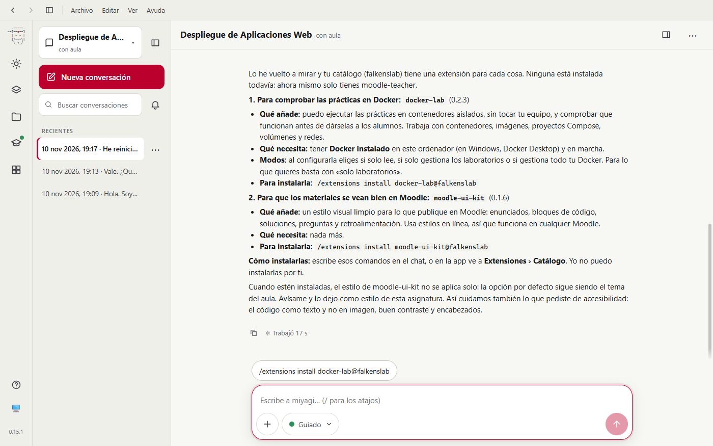
*Fig. 1. Para cada extensión dice qué añade, qué necesita y el comando exacto para instalarla, y lo ofrece como botón.*

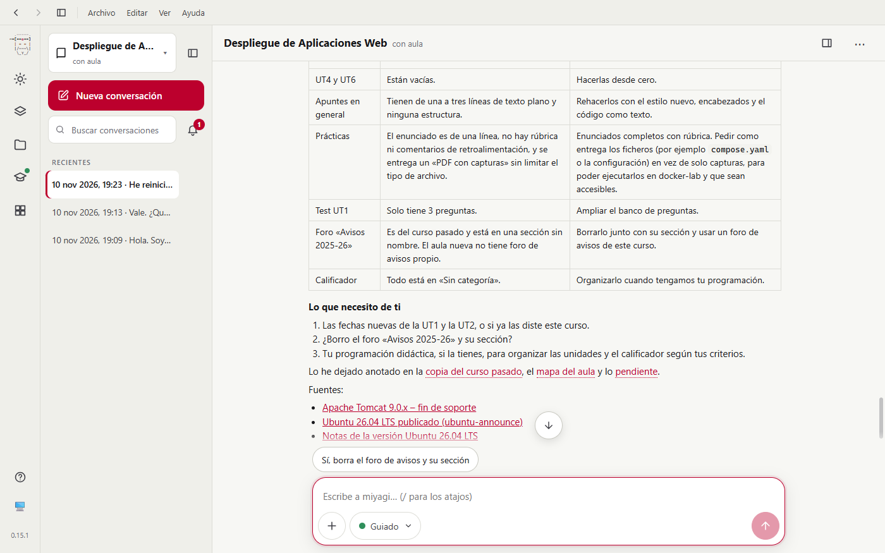
*Fig. 2. La tabla de lo que hay en la copia restaurada, por qué está mal y qué propone, y las tres decisiones que pide al profesor.*

### Programación didáctica

| Esperado | Resultado |
| --- | --- |
| Basada en la norma vigente, con cita | RD 405/2023 y anexo del BOC con la línea «0614 Despliegue de aplicaciones web 5 170 5», comprobados en los PDF descargados |
| Calendario real de Canarias | Descontó el Carnaval y los festivos: 112 h en el centro y 58 h en la empresa (fig. 3) |
| Criterios de calificación | Pesos 15/25/15/10/15/20, un 5 en cada RA y redondeo desde ,5, tal como decidió el profesor |
| Publicada en página y PDF | Página 1966 y PDF 1967, visibles |

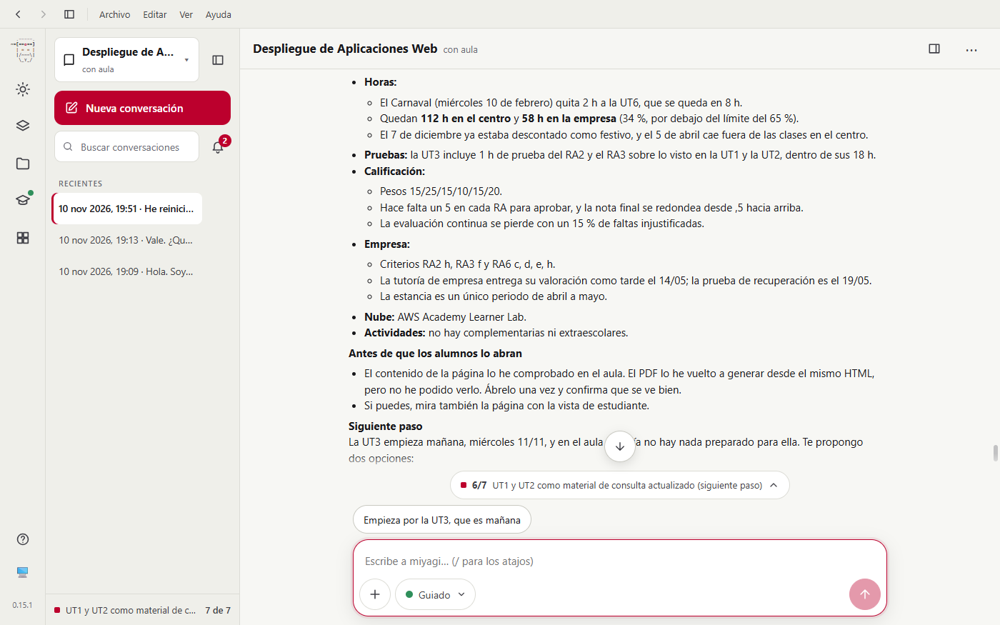
*Fig. 3. Horas, pruebas, calificación y empresa ya decididas; al final avisa de que no pudo ver el PDF (problema 4, ya corregido).*

### Unidades y materiales

| Esperado | Resultado |
| --- | --- |
| Cada unidad completa: apuntes, chuleta, práctica, repaso e interactivo | De la UT3 a la UT7, todas: libro y PDF, chuleta en página y PDF, H5P, repaso aleatorio (10 de 20), práctica con rúbrica y PDF; la UT7 añade proyecto inicial y taller |
| Prácticas comprobadas antes de publicarlas | 14 `lab_check` y 26 `lab_exec` en los laboratorios `ut4-ftp-sftp`, `ut5-dns-ldap`, `ut6-logs` y el de la UT7. Encontró imágenes inestables, una rúbrica incoherente y la caché de Apache. No pudo probar el runner de Gitea ni la interfaz de Grafana, y lo dijo |
| Versiones al día con fuentes | Loki 3.7.9, Alloy v1.21.3 (Promtail retirado), Grafana 13.2.6 y Gitea 28.3.0, con los enlaces a la documentación |
| Mismo estilo en todas las unidades | **No del todo**: la UT5 y la UT7 llevan resumen de sección con fechas y orden recomendado, y sus recursos no registran la finalización, al revés que de la UT1 a la UT4 (fig. 4) |
| Libros bien numerados | **No**: los capítulos salen «1. 1. Transferir archivos…» (fig. 5) |

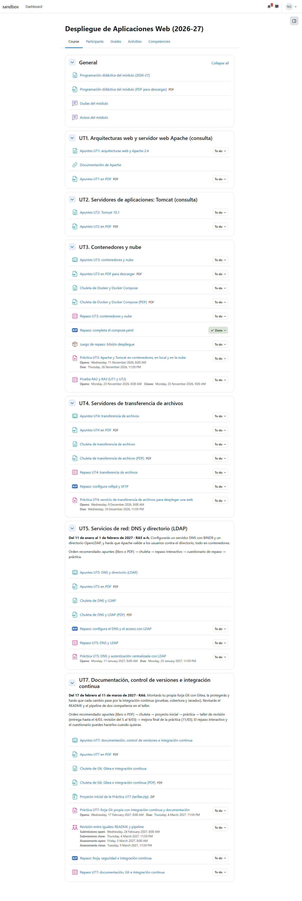
*Fig. 4. Vista de la alumna `daw.naira`. La UT6 está oculta hasta que el profesor la revise. La UT5 y la UT7 tienen resumen con fechas, pero sus apuntes no tienen el botón «To do».*

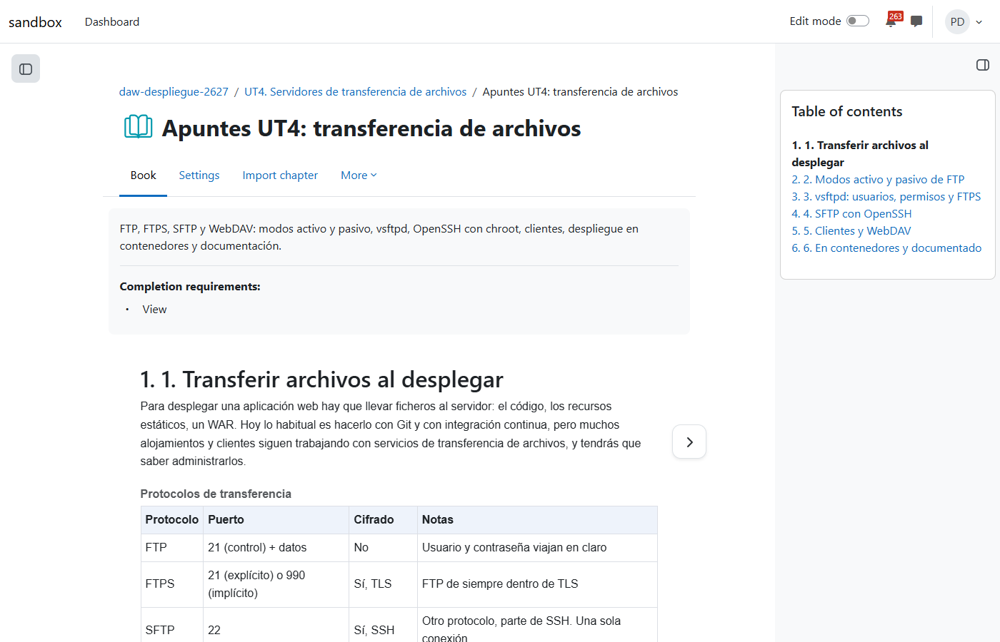
*Fig. 5. Tabla clara de protocolos y puertos; en el índice, el número de capítulo sale dos veces.*

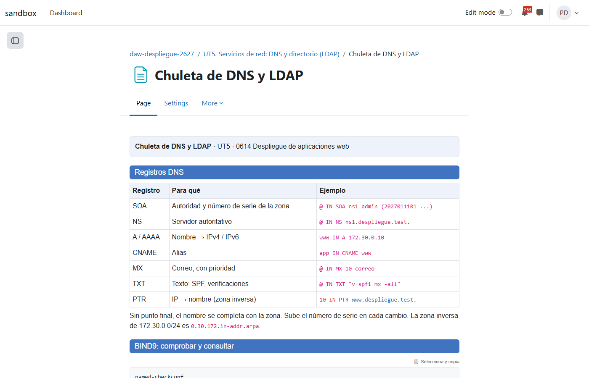
*Fig. 6. Chuleta con el estilo de moodle-ui-kit: un ejemplo por registro DNS y el código como texto copiable.*

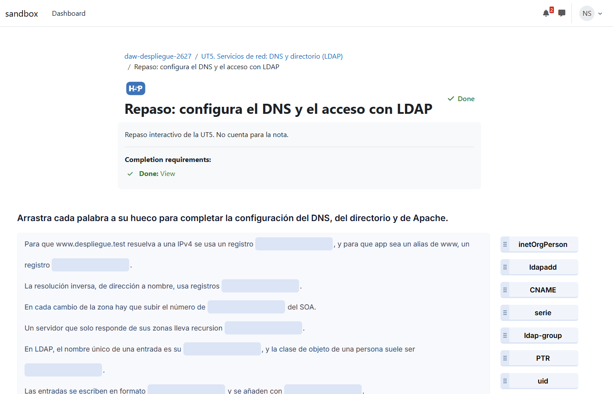
*Fig. 7. Arrastrar palabras sobre DNS y LDAP; se completa al verlo y no cuenta para la nota.*

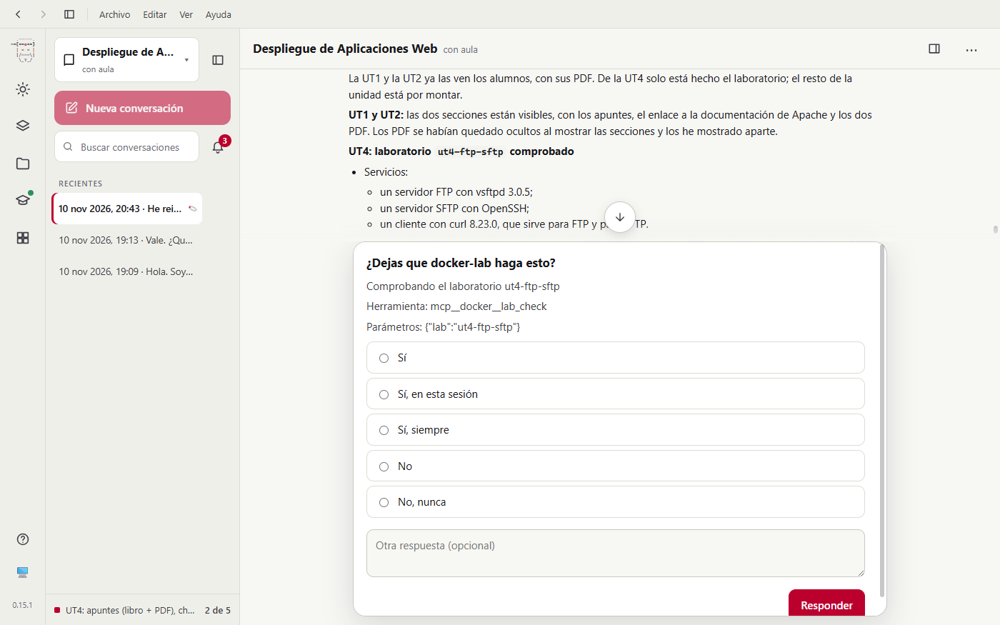
*Fig. 8. Comprobar un laboratorio arranca contenedores, así que docker-lab pregunta antes.*

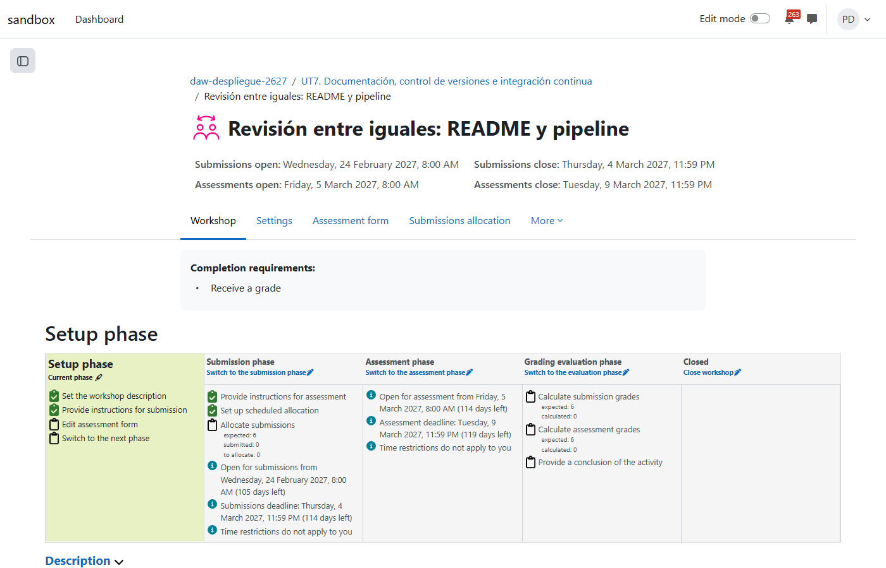
*Fig. 9. Fechas de envío y de revisión correctas; «Edit assessment form» sigue pendiente porque no hay herramienta para la rúbrica del taller (moodle-mcp#61).*

### Calificador

| Esperado | Resultado |
| --- | --- |
| Nota por RA con los pesos de la programación | Una categoría por RA con su peso, cada una con «Pruebas» al 40 % y «Prácticas» al 60 % como ítems manuales; los instrumentos van en una categoría con peso 0 (fig. 10) |
| Repasos, H5P y SCORM sin contar | Peso 0 |
| El 5 obligatorio en cada RA y el redondeo | Moodle no puede imponerlos; miyagi lo dijo y el profesor pasa la nota de cada RA a mano |
| Nota final sobre 10 | **Sobre 120** (6 RA × 20) con agregación natural: se puede revisar |

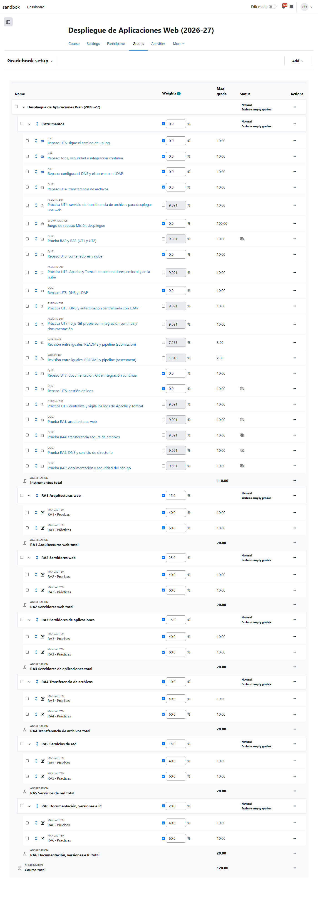
*Fig. 10. Instrumentos con peso 0 y seis categorías de RA con sus pesos; las pruebas nuevas siguen ocultas.*

### Auditoría y arreglos

| Esperado | Resultado |
| --- | --- |
| Encontrar lo que no cuadra, ordenado por gravedad | 19 hallazgos en crítico, alto, medio y bajo (fig. 11), con segunda opinión de `pedagogy-reviewer` |
| Acertar | Casi siempre. Dio por contradictoria la programación publicada cuando el error solo estaba en la copia de la base de conocimiento (lo descubrió en t15) |
| Arreglar lo crítico y lo alto | 4 pruebas por RA ocultas con fecha, nuevo calendario de entregas con 2 intentos, foro de avisos con «Número de avisos» del curso, foro de dudas visible y matriz de evaluación rehecha (fig. 12) |

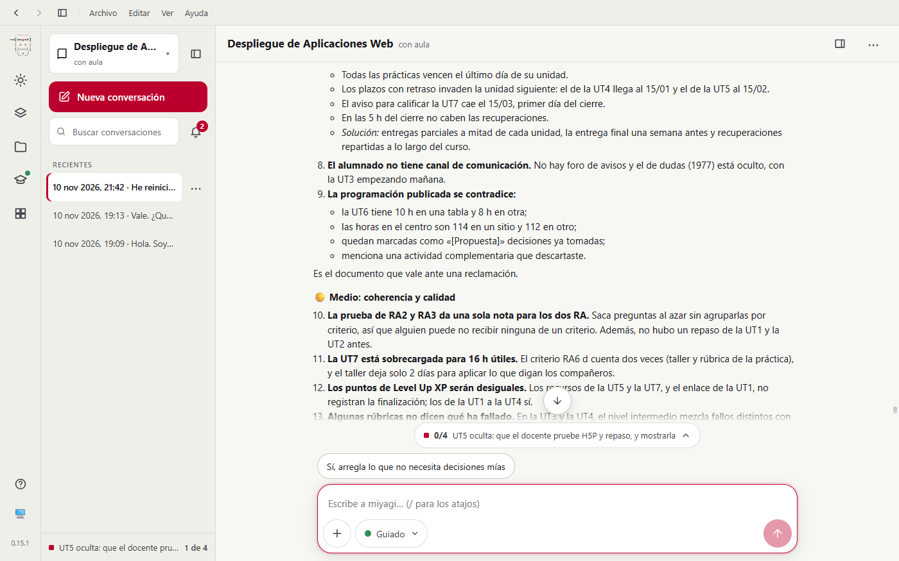
*Fig. 11. Los hallazgos por gravedad, cada uno con su solución, y la lista de tareas de miyagi abajo.*

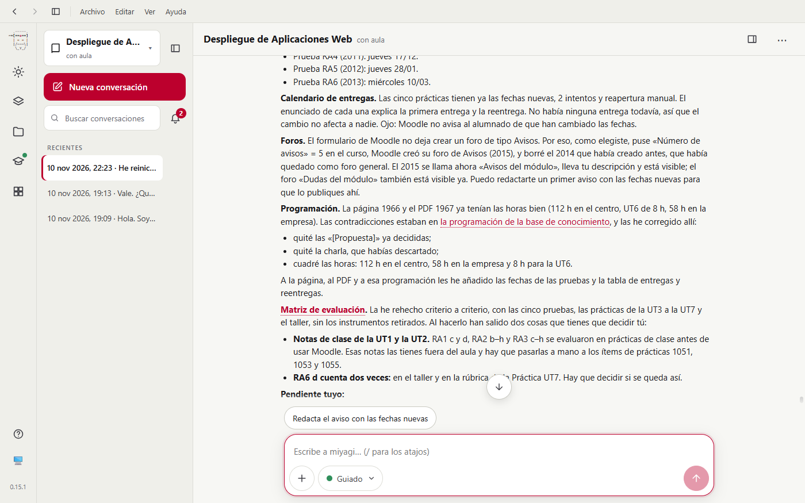
*Fig. 12. Lo arreglado y lo que queda para el profesor: notas de clase de la UT1 y la UT2, RA6 d evaluado dos veces, rúbrica del taller y runner.*

## Aprobaciones

Hubo 61 llamadas a `request_human_approval`, una por publicación o por lote con todos sus elementos listados. Además, la extensión pidió permiso en cada `lab_check` de docker-lab, en `set_rubric` y en los borrados, que moodle-mcp confirma por su cuenta (6 `delete_activity` y 1 `delete_section`). Algunas, en orden:

- Restaurar la copia en el curso 355, oculto y sin usuarios.
- Publicar la programación: página y PDF.
- Crear oculta la Práctica UT3 con su enunciado.
- Mostrar la sección UT4 y sus 7 elementos sin notificar al alumnado.
- Importar 20 preguntas en el banco del repaso de la UT5.
- Poner la rúbrica a la Práctica UT5 (1993). Después llegó el permiso de `set_rubric`: **dos preguntas para una misma acción**.
- Ajustar el calificador para la UT5.
- Borrar la página vieja «Apuntes UT3: BIND9» (1963): el aviso de moodle-mcp habla de entregas y calificaciones.

La lista completa está en el registro de la sesión; no se publicó nada en Moodle fuera de una aprobación.

## Problemas encontrados

| # | Qué | Estado | Dónde |
| --- | --- | --- | --- |
| 1 | No tenía `extensions_catalog` y describía extensiones sin nombrarlas | Corregido | miyagi#102, `src/agent.ts`, prompts (7b66c60) |
| 2 | No podía ver el PDF que acababa de generar | Corregido | miyagi#103, `src/pdfText.ts` y `src/drafts/server.ts` (1155b3c) |
| 3 | Pidió dos veces abrir otra conversación por ser larga y paró tras una sola pieza | Corregido | `prompts/system/teacher-chat*.md` y `check-prompts.mjs` (5b7d182) |
| 4 | Unidades sin cuadrar con la programación (pruebas por RA sin crear, matriz con instrumentos retirados) y con convenciones distintas entre unidades | Corregido | `plugin/skills/unit-building` (ad71f73) |
| 5 | La auditoría atribuyó a la página publicada errores que solo estaban en la copia de la base de conocimiento | Corregido | `plugin/skills/course-auditor` (ad71f73) |
| 6 | Capítulos de libro numerados dos veces | Corregido | agent-extensions e0cc88d, moodle-teacher 0.6.2, habilidad `course-content` |
| 7 | Sin herramienta para la rúbrica del taller | Abierto | moodle-mcp#61 |
| 8 | Aviso de `delete_activity` genérico y alarmante para una página | Abierto | moodle-mcp#62 |
| 9 | Sin herramienta para las sesiones de asistencia | Abierto | moodle-mcp#60 |
| 10 | El bloque de Level Up XP lo añade el profesor a mano (las herramientas de bloques son avanzadas) | Abierto, propuesta | una opción `advanced` en moodle-teacher |
| 11 | Doble pregunta en `set_rubric`: aprobación de miyagi más permiso de herramienta, por el `destructiveHint` del servidor | Abierto, por diseño | revisar con agent-kit si una aprobación de lote debería cubrirlo |
| 12 | El exportador pinta en verde la retroalimentación de las respuestas incorrectas | Abierto | miyagi guardó el estilo neutro como preferencia para los bancos nuevos |
| 13 | Nota final sobre 120 en vez de sobre 10 | Abierto | propuesta al profesor: rehacer el total o escalarlo |
| 14 | No pudo probar el runner de Gitea ni la interfaz de Grafana | Por diseño | docker-lab no permite Docker dentro de Docker ni tiene navegador; miyagi lo dijo |
| 15 | Moodle no impone el 5 en cada RA ni el redondeo | Por diseño | dicho al profesor |
| 16 | Insignias por RA concedidas a mano | Por diseño | razonable |
| 17 | La finalización del curso estaba desactivada | Bien resuelto | lo detectó y pidió activarla |
| 18 | El formulario no deja crear un foro de avisos | Bien resuelto | usó «Número de avisos» del curso |
| 19 | En la prueba, Git Bash reescribía la ruta `/extensions` | Del guion | `MSYS_NO_PATHCONV=1` |

## Cambios en habilidades y prompts

- `prompts/system/teacher-chat.md` y `teacher-chat-standalone.md`: no se deja una tarea a medias ni se manda al profesor a otra conversación por ser larga.
- `plugin/skills/unit-building`: antes de dar una unidad por hecha, se comprueba contra la programación (cada criterio tiene su instrumento, la matriz no nombra instrumentos retirados) y contra las unidades ya hechas (resumen de sección, finalización, nombres).
- `plugin/skills/course-auditor`: cada hallazgo dice de qué copia sale y se lee la publicada antes de darla por incoherente.
- moodle-teacher `course-content`: títulos de capítulo sin número.

## Lo que no cubrió

- El alumnado: nadie entregó, hizo un cuestionario ni preguntó en el foro. Queda para padawan sobre este mismo curso.
- Corregir, el taller en marcha y las insignias concedidas.
- La UT6 sigue oculta y las pruebas nuevas también, a la espera de que el profesor las revise.
- Los hallazgos medios y bajos de la auditoría (del 10 al 19).
- Las versiones web y de terminal de miyagi, que se prueban en las simulaciones 2 a 5.
