# Simulación 2: una profesora de ESO pone en orden su aula de Física y Química de 3.º

Segunda de las cinco simulaciones de docentes, todas en Canarias. Una profesora de Física y Química de 3.º de ESO en un IES de La Laguna lleva desde septiembre un aula de Moodle desordenada, preparada así a propósito. Tiene:

- secciones por trimestre y una página duplicada;
- una simulación PhET en Flash;
- un informe vencido sin rúbrica;
- un examen con una respuesta correcta mal marcada (da el gramo como unidad de masa del SI);
- formulación con la nomenclatura tradicional;
- dos dudas sin contestar en el foro.

Desde la **versión web** de miyagi le pide sincronizar el aula: revisarla sin tocar nada y redactar la programación con el currículo LOMLOE de Canarias, organizada en situaciones de aprendizaje. Después, reordenar el aula sin perder trabajo del alumnado, contestar el foro, montar la situación de aprendizaje de reacciones químicas con todo tipo de materiales, auditar el aula y arreglar lo que salga. La profesora nombra en el chat a dos alumnos con necesidades distintas; la prueba comprueba también que sus nombres no acaban en la base de conocimiento.

| | |
| --- | --- |
| Fecha | 10-11 nov 2026, 22:37–00:16 UTC |
| Entorno | moodle-sandbox (Moodle 5, Docker), Windows 11 |
| Interfaz | `miyagi web` en Chrome, con una carpeta de usuario propia para la prueba |
| Aula | curso 356 «FyQ 3ºB», sembrado con su desorden (script de la prueba) |
| Alumnado | 5 alumnos ficticios (`eso.*`): alto rendimiento, medio, desmotivada, NEAE con TDAH y una recién llegada de Venezuela |
| miyagi | 0.15.1 más los commits hasta a7c156e (sin publicar); el arreglo a7c156e entró a mitad de prueba |
| Extensiones | moodle-teacher 0.6.2 (moodle-mcp 0.9.0), instalada sola al vincular el aula |
| Modo | guiado; un guion hace de profesora, aprueba cada publicación y elige la opción recomendada (solo en el sandbox) |
| Fuentes | ninguna de la profesora; miyagi descargó el currículo de la Consejería y la memoria de Metrotenerife para la SA6 |

## Veredicto

**Superada con hallazgos.** Al final, el aula tiene:

- la programación publicada como libro de 9 apartados y en PDF;
- siete secciones, una por situación de aprendizaje (SA), cada una con su reto, sus fechas y la lista de tareas;
- la SA3 «Viaje al interior del átomo» (la que está en curso) y la SA5 «Reacciones que cambian Canarias» completas y visibles;
- las dos dudas del foro contestadas;
- una bienvenida que explica cómo funciona el aula y un aviso en el Tablón.

En la SA5 hay:

- un libro de 9 capítulos y su PDF;
- cinco PDF imprimibles: chuleta de formulación, fichas estándar y con apoyos, normas, diario e informe de laboratorio, y recuperación y ampliación;
- tres cuestionarios: diagnóstico, práctica y prueba con preguntas calculadas;
- un taller entre iguales sobre el borrador, el informe final con rúbrica y un escape room en SCORM.

**Lo bueno:**
- **Datos del alumnado:** no guardó ni un nombre. Las adaptaciones son variantes que asigna la profesora («con apoyos», «más tiempo») y `check-knowledge --names` da 0 páginas con nombres.
- **Revisor pedagógico:** corrigió un montaje de laboratorio físicamente mal planteado.
- **Revisión de la auditoría:** vio lo urgente, que la SA en curso estaba vacía mientras la de febrero ya estaba completa.

**Lo malo:**
- **Clave mal del examen:** se le escapó tres veces (revisión, «arregla el examen» y auditoría) hasta el arreglo a7c156e, y en una conversación nueva ya la encontró.
- **Calificador:** todo lo nuevo pesa 0, así que la nota sigue siendo la suma de tres actividades antiguas.
- **Errata publicada:** una palabra en inglés en la introducción del escape room.
- **SA6:** quedó solo en plan, esperando respuestas de la profesora.

## Qué se ejecutó

Una conversación (`2026-11-10T22-37-53`): 95,8 min, 478 llamadas y 16 aprobaciones. Después, una conversación nueva (`2026-11-11T00-14-44`): 1,0 min y 17 llamadas, para comprobar el arreglo de la clave.

| Turno | Lo que pidió la profesora | Duración | Lo que hizo miyagi |
| --- | --- | --- | --- |
| t1 | Revisar el aula sin cambiar nada | 2,4 min | Lista por gravedad: examen repetible con la solución visible, tareas sin comentarios, informe vencido sin entregas, foro, nomenclatura, PhET en Flash (con la URL nueva comprobada), duplicado. **No vio la clave del gramo** (fig. 1) |
| t2 | Programación LOMLOE de Canarias por SA, publicada como libro y PDF | — | 7 SA de septiembre a junio, con lo ya dado, criterios y atención a la diversidad; libro y PDF subidos ocultos (fig. 2) |
| t3 | Ordenar por SA sin perder nada y arreglar | — | Secciones renombradas con reto y fechas, sin borrar nada; examen a 1 intento con la solución al cerrar; PhET en HTML5; formulación según la IUPAC; el duplicado movido a «Borrador». **La clave seguía sin verla** (fig. 3) |
| t4 | Contestar el foro | 1,9 min | Preguntó qué nomenclatura acepta en el examen (fig. 6) y contestó una vez por hilo (fig. 7) |
| t5 | SA5 completa, adaptada a dos alumnos | 16,2 min | Plan revisado por `pedagogy-reviewer` y todo construido en `drafts/` y `materials/` antes de subir; variantes sin nombres |
| t6 | Mostrar la SA5 y montar la SA6 | 13,9 min | SA5 subida oculta en tres tandas, comprobada y mostrada; de la SA6 solo hizo el plan, con 4 preguntas a la profesora |
| t7 | `/miyagi:audit` | 1,4 min | Lo grave: la SA3 en curso, vacía; el alumnado no entra; no hay evidencias de la SA1 ni la SA2 (fig. 11). La clave seguía sin aparecer |
| t8 | Arreglar lo crítico y lo alto | 8,9 min | SA3 completa y visible, bienvenida, programación visible, aviso a la clase y el informe de densidad reabierto con rúbrica |
| t9 | En una conversación nueva: revisar el examen pregunta a pregunta | 1,0 min | Exportó el banco y **encontró la clave mal** (fig. 12) |

Los turnos sin duración se cronometraron antes de que el guion midiera cada uno.

## Lo que se esperaba y lo que pasó

### Sincronizar el aula

| Esperado | Resultado |
| --- | --- |
| Revisar sin tocar nada | Sí: solo lecturas, y apuntó la estructura en `course/course-map` y la revisión en el historial |
| Encontrar el desorden sembrado | 7 de 8. Le faltó la clave del examen: leyó los ajustes y la estructura (`get_quiz_structure`, sin respuestas), no el banco |
| Reordenar sin perder trabajo | Movió y renombró las secciones, y nada de lo que tenía entregas, intentos o mensajes se borró. El duplicado no lo borró «porque no lo creé yo»: lo dejó en «Borrador», oculto |
| Corregir la formulación | Página reescrita con sustancias simples, iones y binarios según la IUPAC, que es lo que pide el currículo de 3.º, y explica que «férrico» es nombre tradicional (fig. 5) |

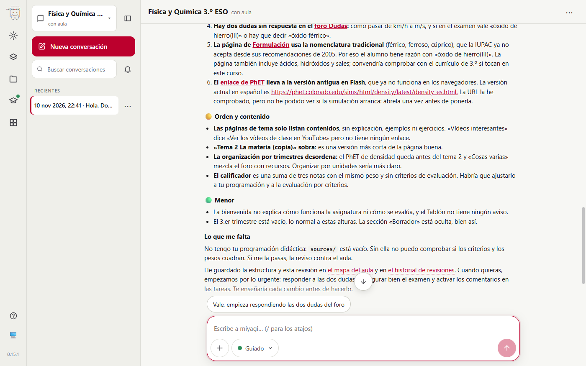
*Fig. 1. Revisión sin tocar el aula, por gravedad, y lo que le falta (la programación de la profesora).*

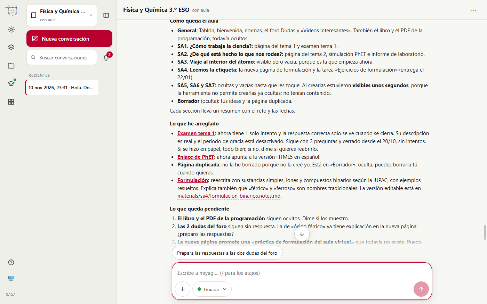
*Fig. 3. Cómo queda el aula y lo arreglado. «Sigue con 3 preguntas»: el examen se arregló sin ver su clave mal.*

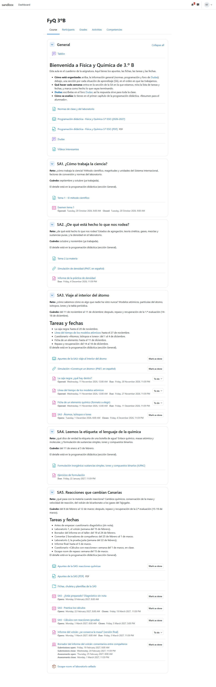
*Fig. 4. Vista del alumno `eso.ruben` al final: bienvenida nueva, las SA con su reto y sus fechas, y la SA3 y la SA5 con lista de tareas y finalización.*

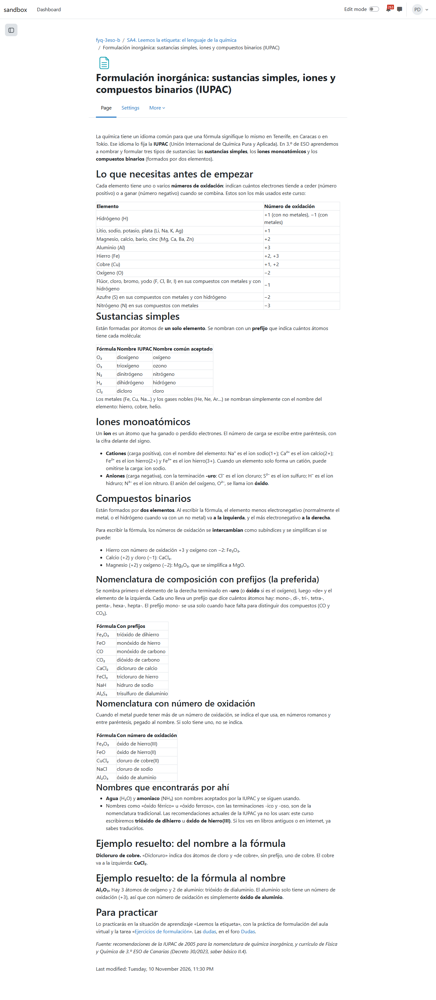
*Fig. 5. La página de formulación rehecha.*

### Programación didáctica

| Esperado | Resultado |
| --- | --- |
| Currículo LOMLOE de Canarias, con fuente | Descargó el currículo de la Consejería (`sources/curriculo/`) y cita las competencias específicas y los criterios |
| Organizada en SA con fechas hasta junio | SA1 y SA2 ya trabajadas; SA3 hasta Navidad; SA4 y SA5 hasta Semana Santa; SA6 y SA7 hasta junio. Contextos canarios: el Tajogaite, la guagua y el tranvía, la energía |
| Tener en cuenta a los dos alumnos | Atención a la diversidad sin nombres: medidas por necesidad, no por persona |
| Publicada como libro y en PDF | Libro 2030 y PDF 2031. Quedaron ocultos hasta t8, porque miyagi pidió el sí para mostrarlos |

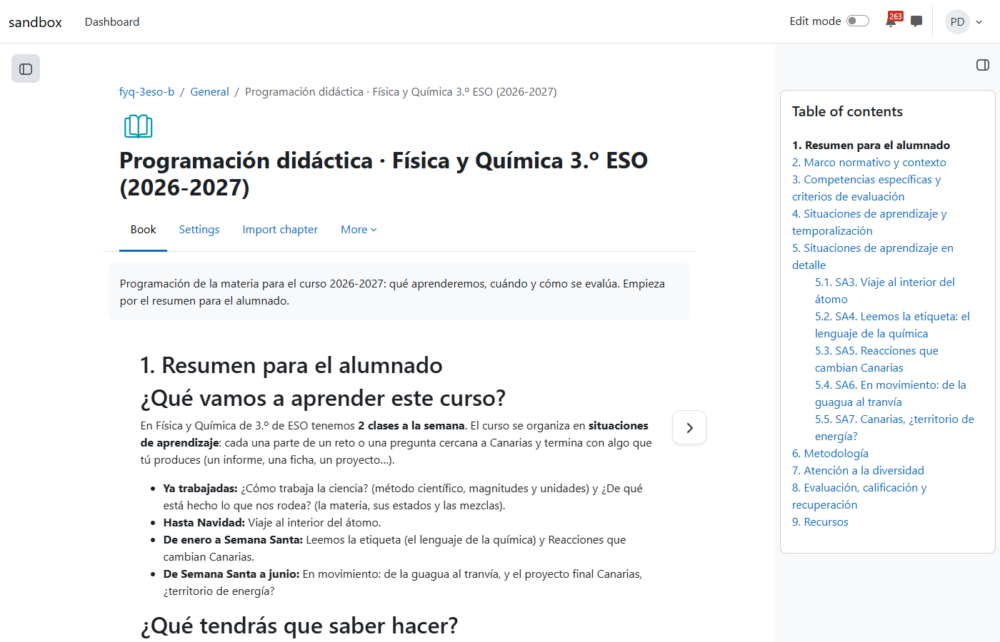
*Fig. 2. El libro empieza por un resumen para el alumnado; el índice sigue el modelo de programación (normativa, competencias, SA, metodología, diversidad, evaluación, recursos).*

### Foro

| Esperado | Resultado |
| --- | --- |
| Duda de km/h a m/s | Explica el factor de conversión con otro ejemplo (90 km/h son 25 m/s) y le pide al alumno que lo intente con 72 km/h |
| Duda de nomenclatura | Antes preguntó a la profesora qué acepta en el examen (fig. 6); respondió que valen los nombres IUPAC y ofreció un aviso al grupo |
| Una respuesta por hilo, aprobada | Sí, las dos en una aprobación que mostraba el texto completo (fig. 7) |

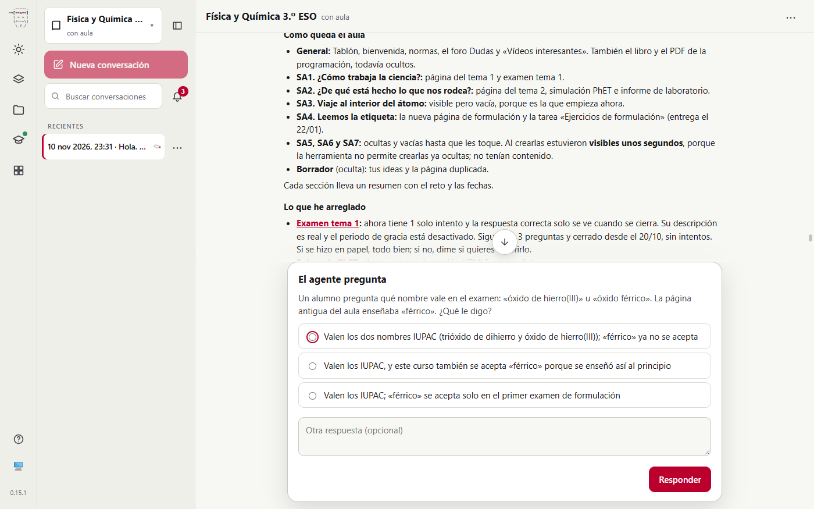
*Fig. 6. Antes de contestar a la alumna, pregunta qué vale en el examen: es una decisión de la profesora.*

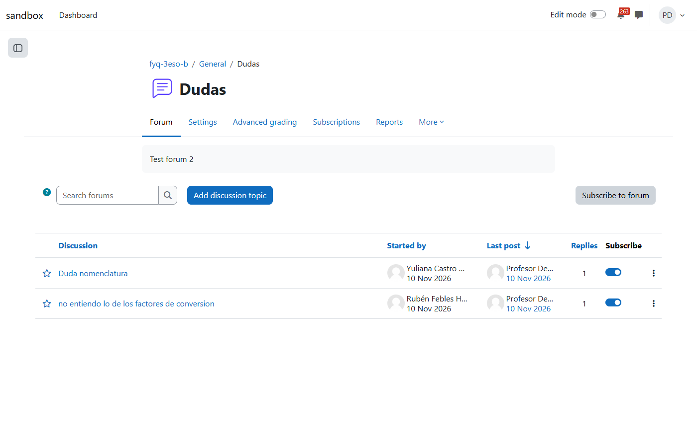
*Fig. 7. Cada duda con una respuesta. La descripción «Test forum 2» de la semilla sigue ahí, y ni la auditoría la vio.*

### Situación de aprendizaje de reacciones químicas (SA5)

| Esperado | Resultado |
| --- | --- |
| Apuntes en libro y PDF | 9 capítulos con «Lo importante» y preguntas de comprobación; arranca con el Tajogaite (fig. 8) |
| Chuleta de formulación y fichas imprimibles | 5 PDF en una carpeta, con versión estándar y con apoyos de los mismos ejercicios (fig. 9) |
| Cuestionario con datos distintos para cada alumno | 4 preguntas calculadas, 2 de ajuste al azar y 1 de razonamiento. Las preguntas calculadas están duplicadas en dos bancos porque en Moodle 5 cada cuestionario tiene el suyo. Pidió a la profesora comprobar la coma decimal |
| Diario de laboratorio | Una ficha en PDF, no la actividad Diario (`mod_journal` está instalado): razonable, pero no lo explicó |
| Evaluación entre iguales del informe | El taller valora el *borrador* (idea de `pedagogy-reviewer`) y el informe final va en una tarea con rúbrica |
| Escape room | SCORM con 5 pruebas, versión en papel aparte (con las soluciones, sin subir) y registro de dónde se atasca cada equipo. Su introducción dice «resolved» (fig. 10) |
| Adaptar sin señalar a nadie | Variantes «con apoyos», «más tiempo» y «en dos partes»; la profesora las asigna con excepciones de usuario |
| Que cuente para la nota | **No**: todo con peso 0, a la espera de un calificador por criterios que nadie montó |

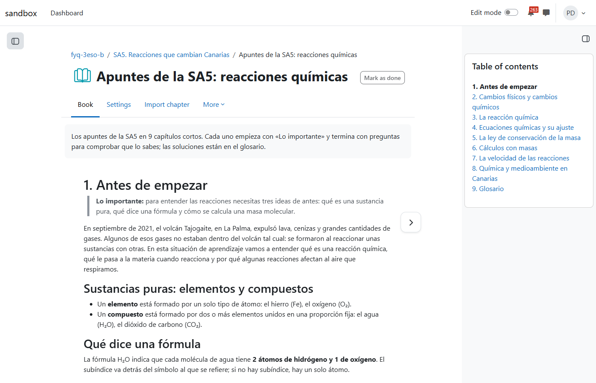
*Fig. 8. Apuntes de la SA5, con subíndices reales en las fórmulas.*

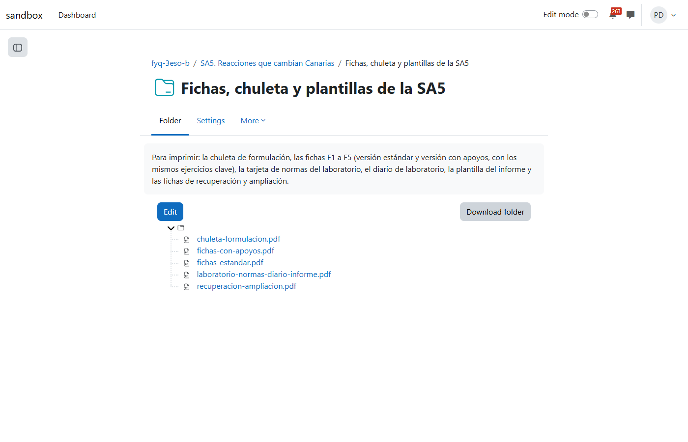
*Fig. 9. Las fichas para imprimir en una carpeta.*

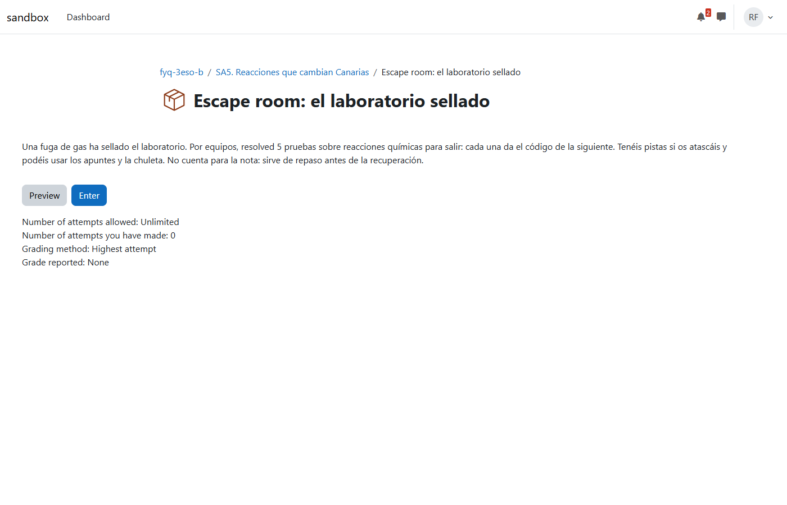
*Fig. 10. Escape room como lo ve el alumno: «resolved 5 pruebas» es una errata en inglés.*

### Auditoría y arreglos

| Esperado | Resultado |
| --- | --- |
| Ordenar por gravedad lo que importa ahora | Sí: la SA en curso vacía (con criterios de la 1.ª evaluación) frente a la SA5 de febrero ya completa; 4 de 5 alumnos sin entrar desde el 1/10; la SA1 y la SA2 sin evidencias (fig. 11) |
| Ver la clave mal | No (misma conversación, con las habilidades cargadas antes del arreglo) |
| Arreglar lo alto | SA3 construida, comprobada oculta y mostrada; bienvenida; aviso por correo al grupo; informe de densidad reabierto con rúbrica y comentarios |
| Calificador por criterios | Marcado como medio y sin hacer. Pasa a regla (ver los problemas encontrados) |

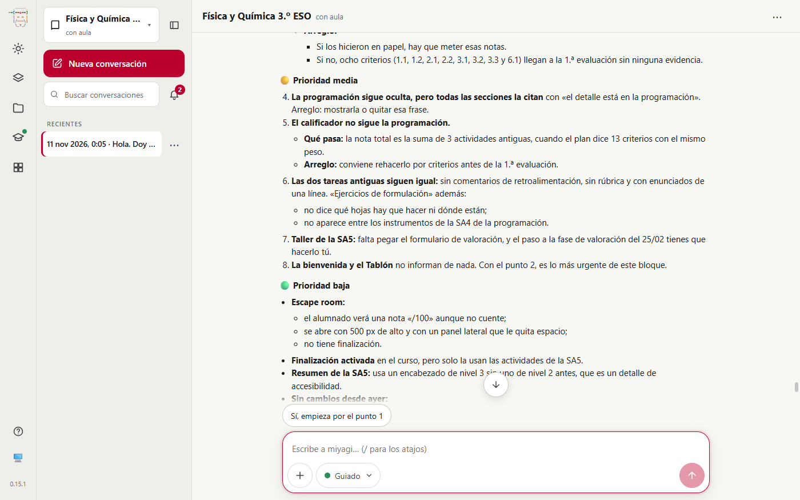
*Fig. 11. Auditoría en la misma conversación: separa lo nuevo de lo pendiente desde ayer.*

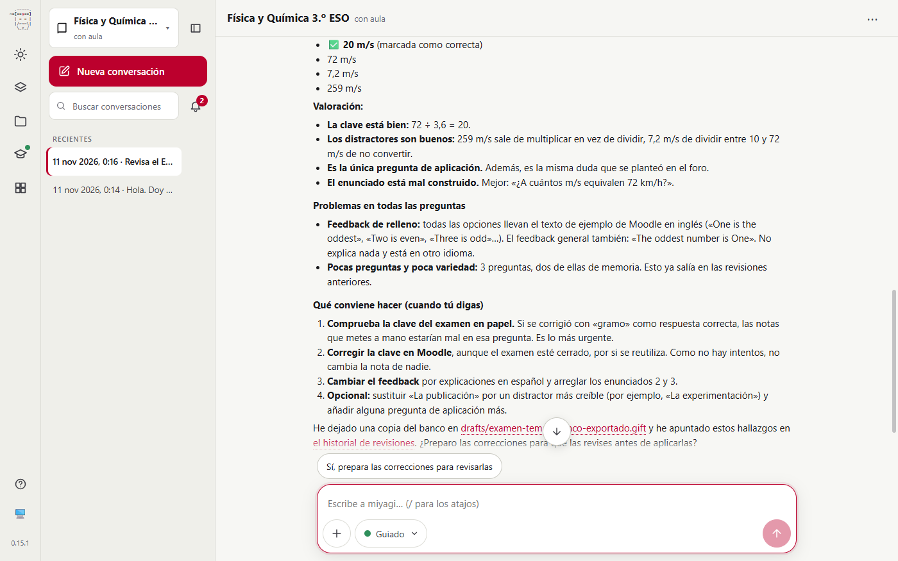
*Fig. 12. En una conversación nueva, con el arreglo a7c156e: «La clave de la pregunta 2 está mal», con la correcta y cuántos se verían afectados.*

## Aprobaciones

16 llamadas a `request_human_approval`; cada lote nombra sus elementos:

1. Crear oculto el libro de la programación con sus capítulos.
2. Subir oculto el PDF de la programación.
3. Reorganizar por SA: renombrar secciones, poner los resúmenes y mover elementos, sin borrar nada.
4. Ajustes del Examen tema 1 (sin intentos; no cambia preguntas ni fechas).
5. Arreglar el enlace de PhET.
6. Sustituir el contenido de la página de formulación.
7. Publicar 2 respuestas en el foro, con su texto.
8. Cerrar el plan de la SA5 y pasar a construirla.
9. SA5, tanda 1 de 3: activar la finalización en el curso y subir oculto el libro, el PDF y la carpeta.
10. SA5, tanda 2 de 3: tres cuestionarios ocultos con sus preguntas, con peso 0.
11. SA5, tanda 3 de 3: taller, tarea con rúbrica y escape room, ocultos.
12. Prueba en oculto terminada: mostrar la SA5.
13. Cambios en lo visible: mostrar la programación y sustituir la bienvenida.
14. Cerrar el plan de la SA3.
15. Subir oculta la SA3.
16. Mostrar la SA3 y avisar a la clase.

No se publicó nada fuera de una aprobación. El aviso del Tablón llegó por correo a todo el grupo y la aprobación 16 lo decía.

## Problemas encontrados

| # | Qué | Estado | Dónde |
| --- | --- | --- | --- |
| 1 | No revisaba la respuesta correcta de las preguntas: leía la estructura del cuestionario, que las da sin respuestas | Corregido y comprobado (t9) | `plugin/skills/course-auditor` y `quiz-design` (a7c156e) |
| 2 | Lo nuevo y calificable quedó con peso 0 porque el calificador no sigue la evaluación por criterios | Corregido | `plugin/skills/unit-building`: montar antes el calificador (cc32d37) |
| 3 | Texto publicado con una palabra en inglés («resolved») | Corregido | `plugin/skills/publish-check`: repasar idioma y erratas (cc32d37) |
| 4 | Una sección nueva no se puede crear oculta, así que la SA5, la SA6 y la SA7 se vieron unos segundos | Abierto | moodle-mcp#63 |
| 5 | La SA6 se quedó en plan: hizo cuatro preguntas en el texto y el guion no responde a eso | De la prueba | se retomará con padawan o a mano |
| 6 | La descripción «Test forum 2» no la vio nadie | Abierto, menor | — |
| 7 | El diario de laboratorio en PDF, sin explicar por qué no la actividad Diario | Abierto, menor | — |
| 8 | Las notas del examen en papel las pasa la profesora porque miyagi solo ve alias | Por diseño | lo explicó paso a paso |
| 9 | El duplicado no se borró, se movió a «Borrador» | Por diseño | prudente |

## Cambios en habilidades y prompts

- `course-auditor`: un apartado «Answer keys» (leer el banco con las respuestas; una clave mal es crítica).
- `quiz-design`: al cambiar un cuestionario existente se revisan las claves; una clave mal se corrige aunque haya intentos, con el sí del docente y recalificando.
- `publish-check`: releer los textos, los cortos sobre todo, buscando palabras en otro idioma y erratas.
- `unit-building`: si la programación califica de otra forma que el calificador, proponer montar el calificador antes de cerrar la evaluación.

## Lo que no cubrió

- La SA6, la SA7 y la SA4 completa, además de las fichas en papel de la SA3.
- El alumnado: entregas, intentos, el taller en marcha y el escape room jugado. Queda para padawan sobre el curso 356.
- Corregir con las rúbricas y el calificador por criterios.
- Las preguntas calculadas con coma decimal y el SCORM jugado: miyagi pidió a la profesora que los probara.
