# Simulación 3: una tutora de Primaria estrena el aula virtual con Matemáticas de 4.º

Tercera de las cinco simulaciones de docentes, todas en Canarias. Una tutora de 4.º A de un CEIP de Santa Cruz de Tenerife estrena el aula virtual. Empieza **de cero**, con un curso de Moodle vacío y seis alumnos de 9 años; uno de ellos con discalculia. Usa la **aplicación de escritorio**, en modo guiado y con miyagi en tono cercano. Le pide:

- algo bonito y fácil para niños, con juegos y puntos;
- la programación con el currículo de Canarias, en PDF y en una versión para las familias;
- el aula preparada con mosaico, puntos, niveles y una lista de tareas;
- la situación de aprendizaje de la multiplicación completa (explicaciones con imágenes, juegos, fichas imprimibles, un tablero y un reto), adaptada a la alumna con discalculia, y la siguiente;
- una auditoría y los arreglos.

| | |
| --- | --- |
| Fecha | 11 nov 2026, 00:22–01:31 UTC |
| Entorno | moodle-sandbox (Moodle 5, Docker, solo en inglés), Windows 11 |
| Interfaz | aplicación de escritorio (Electron), con una carpeta de usuario propia para la prueba; tono «cercano» |
| Aula | curso 357 «Matemáticas 4.º A», vacío |
| Alumnado | 6 alumnos ficticios (`prim.*`): uno adelantado, dos de nivel medio, uno inseguro con los enunciados, uno movido y una NEAE con discalculia |
| miyagi | 0.15.1 más los commits hasta f03ae17 (sin publicar); f03ae17 entró tras el primer turno |
| Extensiones | moodle-teacher 0.6.2; h5p y moodle-ui-kit, recomendadas por miyagi e instaladas por la tutora |
| Modo | guiado; un guion hace de tutora, aprueba cada publicación y elige la opción recomendada (solo en el sandbox) |
| Fuentes | ninguna de la tutora; miyagi descargó el Decreto 211/2022, la Orden de evaluación de 2023, las rúbricas oficiales y el calendario escolar 2026-27 |

## Veredicto

**Superada con hallazgos.** El aula de los «Exploradores del espacio» queda así:

- **Portada:** un mosaico de 10 planetas, uno por situación de aprendizaje.
- **Programación:** un PDF de 6 páginas con los 14 criterios del 2.º ciclo citados del BOC, y una guía de una página para las familias.
- **Planeta 2, «La fábrica de multiplicar», visible:**
  - libro de 5 capítulos con dibujos propios y su descripción alternativa;
  - 12 H5P que explican cada error típico al fallar;
  - fichas A, B y C en PDF, con ruta de apoyo, y una tabla de consulta;
  - un tablero para los problemas que inventan;
  - un reto en dos rutas, Asteroide y Cometa (con apoyos);
  - un diario de autoevaluación;
  - una lista de misiones que se marca sola;
  - 5 insignias de nivel.
- **Planeta 3, «Mercadillo galáctico»:** montado y oculto.

**Lo bueno:**
- **Currículo:** detectó que «hasta 100.000» se sale del 2.º ciclo, que llega hasta 9999, y lo dejó como ampliación no exigible.
- **Diversidad:** adaptó la unidad a la discalculia sin señalar a nadie y no guardó ningún nombre.
- **Auditoría:** revisó la respuesta correcta de los 16 H5P (el arreglo de la simulación 2 en marcha) y vio que el sitio solo está en inglés.
- **Familias:** ocultó a los niños y a las familias la «nota» que Moodle calculaba con los H5P.

**Lo malo:**
- **Extensiones:** dijo que no había extensiones de juegos ni de estilo, por cómo busca el catálogo.
- **Level Up XP:** dijo que no estaba instalado y que había que pedírselo al administrador, cuando sí lo está.
- **Libros:** los capítulos volvieron a salir como «1. 1. …», ahora desde el código de los materiales.
- **Tableros:** los dos tienen las columnas «Heading».

## Qué se ejecutó

Una conversación (`2026-11-11T00-26-23`): 63,9 min, 482 llamadas y 16 aprobaciones. Antes hubo dos sesiones cortas al crear la asignatura. La app se reinició tras t1 para cargar el arreglo f03ae17, y la conversación siguió en la misma sesión.

| Turno | Lo que pidió la tutora | Duración | Lo que hizo miyagi |
| --- | --- | --- | --- |
| t1 | «Algo bonito, con juegos y puntos: ¿qué me recomiendas?» | — | Propuesta clara (una aventura, misiones, insignias), pero «no hay ninguna extensión de estilos ni de juegos»: buscó en el catálogo con 6 palabras a la vez (fig. 1) |
| t2 | Canarias, sin programación propia; la multiplicación en 4 semanas; el aula no califica; tablets. «¿De verdad no hay ninguna extensión?» | — | Recomendó h5p y moodle-ui-kit con su comando, descargó el decreto y resumió lo que pide para la multiplicación (fig. 2) |
| t3 | `/extensions install` de las dos y `/extensions reload` | — | Instaladas |
| t4 | Programación por SA, en PDF, y una versión para las familias | 19,0 min | Programación de 6 páginas y guía de 1, subidas ocultas; 4 decisiones pendientes para la tutora (fig. 3, fig. 4) |
| t5 | Aula visual con mosaico, puntos, niveles y lista de tareas | 6,1 min | Portada en mosaico, 10 secciones, lista de misiones e insignias de nivel. «Tu Moodle no tiene un bloque de puntos» (fig. 5) |
| t6 | SA de la multiplicación completa, adaptada | 15,5 min | Todo montado oculto, revisado por `pedagogy-reviewer` |
| t7 | Mostrarla y montar la siguiente | 11,9 min | Planeta 2 comprobado y mostrado, con sus insignias activadas; Planeta 3 montado oculto |
| t8 | `/miyagi:audit` | 1,5 min | Por prioridad: Moodle en inglés, una nota visible que no existe y familias sin información (fig. 11) |
| t9 | Arreglar lo crítico y lo alto | 2,0 min | Calificador oculto al alumnado; programación y guía visibles tras preguntar; pasos para que el administrador instale el español |

Los turnos sin duración se cronometraron antes de que el guion midiera cada uno.

## Lo que se esperaba y lo que pasó

### Extensiones y currículo

| Esperado | Resultado |
| --- | --- |
| Recomendar las extensiones que ayudan, con su nombre | En t1 dijo que no había (fig. 1): `extensions_catalog` solo devuelve las extensiones que contienen todas las palabras de la búsqueda. Corregido en los prompts y comprobado en t2 (fig. 2) |
| El currículo oficial, citado | Decreto 211/2022 y Orden de 31 de mayo de 2023, por artículos; criterios por ciclo; orden de las tablas fijado por el decreto (fig. 4) |
| Detectar lo que no cuadra con la tutora | «Números hasta 100.000» excede el 2.º ciclo (9999) y lo pone como ampliación; propone el cuaderno como portafolio porque la Orden pide instrumentos variados |

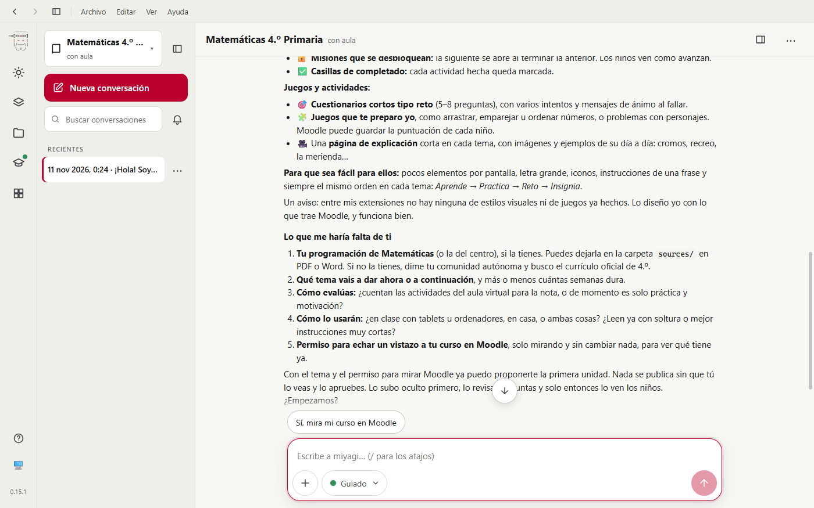
*Fig. 1. Propuesta cercana y razonable, pero «entre mis extensiones no hay ninguna de estilos visuales ni de juegos».*

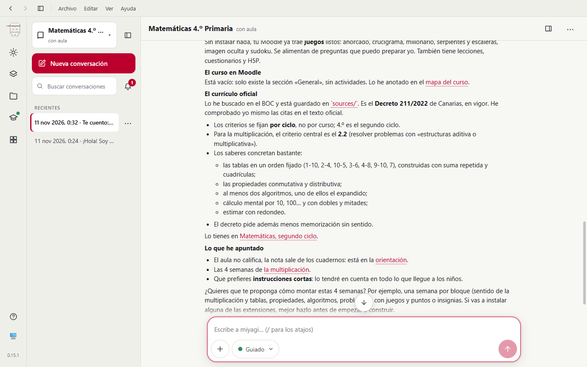
*Fig. 2. Tras el arreglo f03ae17: h5p y moodle-ui-kit con su comando, los juegos que ya trae Moodle y lo que dice el decreto de la multiplicación.*

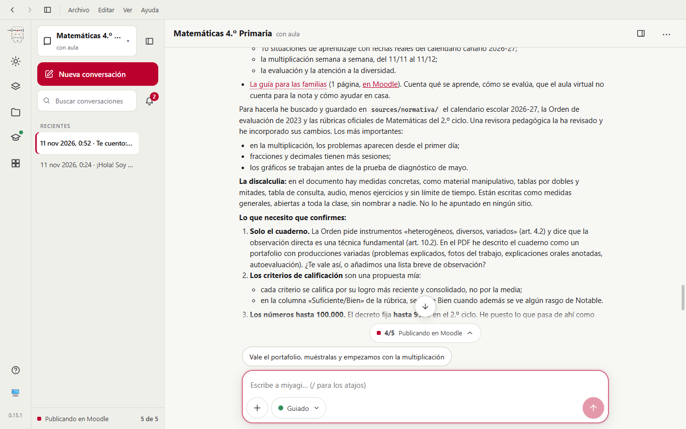
*Fig. 3. Lo que contiene la programación y lo que la tutora tiene que confirmar.*

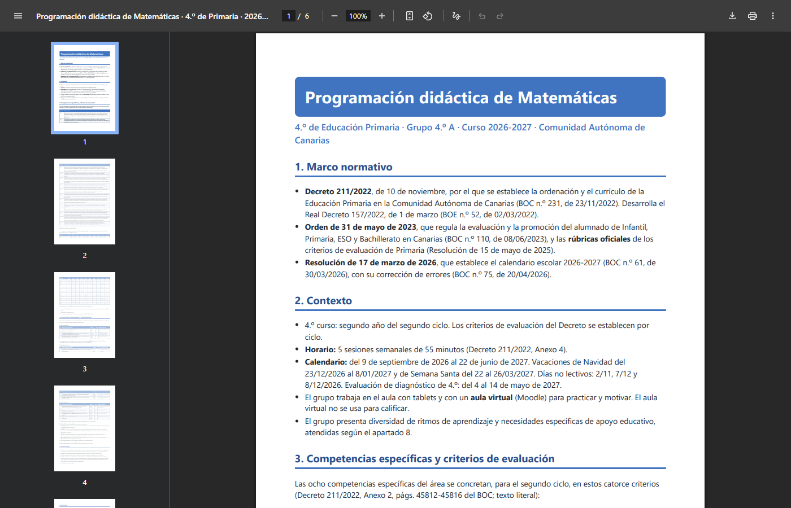
*Fig. 4. El PDF: marco normativo con boletín y fecha, contexto con el calendario real y criterios del Anexo 2 citados literalmente.*

### El aula para niños

| Esperado | Resultado |
| --- | --- |
| Visual, fácil y para tablet | Portada en mosaico con tarjetas grandes, cada sección con sus pasos en orden y emojis (fig. 6). Usa una etiqueta HTML con el estilo de moodle-ui-kit en vez del formato de curso Tiles, también instalado, así que hay que actualizar la portada a mano al abrir cada planeta. Lo dijo |
| Puntos y niveles | Insignias por nivel (Cadete, Piloto, Capitán o capitana, Comandante) con criterios de finalización (fig. 10). El bloque de puntos Level Up XP **sí está instalado**, pero miyagi dijo que no |
| Lista de tareas que puedan marcar | Checklist con las actividades del planeta, que se marca sola (fig. 8) |
| Sin nota visible para niños y familias | Moodle calculaba un total con los H5P; en t9 desactivó el calificador para el alumnado |
| En español | **No**: el sandbox solo tiene inglés («Mark as done», «To do»). Lo vio la auditoría; es del entorno de pruebas (moodle-sandbox#7) |

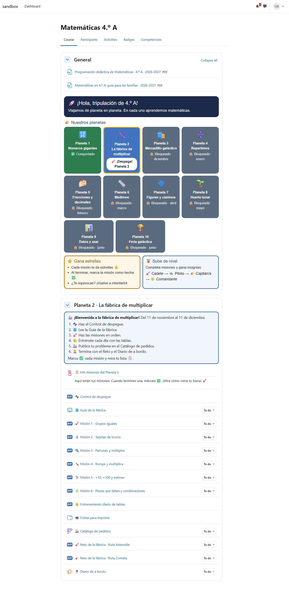
*Fig. 6. Vista de `prim.gara`: guía para familias y programación, mosaico de planetas, Planeta 2 con sus seis pasos y sus actividades en orden. Las cajas «Gana estrellas» prometen estrellas que no se ven (lo dijo la auditoría).*

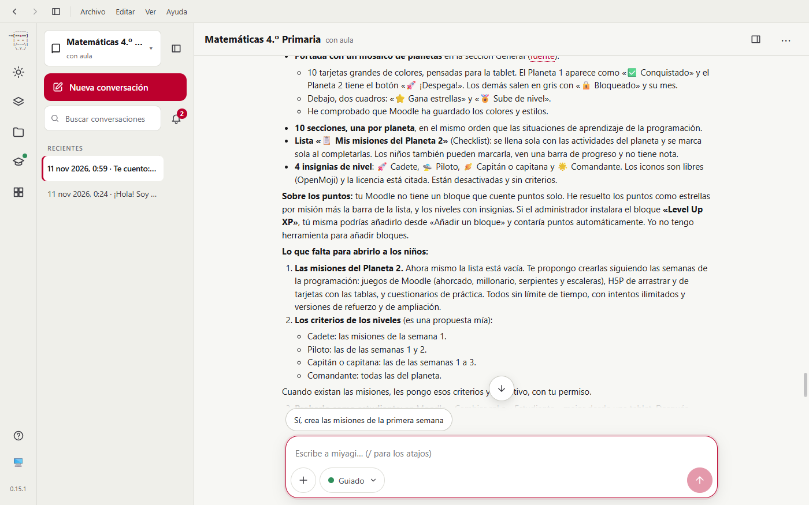
*Fig. 5. El resumen de t5: lo que hay y la frase sobre el bloque de puntos, que no era cierta.*

### La situación de aprendizaje de la multiplicación

| Esperado | Resultado |
| --- | --- |
| Explicaciones con imágenes | Libro de 5 capítulos, uno por semana, con dibujos propios (grupos, cuadrícula, «rompe y multiplica») y texto alternativo. Los capítulos salen «1. 1. …» (fig. 7) |
| Juegos interactivos | 10 H5P de misiones, más el diagnóstico y el entrenamiento diario de tablas (22 tarjetas con truco). Al fallar, explican el error concreto («Has juntado los números. Son 4 grupos de 3») |
| Fichas imprimibles en PDF | Carpeta con las fichas A, B y C en las dos rutas y una tabla de consulta; el solucionario no se sube |
| Tablero de problemas inventados | Tablero con instrucciones en 4 pasos, pero con las columnas «Heading» por defecto: no hay herramienta para renombrarlas (fig. 9) |
| Reto corto | En dos rutas: Asteroide (6 preguntas) y Cometa (4, con tabla y calculadora) |
| Adaptada a la discalculia sin señalar | Ruta Cometa con letra grande, una casilla por cifra, decenas y unidades en color, tabla de consulta y sin tiempo; las rutas tienen nombres neutros y la tutora orienta en clase. Ningún nombre guardado |

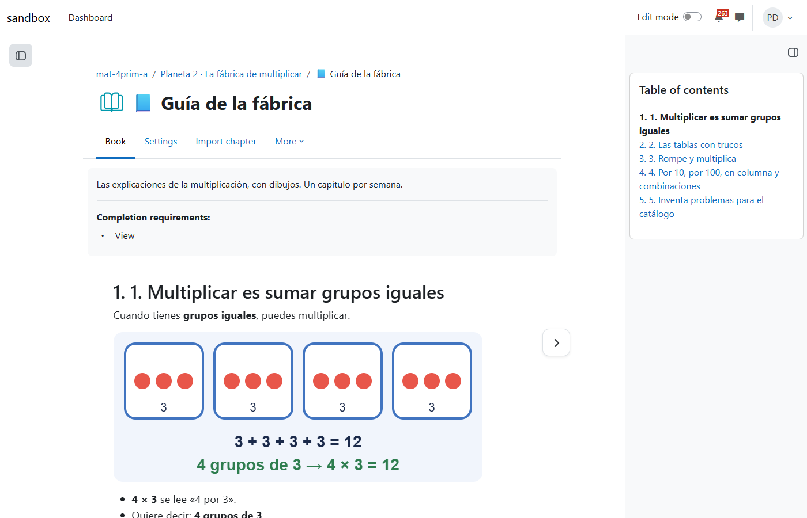
*Fig. 7. Dibujo propio de «4 grupos de 3». En el índice: «1. 1. Multiplicar es…», ya corregido en el código (0178803).*

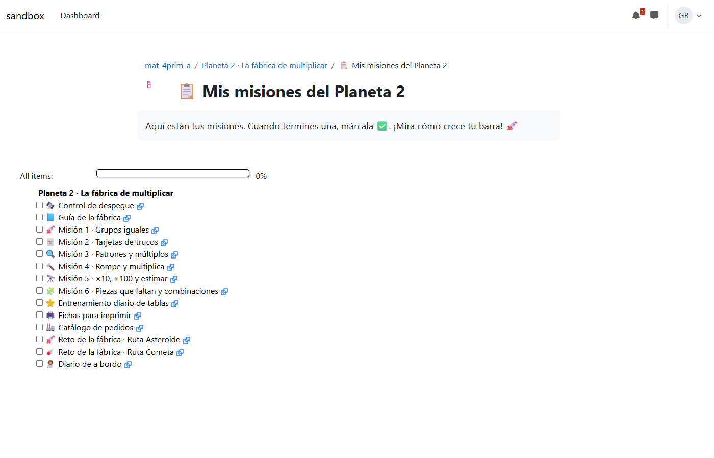
*Fig. 8. La lista de misiones como la ve la alumna, con su barra de progreso.*

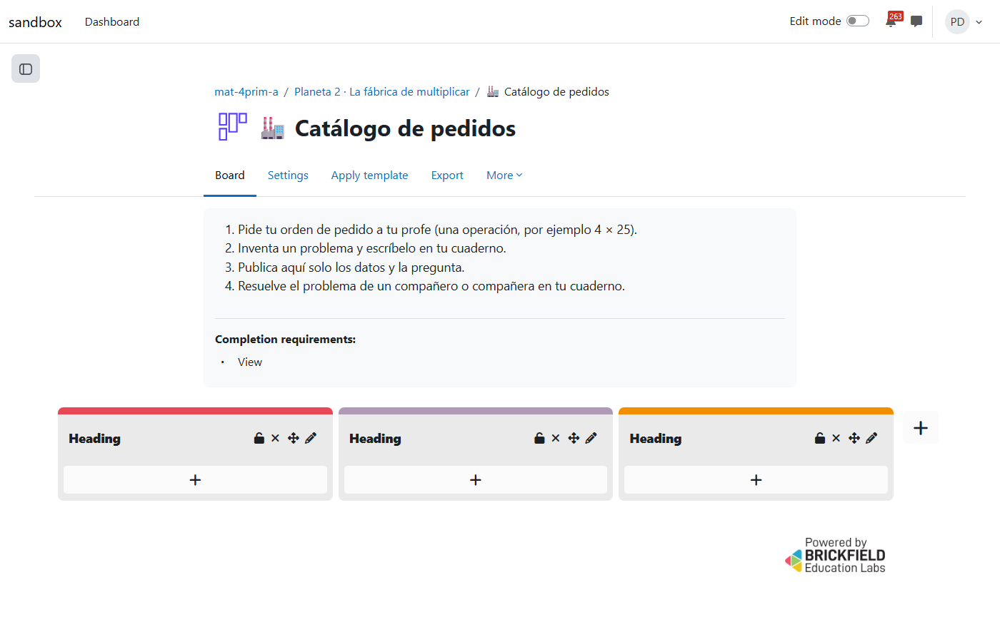
*Fig. 9. El tablero con buenas instrucciones y las tres columnas sin nombre (moodle-mcp#64).*

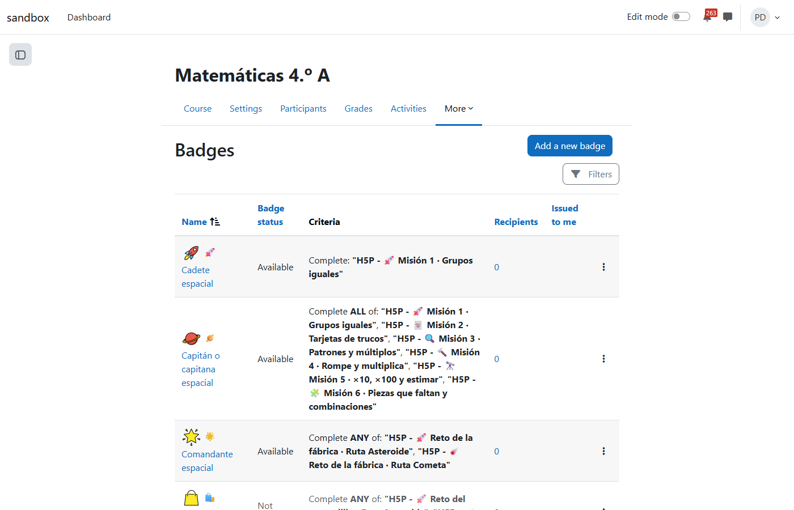
*Fig. 10. Las insignias de nivel con sus criterios de finalización.*

### Auditoría

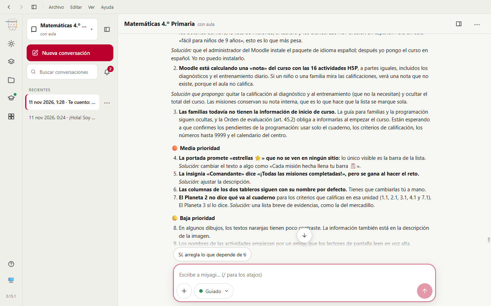
*Fig. 11. La auditoría comprobó la respuesta correcta de los 16 H5P y de las fichas, y puso el idioma del sitio como primera prioridad.*

## Aprobaciones

16 llamadas a `request_human_approval`, cada una con lo que publicaba:

1. Subir oculto el PDF de la programación.
2. Subir oculta la guía para las familias.
3. Activar la finalización en el curso.
4. Crear diez secciones ocultas, una por planeta.
5. Crear oculta la portada (etiqueta).
6. Crear oculta la lista de misiones del Planeta 2.
7. Crear cuatro insignias desactivadas y sin criterios.
8. Planeta 2, bloque 1: texto de la sección, diagnóstico y libro, ocultos.
9. Planeta 2, bloque 2: 10 H5P ocultos.
10. Planeta 2, bloque 3: fichas, tablero, reto y diario, ocultos.
11. Planeta 2, bloque 4: criterios de las insignias.
12. Mostrar la portada, el Planeta 2 y sus actividades, y activar las insignias.
13. Planeta 3, bloque 1.
14. Planeta 3, bloque 2: 6 H5P ocultos.
15. Planeta 3, bloque 3.
16. Arreglos de la auditoría: ocultar el calificador al alumnado y mostrar la programación y la guía.

No se publicó nada fuera de una aprobación. Antes de la 16 preguntó qué enseñar a las familias y avisó de que publicar la programación tal cual daba por buenas sus propuestas.

## Problemas encontrados

| # | Qué | Estado | Dónde |
| --- | --- | --- | --- |
| 1 | `extensions_catalog` con varias palabras solo encuentra la extensión que las tiene todas, así que dijo que no había extensiones de estilo ni de juegos | Corregido en miyagi y comprobado (t2); pedido el arreglo de fondo | `prompts/system/teacher-*.md` (f03ae17), agent-kit#94 |
| 2 | Dijo que el bloque de puntos no estaba instalado sin poder verlo | Corregido | `plugin/skills/teaching-methodologies` (85d19bb) |
| 3 | Capítulos de libro «1. 1. …» otra vez: el libro sale de `materials/` sin cargar la habilidad de moodle-teacher | Corregido en código | `src/materials/notes.ts`, `resource-authoring`, `materials-format` (0178803) |
| 4 | Columnas del tablero «Heading» sin poder renombrarlas | Abierto | moodle-mcp#64 |
| 5 | El sitio de pruebas solo tiene inglés | Abierto (entorno) | moodle-sandbox#7 |
| 6 | La portada en mosaico se actualiza a mano; no usó el formato Tiles | Abierto, menor | lo explicó; a valorar |
| 7 | Las cajas de la portada prometen «estrellas» que no se ven | Abierto, medio | lo encontró la auditoría |
| 8 | La programación de la base de conocimiento menciona H5P con audio y juegos del módulo Game que no existen | Abierto, menor | lo encontró la auditoría; el PDF no los promete |

## Cambios en habilidades, prompts y código

- Prompts de chat y run: buscar en el catálogo una necesidad cada vez, en una o dos palabras.
- `teaching-methodologies`: si no se puede comprobar si un complemento está instalado, decirlo y explicar cómo lo comprueba el docente.
- `src/materials/notes.ts`: el título de un capítulo pierde su número al exportarse y la validación lo avisa. Lo dicen también `resource-authoring` y `materials-format`.

## Lo que no cubrió

- Los niños: misiones jugadas, insignias ganadas y problemas en el tablero. Queda para padawan sobre el curso 357.
- Los planetas 4 a 10 y los arreglos de prioridad media de la auditoría.
- Responder en texto a las preguntas abiertas de miyagi (calendario del centro, festivos, nombre del centro): el guion solo responde a los formularios.
