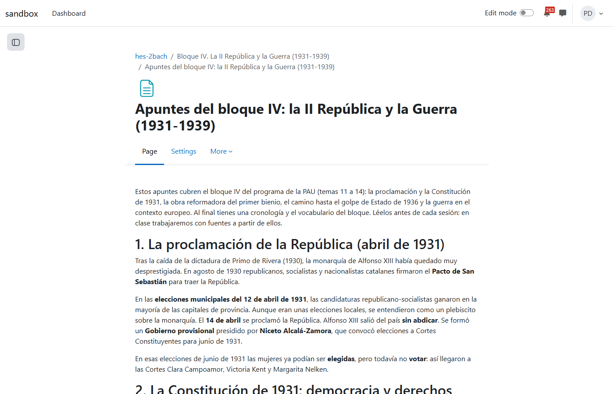
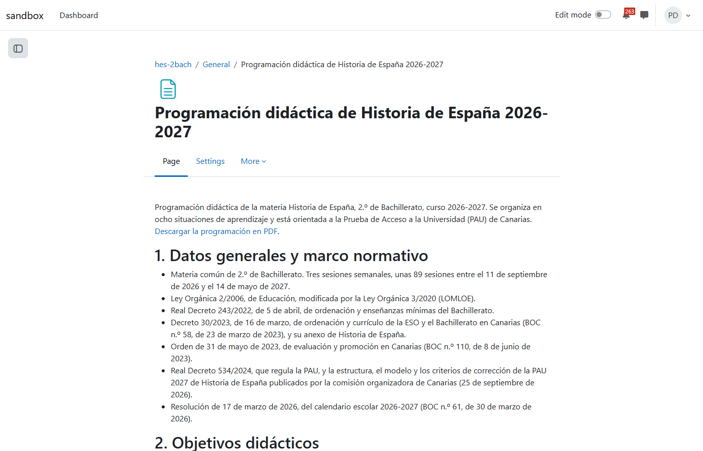
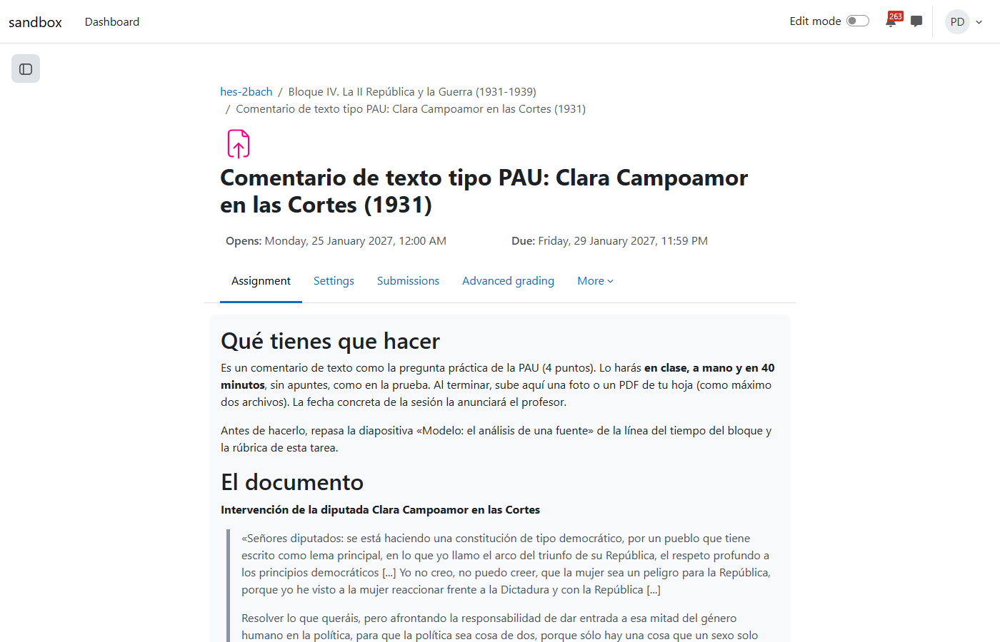
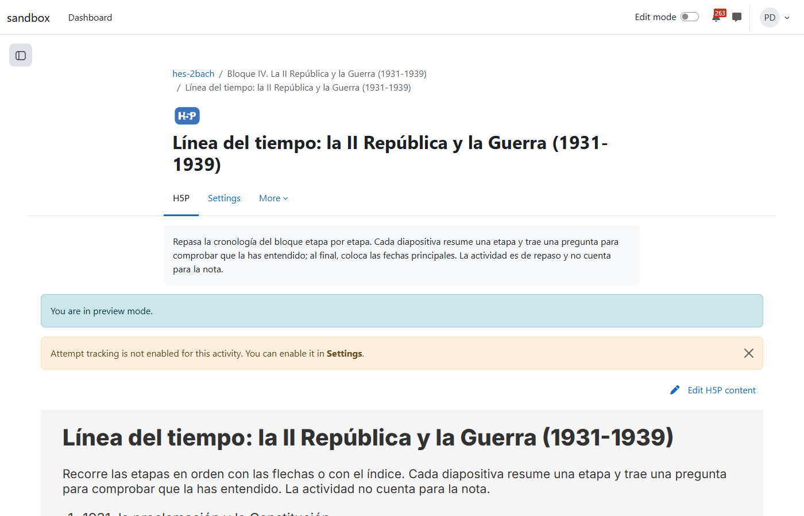
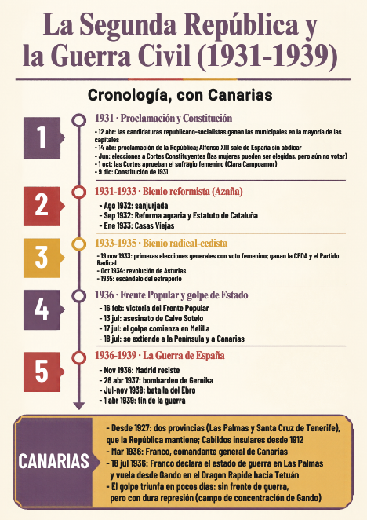
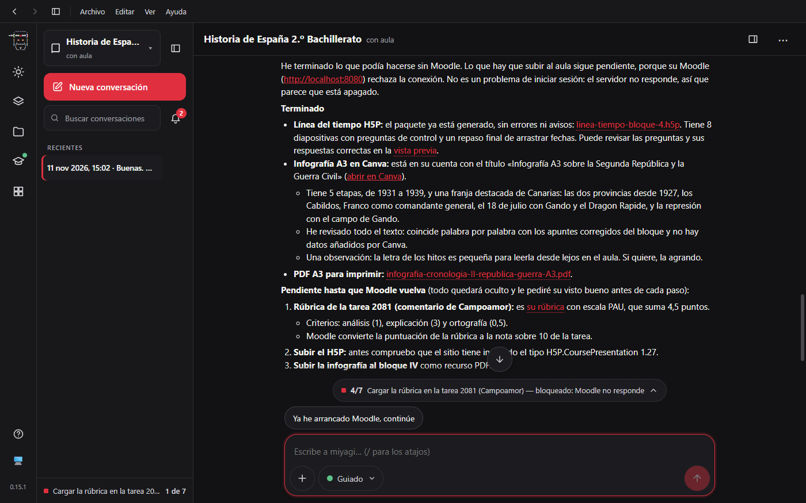
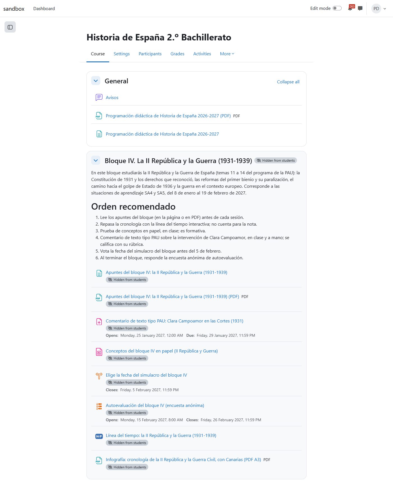

# Simulación 4: un profesor de Bachillerato prepara Historia de España desde el terminal

Cuarta de las cinco simulaciones de docentes, todas en Canarias. Un profesor de Historia de España de 2.º de Bachillerato en un IES de Las Palmas de Gran Canaria trabaja **desde el terminal**, en tono formal (miyagi le trata de usted). Usa `miyagi ingest` y `miyagi run --task` en modo guiado. Trae sus propios materiales en `sources/`:

- sus apuntes del tema de la Segunda República, con **tres errores puestos a propósito**;
- su rúbrica de comentario de texto;
- sus notas de una reunión de coordinación de la PAU, que podían estar desfasadas.

Pide la programación orientada a la PAU de la ULPGC, publicada en HTML y en PDF, y el bloque de la Segunda República y la Guerra Civil con todo lo que necesita: apuntes en HTML y PDF, una línea del tiempo en H5P, un comentario tipo PAU con rúbrica, un cuestionario en papel (Offline Quiz), una consulta (Choice) y una encuesta de autoevaluación (Questionnaire). Al final, ya en la aplicación de escritorio, pide una **infografía en Canva** para imprimir en A3.

| | |
| --- | --- |
| Fecha | 11 nov 2026, 01:40–02:39 UTC (terminal) y 14:57–15:25 UTC (escritorio) |
| Entorno | moodle-sandbox (Moodle 5, Docker), Windows 11 |
| Interfaz | `miyagi ingest` y `miyagi run --mode guided --headless --plain --task` (terminal); la ronda de Canva en la aplicación de escritorio |
| Aula | curso 358 «Historia de España 2.º Bachillerato», vacío salvo el foro de Avisos |
| Alumnado | 5 alumnos ficticios (`bach.*`): una aspirante a Medicina, un buen comentarista desorganizado, una con ansiedad ante el examen, un repetidor que trabaja y una de altas capacidades |
| miyagi | 0.15.1 más los commits hasta c24bdd8 (sin publicar); c24bdd8 entró tras el ingest |
| Extensiones | moodle-teacher 0.6.2, h5p y canva, instaladas con `miyagi extension add` |
| Modo | guiado; un contestador responde por el fichero de respuesta del kit (solo en el sandbox); en el escritorio, el guion de siempre |
| Fuentes | las tres del profesor; miyagi descargó el Decreto 30/2023, la Orden de evaluación de 2023, el calendario escolar y los documentos oficiales de la PAU 2027 de Canarias |

## Veredicto

**Superada con hallazgos.**

**Lo mejor de la prueba:**
- **Errores de los apuntes:** en el ingest encontró los tres antes de usarlos:
  - el primer voto de las mujeres fue en 1933, no en junio de 1931;
  - el golpe empezó en Melilla, no en Canarias;
  - la división provincial de Canarias es de 1927, no de la República.
- **Notas de la PAU:** las comparó con la web oficial y las desmintió: el modelo 2027 no es «elegir entre dos opciones», sino conceptos (3 puntos), una práctica con fuente (4) y una composición (3).
- **Programación:** cita el Decreto 30/2023 y la Orden de 2023, tiene 8 situaciones de aprendizaje y da un instrumento a cada uno de sus 26 criterios.
- **Canva:** la infografía reproduce palabra por palabra los apuntes corregidos (miyagi lo comprobó) y se exportó a PDF A3.

**Lo malo:**
- Contrastó al principio con prensa y una wiki (corregido en c24bdd8: en el bloque ya citó la Gaceta y el Congreso).
- Sustituyó en la programación publicada la rúbrica del profesor por la de la PAU sin preguntar antes.
- El cuestionario en papel y la encuesta quedaron sin preguntas, porque no hay herramienta para esos módulos.

## Qué se ejecutó

| Sesión | Orden | Duración | Llamadas | Aprobaciones | Resultado |
| --- | --- | --- | --- | --- | --- |
| r0 | `miyagi ingest` | 1,6 min | 16 | 0 | 3 fuentes incorporadas y 3 errores de los apuntes señalados |
| r1 | `run --task` programación | 20,3 min | 143 | 2 | Página 2078 y PDF 2077, ocultos, comprobados y mostrados; notas de la PAU desmentidas con la fuente oficial |
| r2 | `run --task` bloque IV | 26,3 min | 148 | 1 | Apuntes en página y PDF, comentario, banco de 16 conceptos, Offline Quiz, consulta y Questionnaire, todo oculto. La rúbrica y el H5P se quedaron sin subir (problema 7, del guion) |
| r3 | `run --task` auditoría y arreglos | 8,3 min | 55 | 3 | Revisó las claves del banco y los apuntes corregidos; el bloque sigue oculto a la espera de las piezas que faltan |
| escritorio | rúbrica, H5P y Canva | 27,4 min | 79 | 3 | H5P generado; infografía en Canva y su PDF. Moodle se cayó (Docker) y miyagi esperó la sesión sin subir nada. Al volver Moodle subió la rúbrica, la línea del tiempo y el PDF A3, ocultos y comprobados |

## Lo que se esperaba y lo que pasó

### Los materiales del profesor

| Esperado | Resultado |
| --- | --- |
| Detectar los errores de los apuntes | Los tres, ya en el ingest. En la tercera frase preguntó qué quería decir el profesor en vez de suponerlo |
| Corregirlos con fuentes fiables | En el ingest, con prensa y una wiki en inglés; en el bloque, tras c24bdd8, con la Gaceta de Madrid, el Congreso y fuentes universitarias. La parte de la Guerra Civil, que no estaba en los apuntes, la redactó él y avisó de qué fechas no pudo comprobar en una fuente primaria |
| Contrastar las notas de la PAU | Descargó los documentos oficiales del modelo 2027 y explicó en qué acertaban y en qué no |
| Respetar la rúbrica del profesor | **No del todo**: la programación publicada la sustituye por la escala de la PAU (análisis 1, explicación 3, ortografía por tramos). Lo dijo en la aprobación de mostrarla y en el resumen, pero no preguntó antes. Corregido en `teaching-plan` (9530e10) |

*Fig. 2. Los apuntes publicados: «las mujeres ya podían ser elegidas, pero todavía no votar».*

### Programación

*Fig. 1. La programación como página HTML, con el PDF al lado en la sección General.*

| Esperado | Resultado |
| --- | --- |
| Normativa canaria vigente | Decreto 30/2023 (8 competencias específicas y 26 criterios), Orden de 31 de mayo de 2023 y calendario escolar 2026-27. Dijo que no pudo leer el Anexo 6 (horario) ni el art. 44 del Decreto 81/2010 y preguntó las sesiones |
| Por situaciones de aprendizaje y hacia la PAU | 8 SA que siguen los 6 bloques del programa de la PAU, con Canarias en todas; 89 sesiones |
| HTML y PDF | Página 2078 y PDF 2077 de 5 páginas, primero ocultos y comprobados, después mostrados |

### El bloque de la Segunda República y la Guerra Civil

| Esperado | Resultado |
| --- | --- |
| Apuntes HTML y PDF | Página 2079 y PDF de 7 páginas, con cronología y vocabulario |
| Línea del tiempo H5P | El tipo Timeline no está instalado en el sitio, así que hizo una presentación interactiva (Course Presentation 1.27) de 8 diapositivas por etapas, con preguntas y un ejercicio final de colocar fechas, y explicó por qué. Quitó la calificación que Moodle le puso por defecto (fig. 4) |
| Comentario tipo PAU con fuente primaria y rúbrica | El discurso de Clara Campoamor del modelo de 2027, en clase, a mano y en 40 minutos. Rúbrica de 3 criterios con la escala de la PAU; la ortografía va como criterio positivo porque las rúbricas no admiten puntos negativos, y explicó la diferencia de nota que eso causa (8,89 frente a 8,75) (fig. 3) |
| Cuestionario en papel (Offline Quiz) | Creado y **vacío**: no hay herramienta para añadirle preguntas (moodle-mcp#65). Dejó dos versiones en papel y las instrucciones |
| Consulta de la fecha del simulacro | Tres fechas posteriores al Carnaval, sin cambio de voto y presentada como formativa |
| Encuesta de autoevaluación (Questionnaire) | Creada, anónima y **sin preguntas**, por el mismo motivo (moodle-mcp#65); las 16 preguntas quedaron en `drafts/` |
| Infografía en Canva para A3 | Diseño en la cuenta de Canva del usuario, con cinco etapas y una franja de Canarias. Comprobó que el texto coincidía con los apuntes; después agrandó la letra de los hitos y corrigió dos solapamientos. PDF A3 subido al bloque (fig. 5) |

*Fig. 3. El comentario: qué hay que hacer, en qué condiciones y el documento.*

*Fig. 4. La línea del tiempo como presentación H5P, sin calificación.*

*Fig. 5. La infografía A3 hecha en Canva: cinco etapas y la franja de Canarias (las dos provincias de 1927, los Cabildos, Gando y el Dragon Rapide).*

*Fig. 6. En el escritorio: H5P y Canva terminados, y la subida pendiente porque Moodle no respondía.*

*Fig. 7. El bloque IV oculto, con la página de orden recomendado y las nueve piezas.*

## Aprobaciones

9 llamadas a `request_human_approval` en total: 2 en r1, 1 en r2, 3 en r3 y 3 en el escritorio. Además, en el modo guiado preguntan los permisos de herramienta (h5p, canva, `set_rubric`).

- **r1:** crear ocultos la página y el PDF de la programación; mostrarlos, avisando de que publica las propuestas de miyagi.
- **r2:** subir oculto el bloque IV.
- **r3 y escritorio:** los arreglos de la auditoría; la rúbrica, el H5P y la infografía, ocultos; dejar el bloque oculto hasta la revisión del profesor.

En r2, el contestador respondió «y» a los permisos de herramienta, que en el modo guiado son una lista de opciones, y el kit lo leyó como un rechazo. miyagi paró `set_rubric` y el H5P y dijo exactamente qué faltaba y dónde estaba preparado. Era un fallo del guion de la prueba y está corregido.

## Problemas encontrados

| # | Qué | Estado | Dónde |
| --- | --- | --- | --- |
| 1 | Contrastó datos de examen con prensa y una wiki | Corregido | `prompts/system/web-research.md`, `topic-research` (c24bdd8) |
| 2 | Sustituyó la rúbrica del profesor en la programación publicada sin preguntar | Corregido | `teaching-plan` (9530e10) |
| 3 | Offline Quiz y Questionnaire quedaron sin preguntas | Abierto | moodle-mcp#65 |
| 4 | La salida `--plain` en un fichero, en Windows, va llena de códigos ANSI partidos a mitad de palabra | Abierto | agent-kit#95 |
| 5 | H5P Timeline no está instalado en el sitio | Bien resuelto | presentación interactiva por etapas |
| 6 | Moodle se cayó (Docker) y la sesión caducó | Bien resuelto | miyagi esperó, no subió nada y lo dijo |
| 7 | El contestador respondía «y» a los permisos de herramienta | Del guion | contestador corregido |
| 8 | Canva no pidió iniciar sesión: usó la sesión de Canva que el usuario ya tenía en su configuración de Claude | Nota del entorno | el diseño quedó en la cuenta del usuario |

## Cambios en habilidades y prompts

- `web-research.md` y `topic-research`: lo que puede entrar en un examen se cita de la fuente primaria u oficial; la prensa y las wikis solo sirven como pista.
- `teaching-plan`: el instrumento del docente se mantiene en la programación y el cambio se propone al lado; antes de publicar un plan que lo quite, se pregunta.

## Lo que no cubrió

- El alumnado: el comentario entregado y corregido con la rúbrica, la consulta votada, la encuesta respondida. Queda para padawan sobre el curso 358.
- El modo interactivo del terminal (paso a paso) y `miyagi chat` en una terminal real: se usaron `run --task` con un contestador.
- Las preguntas del cuestionario en papel y de la encuesta, y la revisión del bloque como estudiante, que miyagi deja al profesor.
