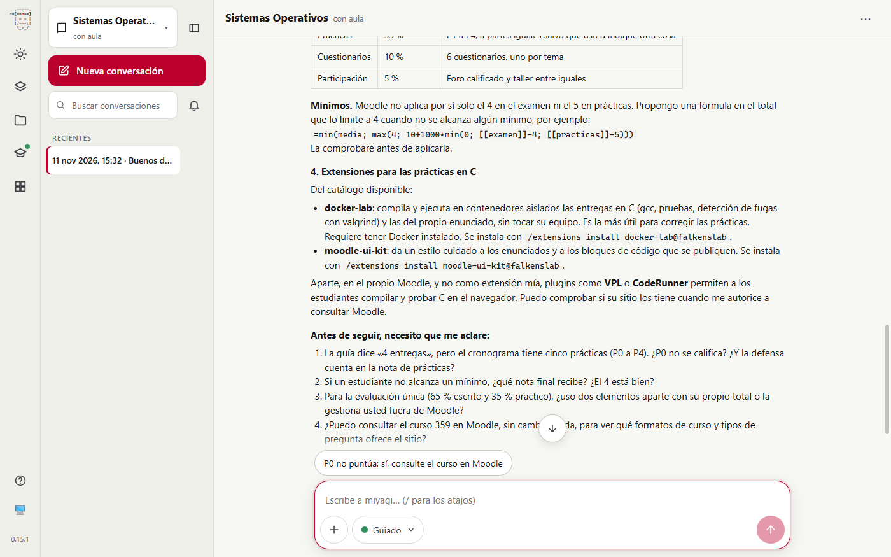
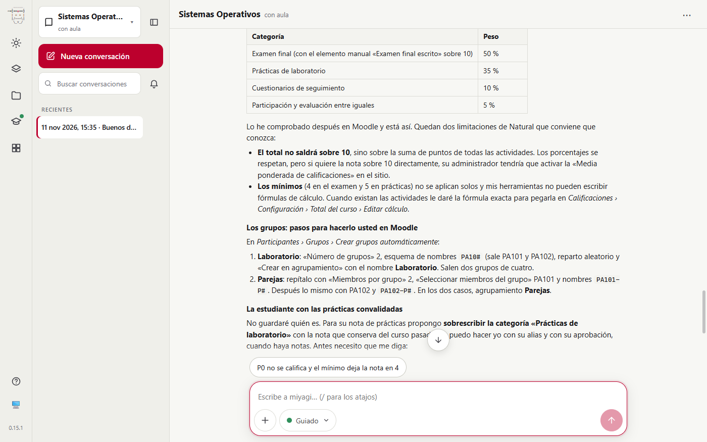
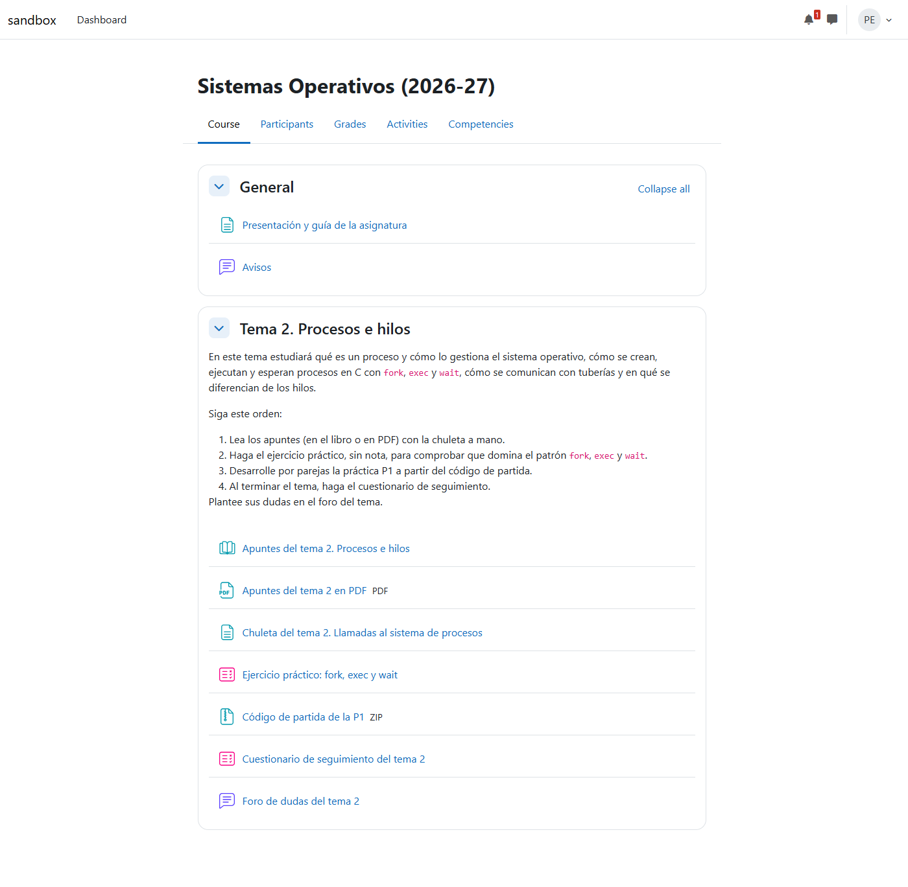
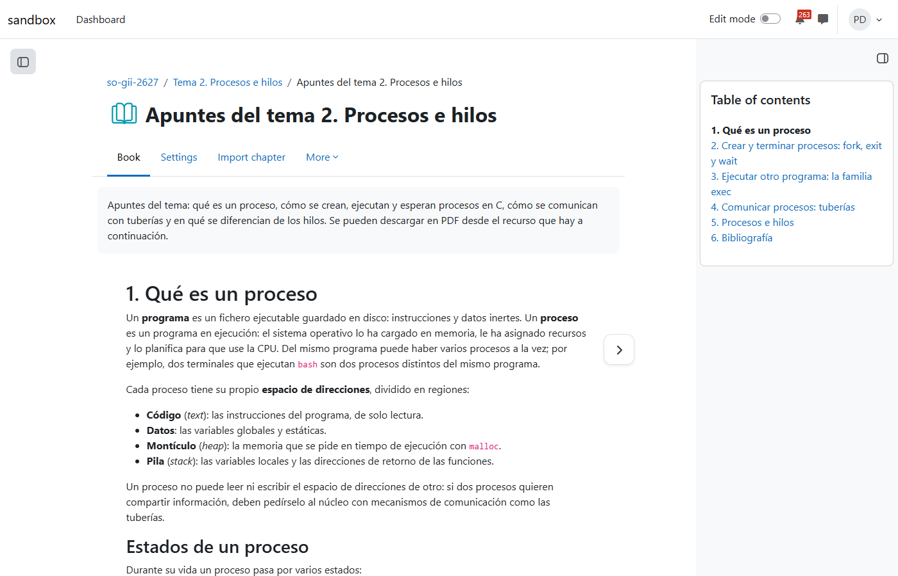
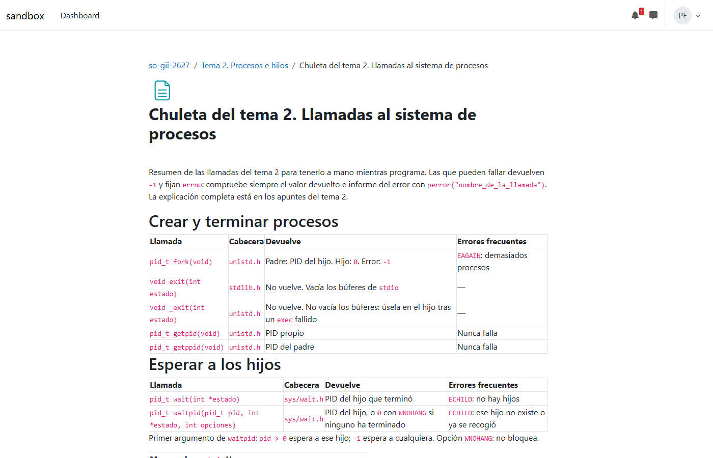
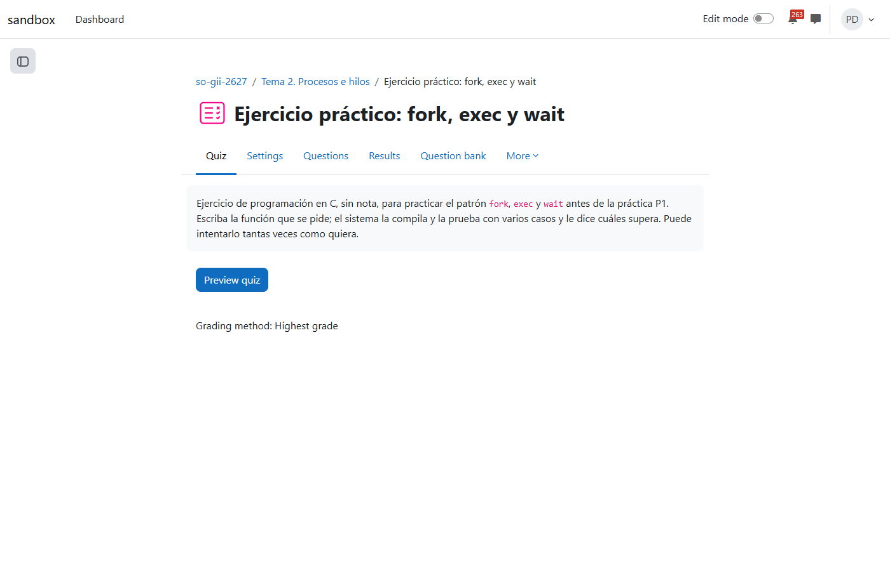
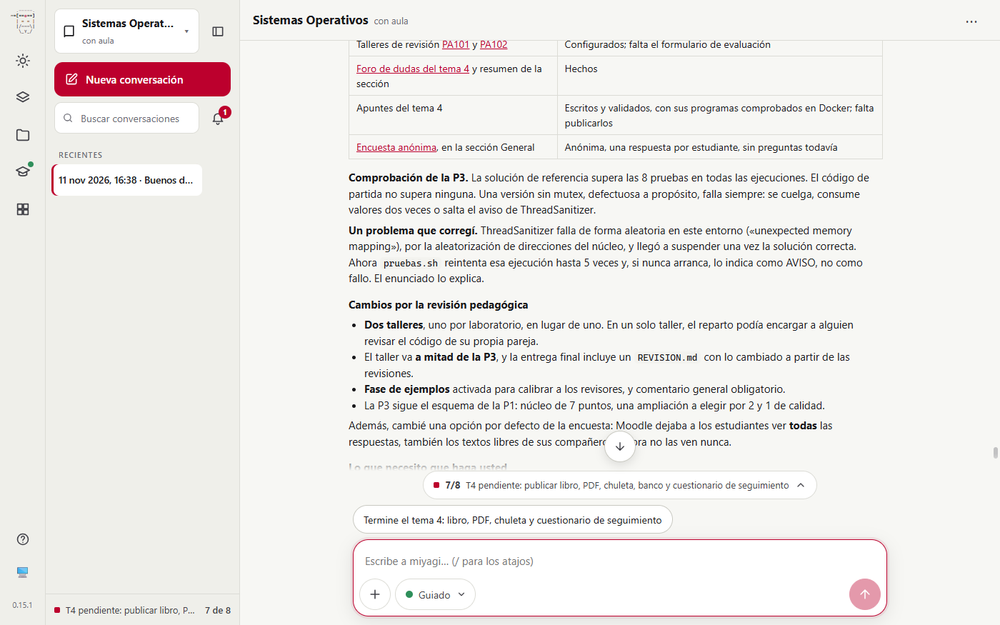
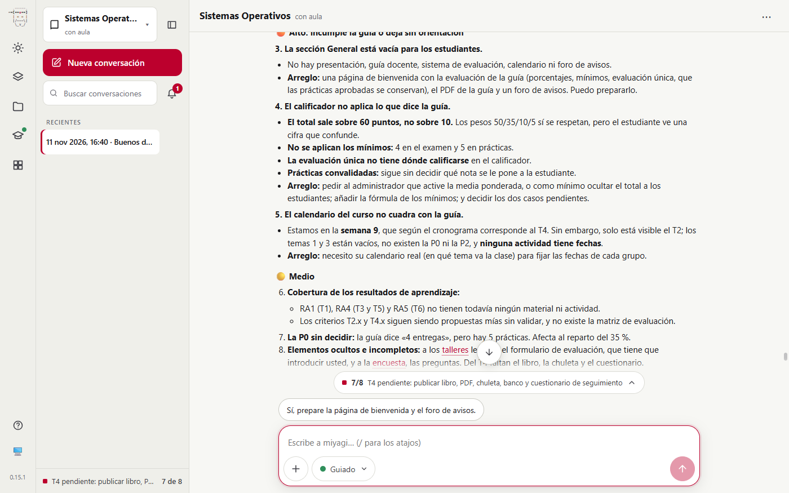

# Simulación 5: un profesor de universidad monta Sistemas Operativos desde su guía docente

Quinta y última de las simulaciones de docentes, todas en Canarias. Un profesor del Grado en Ingeniería Informática (2.º curso, primer cuatrimestre, 6 ECTS) trabaja desde la **versión web**, en tono formal. Adjunta la guía docente de Sistemas Operativos, inventada para la prueba y con estructura realista. Pide a miyagi:

- la estructura del aula a partir de la guía, con los grupos de prácticas y el calificador de la evaluación;
- qué extensiones le convienen para las prácticas en C;
- el tema 2 completo: apuntes en libro y PDF, chuleta, la práctica P1 con rúbrica, un ejercicio de CodeRunner comprobado en Docker, un cuestionario aleatorio y un foro;
- el tema 4: la práctica P3 comprobada en Docker, un taller de revisión entre parejas y una encuesta Questionnaire;
- la auditoría y los arreglos.

| | |
| --- | --- |
| Fecha | 11 nov 2026, 15:30–16:48 UTC |
| Entorno | moodle-sandbox (Moodle 5, Docker; el sitio solo permite la agregación Natural), Windows 11 |
| Interfaz | `miyagi web` en Chrome, con una carpeta de usuario propia para la prueba; tono formal |
| Aula | curso 359 «Sistemas Operativos (2026-27)», vacío |
| Alumnado | 8 estudiantes ficticios (`so.alu01xx`): un buen programador, una teórica, uno que copia código, una que trabaja, un Erasmus, una repetidora con prácticas convalidadas, uno al que le cuesta la concurrencia y una con discapacidad auditiva |
| miyagi | 0.15.1 más los commits del día (sin publicar) |
| Extensiones | moodle-teacher 0.6.3; docker-lab, recomendada por miyagi e instalada desde el chat |
| Modo | guiado; un guion hace de profesor, aprueba cada publicación y elige la opción recomendada (solo en el sandbox) |
| Fuentes | la guía docente adjunta en el chat |

## Veredicto

**Superada con hallazgos.**

**Lo hecho:**
- **Lectura de la guía:** propuso la estructura por temas, con cada práctica en su semana del cronograma.
- **Calificador:** 50/35/10/5 por categorías, como dice la guía. Lo montó en agregación Natural porque el sitio no ofrece otra, y dio la fórmula de los mínimos comprobada con un caso.
- **Extensiones:** recomendó docker-lab y moodle-ui-kit, con su comando.
- **Tema 2, completo y visible:**
  - libro de 6 capítulos, ya bien numerados, y su PDF de 10 páginas;
  - chuleta de llamadas al sistema;
  - ejercicio CodeRunner que supera sus 6 casos, comprobado en Docker y en el servidor de CodeRunner;
  - código de partida de la P1, que pasa 3 de 13 pruebas cuando la solución de referencia pasa las 13;
  - práctica P1 con rúbrica de 7 criterios;
  - cuestionario de 10 preguntas aleatorias de un banco de 20;
  - foro.
- **Tema 4:**
  - la P3 comprobada en Docker: la versión sin mutex falla siempre;
  - corrigió un fallo aleatorio de ThreadSanitizer en el entorno;
  - dos talleres, uno por laboratorio, para que nadie revise a su propia pareja;
  - una encuesta anónima, con las respuestas ocultas a los compañeros.
- **Auditoría:** encontró lo crítico:
  - la P1 visible pero sin poder entregarse, porque no hay grupos;
  - un cuestionario que prometía mostrar las respuestas al cerrar, sin fecha de cierre;
  - la sección General vacía.

  Lo arregló todo salvo lo que necesita al profesor.

**Lo que queda fuera:**
- **Grupos:** miyagi no puede crear grupos ni asignar estudiantes (ADR-021), y aquí son imprescindibles. La P1, la P3 y los talleres dependen de ellos.
- **Herramientas que no existen:** el formulario de los talleres y las preguntas de la encuesta no se pueden crear (moodle-mcp#61 y #65).
- **Foro de avisos:** volvió a crearse como foro general y tuvo que borrarlo (corregido en moodle-teacher 0.6.4).
- **Pestañas:** no las puso «porque no ha comprobado si hay Onetopic» (corregido en moodle-teacher 0.6.3).

## Qué se ejecutó

Una conversación (`2026-11-11T15-30-26`): 77,8 min, 358 llamadas y 31 aprobaciones.

| Turno | Lo que pidió el profesor | Duración | Lo que hizo miyagi |
| --- | --- | --- | --- |
| t1 | Leer la guía y proponer la estructura, los grupos, el calificador y las extensiones | 1,2 min | Propuesta completa sin publicar nada; docker-lab y moodle-ui-kit con su comando; «no puedo crear grupos» (fig. 1) |
| t2–t3 | `/extensions install docker-lab@falkenslab` y `/extensions reload` | 0,2 min | Instalada |
| t4 | Estructura, calificador y grupos, cuatro estudiantes por grupo, con una convalidada | 2,5 min | Secciones ocultas y calificador; los grupos, con los pasos para hacerlos el profesor; la convalidada sin guardar quién es (fig. 2) |
| t5 | Tema 2 completo | 36,9 min | Todo oculto y comprobado en Docker; resumen con el orden de trabajo |
| t6 | Mostrar el tema 2 y montar el tema 4 con P3, taller y encuesta | 25,6 min | Tema 2 visible; del tema 4, la P3, los talleres, el foro y la encuesta, ocultos (fig. 7) |
| t7 | `/miyagi:audit` | 1,5 min | Ordenada por gravedad (fig. 8) |
| t8 | Arreglar lo crítico y lo alto | 8,1 min | P1 oculta hasta que haya grupos, frase del cuestionario corregida, presentación y foro de avisos, categoría de evaluación única |

## Lo que se esperaba y lo que pasó

| Esperado | Resultado |
| --- | --- |
| La estructura y la evaluación salen de la guía docente | Sí: temas, prácticas en su semana, pesos 50/35/10/5 y mínimos 4 y 5. Preguntó lo que la guía no dice: si la P0 cuenta y qué nota poner cuando no se llega a un mínimo |
| Formato de pestañas (Onetopic) | No lo puso: dijo que no había comprobado si estaba instalado, y lo estaba. El arreglo de la simulación 3 hizo que no dijera que faltaba; moodle-teacher 0.6.3 le enseña a probarlo |
| Grupos y agrupamientos | No los hace, por diseño (ADR-021: grupos y miembros están entre las herramientas prohibidas). Dejó los pasos y ocultó la P1 hasta que existan |
| Prácticas en C comprobadas | Laboratorios `sistemas-operativos-t2` y `-t4` con gcc 14 y sin internet, apagados al terminar; pruebas automáticas con solución de referencia y código de partida |
| CodeRunner | Pregunta `c_function` validada por el servidor de CodeRunner al guardarla (fig. 6) |
| Cuestionario aleatorio | 10 de 20 preguntas en 4 categorías (3+3+2+2), con 2 intentos y 20 minutos |
| Taller entre parejas | Dos talleres, con fase de ejemplos; el formulario de evaluación lo tiene que crear el profesor (moodle-mcp#61) |
| Encuesta Questionnaire | Anónima y con las respuestas ocultas a los compañeros (Moodle las enseñaba por defecto), sin preguntas (moodle-mcp#65) |
| Estudiante con prácticas convalidadas | No guardó quién es; propone sobrescribir su nota de prácticas con su alias cuando haya notas |

*Fig. 1. La propuesta a partir de la guía: estructura, grupos, calificador con la fórmula de los mínimos y las extensiones.*

*Fig. 2. Estructura y calificador hechos; los grupos, con los pasos para hacerlos en Moodle.*

*Fig. 3. Vista de `so.alu0105`: presentación y avisos, y el tema 2 con su orden de trabajo.*

*Fig. 4. Los capítulos ya sin el número doble que salía en FP y en Primaria (arreglo 0178803 en acción).*

*Fig. 5. La chuleta de llamadas al sistema: firma, cabecera, qué devuelve y errores frecuentes.*

*Fig. 6. El ejercicio de CodeRunner, sin nota y con intentos ilimitados.*

*Fig. 7. El tema 4: P3 comprobada, dos talleres, la encuesta y lo que necesita del profesor.*

*Fig. 8. La primera auditoría del curso.*

## Aprobaciones

31 llamadas a `request_human_approval`, una por pieza o por lote con todo listado. Entre ellas:

- arrancar cada laboratorio Docker;
- crear oculto cada recurso del tema 2 y mostrar la sección;
- definir cada rúbrica;
- crear los talleres y la encuesta;
- los arreglos de la auditoría, uno a uno.

Una de ellas fue para **corregir el foro de avisos**, que se había creado como foro general. No se publicó nada fuera de una aprobación.

## Problemas encontrados

| # | Qué | Estado | Dónde |
| --- | --- | --- | --- |
| 1 | No probó el formato de pestañas: «no he comprobado si hay Onetopic» | Corregido | moodle-teacher 0.6.3 (`read-a-course`: el formato es un ajuste que puede probar) |
| 2 | El foro de avisos se creó como foro general y hubo que borrarlo (también en ESO) | Corregido | moodle-teacher 0.6.4 (`forums`: el foro de avisos sale del ajuste del curso) |
| 3 | Grupos y agrupamientos imprescindibles que miyagi no puede crear | Abierto, decisión | ADR-021; a decidir si se permite crear grupos y repartir estudiantes con aprobación |
| 4 | Formulario de los talleres y preguntas de la encuesta | Abierto | moodle-mcp#61 y #65 |
| 5 | Nota sobre 60 y mínimos a mano: el sitio solo permite Natural y las herramientas no escriben cálculos | Del entorno | fórmula y pasos dejados al profesor |

## Cambios en habilidades y prompts

- moodle-teacher `read-a-course` (0.6.3): el formato del curso es el ajuste `format` de `update_course`, y probarlo es la forma de saber si está instalado.
- moodle-teacher `forums` (0.6.4): el foro de avisos se recupera con «Número de avisos» del curso, nunca con `create_activity`.

## Lo que no cubrió

- Los temas 1, 3, 5 y 6, y del tema 4 los apuntes, la chuleta y el cuestionario.
- Los estudiantes: entregas por parejas, el taller en marcha y el ejercicio de CodeRunner resuelto. Queda para padawan, una vez creados los grupos.
- La evaluación única y las fechas, que dependen del calendario real del profesor.
