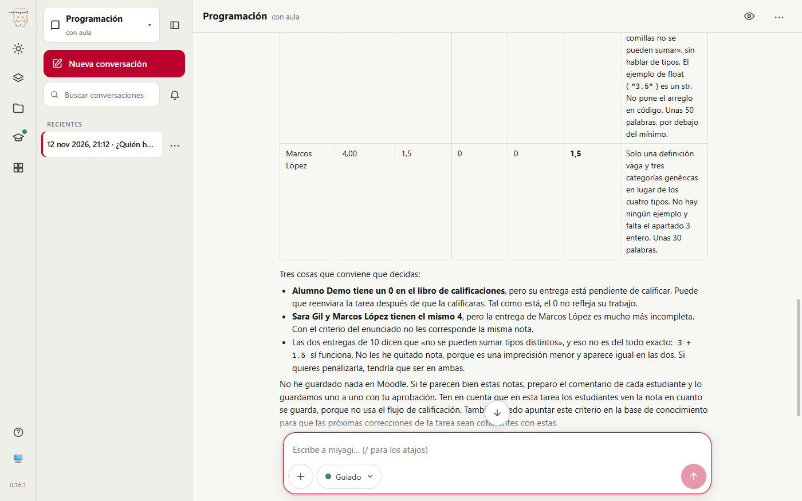
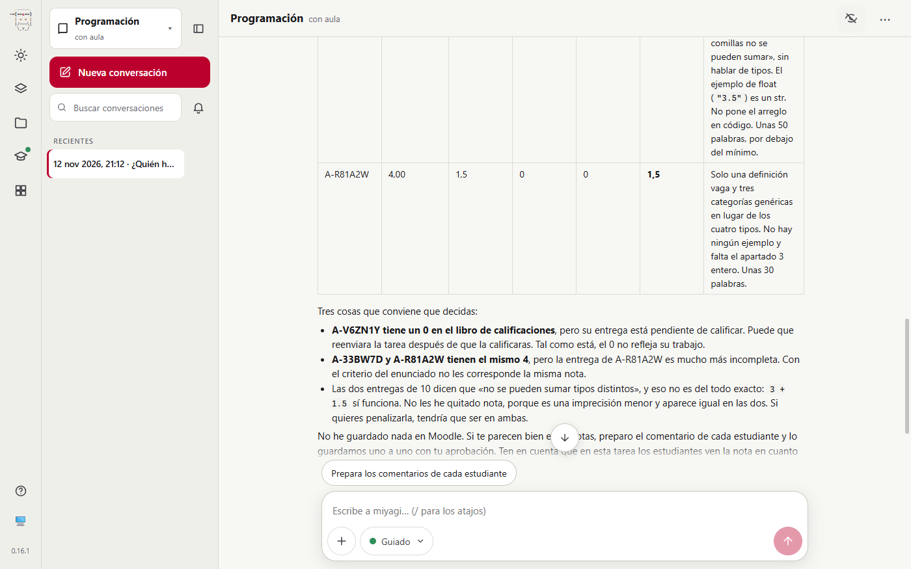
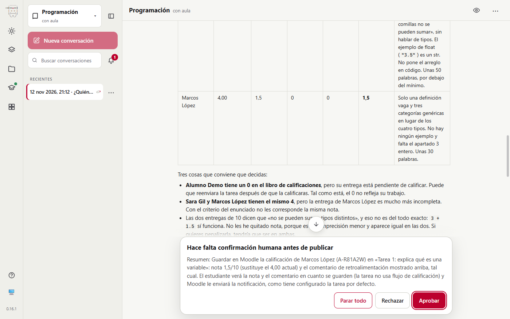

# Nombres reales en la página, alias para el agente

Prueba de #109. Con un aula de verdad, en la versión web, se comprueba lo siguiente:

- la página muestra el nombre de cada estudiante donde moodle-mcp le da al agente un alias, en las respuestas, el panel de aprobación y las vistas previas de `drafts/`;
- un nombre que escribe el docente le llega al agente como alias;
- el botón «Ocultar nombres» vuelve a los alias y, al reiniciar, los nombres vuelven a verse;
- ningún fichero de la asignatura guarda un nombre.

| | |
| --- | --- |
| Fecha | 12 nov 2026, 21:09–21:20 UTC |
| Entorno | moodle-sandbox (Moodle 5.2, Docker), Windows 11, Chrome |
| Aula | curso 2 «Curso de pruebas para agentes», Tarea 1 con 4 entregas (Alumno Demo, Lucía Martín, Marcos López, Sara Gil, alumnos ficticios del sandbox) |
| miyagi | 0.16.1 más los cambios de #109 (sin publicar), `miyagi web` en una carpeta de usuario aislada |
| Extensiones | moodle-teacher 0.6.6 (moodle-mcp 0.10.0), `student_data: pseudonymize` |
| Modo | guiado; un guion hace de profesor y **rechaza** cada aprobación, para no cambiar el curso compartido |
| Directorio de pseudonym | el de la carpeta aislada (`APPDATA` propio), creado por moodle-mcp durante la prueba |

## Veredicto

**Superada.** Los alias se convierten en nombres en todo lo que ve el docente y en ningún otro sitio:

- La respuesta con la tabla de entregas muestra «Lucía Martín», «Sara Gil», «Marcos López» y «Alumno Demo». La transcripción de la sesión tiene sus cuatro alias y ningún nombre.
- El panel de aprobación dice «Marcos López (A-R81A2W)».
- El docente escribió «Marcos López» y el agente recibió `A-R81A2W`.
- «Ocultar nombres» deja toda la página con alias al momento, y tras reiniciar el host se vuelven a ver los nombres.
- La vista previa de un borrador con un alias sale con el nombre, y el fichero sigue con el alias.

## Qué se ejecutó

| Paso | Qué | Resultado |
| --- | --- | --- |
| 1 | Asignatura nueva «Programación» desde la página, aula vinculada al curso 2 | moodle-teacher 0.6.6 instalado; sesión del profesor iniciada por HTTP en su perfil |
| 2 | «¿Quién ha entregado la Tarea 1…? Dame una tabla con la nota que propondrías. No publiques nada.» | 1,0 min, sin aprobaciones; tabla con los cuatro nombres (fig. 1) |
| 3 | «Ocultar nombres», captura y vuelta | La respuesta pasa a `A-V6ZN1Y`, `A-33BW7D`, `A-R81A2W`… y vuelve a los nombres (fig. 2) |
| 4 | «Prepara el comentario de Marcos López… y pídeme la aprobación» | 0,4 min, una aprobación con «Marcos López (A-R81A2W)», rechazada (fig. 3) |
| 5 | Un `comentario.md` en `drafts/` con `A-R81A2W`, pedido a `/api/drafts/file` | 200, «Comentario para Marcos López…»; el fichero, con el alias |
| 6 | `names` con `shown: false` por la API, host parado y vuelto a arrancar | El primer `info` trae `names: {"shown":true}` |

Las llamadas por tipo de herramienta no se pueden dar: la carpeta de la prueba se borró, con su `transcript.jsonl`, antes de contarlas. Las duraciones son las que midió el guion.

## Lo que se esperaba y lo que pasó

| Esperado | Resultado |
| --- | --- |
| Nombres en las respuestas | Sí, en la tabla y en el texto («Sara Gil y Marcos López tienen el mismo 4») |
| La sesión, sin nombres | `grep` de «Lucía», «Martín», «Sara Gil», «Marcos» y «Alumno Demo» en toda la asignatura: ningún fichero. `transcript.jsonl` tiene los alias `A-33BW7D`, `A-9FS6MH`, `A-R81A2W` y `A-V6ZN1Y` |
| Un nombre escrito llega como alias | `history.jsonl`: «Prepara el comentario de A-R81A2W para la Tarea 1…» |
| Aprobación con nombre y alias | «Guardar en Moodle la calificación de Marcos López (A-R81A2W)…» |
| «Ocultar nombres» | Toda la página con alias; el botón cambia a «Mostrar los nombres de los alumnos» |
| Al reiniciar, nombres | `shown: true` |
| Vista previa de `drafts/` | Con el nombre; el fichero, con el alias |

*Fig. 1. La propuesta de notas con los nombres de los estudiantes; arriba a la derecha, el ojo de «Ocultar nombres».*

*Fig. 2. La misma respuesta con «Ocultar nombres»: los alias que tiene el agente, y el ojo tachado.*

*Fig. 3. El panel de aprobación con «Marcos López (A-R81A2W)». La petición se escribió con su nombre y al agente le llegó el alias.*

## Aprobaciones

1. Guardar la calificación de Marcos López (A-R81A2W) en la Tarea 1: 1,5/10 y su comentario. **Rechazada** por el guion; miyagi no guardó nada y lo dijo.

No se publicó nada en el curso.

## Problemas encontrados

| # | Qué | Estado | Dónde |
| --- | --- | --- | --- |
| 1 | La carpeta de pseudonym (la clave y el directorio) no estaba entre las rutas que el agente no puede leer: con ella podía deshacer toda la pseudonimización | Corregido antes de la prueba | 93ac5f7, `sensitivePaths()` en `src/globalConfig.ts` y `check-file-scope.mjs` |
| 2 | moodle-teacher decía que miyagi deja los grupos al docente, lo contrario de ADR-028 | Corregido | moodle-teacher 0.6.6 (agent-extensions 7ed5907) |
| 3 | La captura `desktop-aprobacion-nota` de la guía enseña un alias en la app, y ahora la app enseña el nombre | Pendiente | `docs/static/img/v2/desktop-aprobacion-nota.webp`, para la próxima tanda de capturas |
| 4 | La API pública de pseudonym no tiene la vuelta (alias a nombre): el host usa su CLI, `pseudonym aliases` | Por diseño de pseudonym (su ADR-007) | `src/host/names.ts` |

## Cambios

- `src/host/names.ts`, `src/host/server.ts`, `src/classroom.ts` (`studentDataLevel`), el botón en `gui/` y `test/names.test.mjs`.
- La documentación: Seguridad y privacidad, y Preguntas frecuentes, en español e inglés.

## Lo que no cubrió

- La app de escritorio: usa el mismo host, pero no se probó en ella.
- Borradores, Hoy y la campana con contenido real (solo la vista previa de `drafts/`); se apoyan en las mismas respuestas de `act()`.
- Un aula con `student_data: clear` o sin aula, en vivo: lo cubre `test/names.test.mjs`.
- Apodos y nombres de pila solos, que a propósito no se reconocen.
