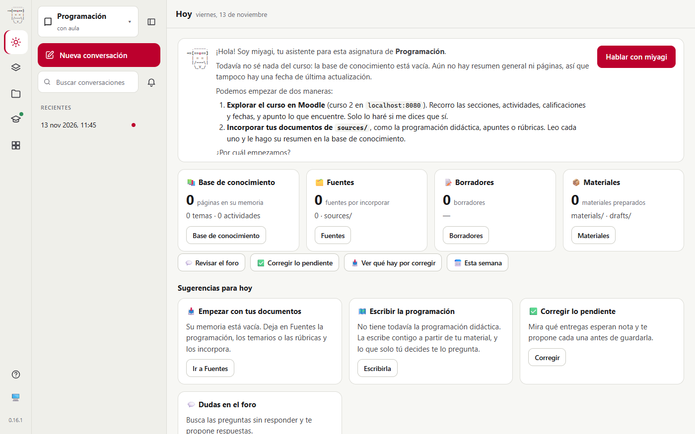
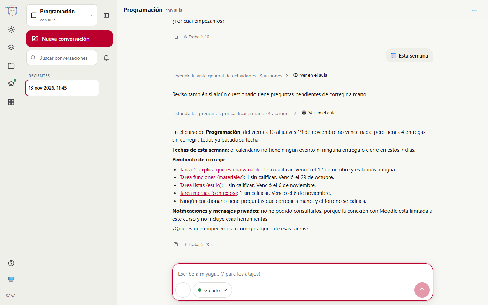

# Acciones de la página desde las skills de las extensiones

Prueba de #110. Se comprueba, en la versión web y con un aula real, que las skills `week` y `to-grade` de moodle-teacher salen como botones en **Hoy** cuando su encabezado trae `label`, y que «Esta semana» lanza la skill y miyagi contesta con lo que hay en el curso.

| | |
| --- | --- |
| Fecha | 13 nov 2026, 11:44–11:46 UTC |
| Entorno | moodle-sandbox (Moodle 5.2, Docker), Windows 11, Chrome headless |
| Aula | curso 2 «Curso de pruebas para agentes», con entregas sin corregir de los alumnos ficticios del sandbox |
| miyagi | 0.16.1 con agent-kit 0.35.0 y los cambios de #110 (sin publicar), `miyagi web` en una carpeta de usuario aislada |
| Extensiones | moodle-teacher 0.8.1 de agent-extensions@241459f, enlazada (`extension add --link`), `student_data: pseudonymize` |
| Modo | guiado; la prueba solo lee, no hubo aprobaciones |

## Veredicto

**Superada.**

- **Hoy** muestra «📥 Ver qué hay por corregir» y «📅 Esta semana» junto a los botones de miyagi.
- Pulsar «Esta semana» envía `/moodle-teacher:week`, el comando con el que el SDK ofrece la skill. El agente siguió sus pasos y contestó con las fechas de la semana y las 4 tareas sin corregir.

## Qué se ejecutó

| Paso | Qué | Resultado |
| --- | --- | --- |
| 1 | `SKILL.md` de prueba en un plugin mínimo y `supportedCommands()` del SDK | La skill aparece como `demo-ext:week`: la página puede mandarla como cualquier comando |
| 2 | Asignatura nueva «Programación» desde la página, con el aula vinculada al curso 2 | moodle-teacher enlazado y configurado con el sitio y el curso |
| 3 | Hoy, y clic en «Esta semana» | Sesión de 0,4 min con 9 llamadas: `time`, `knowledge_index`, `knowledge_read`, `list_events`, `get_activities_overview` y 4 de `list_questions_to_grade` |

## Lo que se esperaba y lo que pasó

| Esperado | Resultado |
| --- | --- |
| Las dos skills con `label`, en Hoy, solo con aula | Las dos en la fila del día (fig. 1). La prueba `test/skillActions.test.mjs` comprueba que una skill sin `label` no sale |
| El botón lanza la skill | `conversation.jsonl` registra `moodle-teacher:week`; las herramientas son las que dicen los pasos de la skill |
| La respuesta, con lo que hay en el curso | No vence nada esta semana; hay 4 tareas con una entrega sin corregir cada una (fig. 2) |
| Nada publicado | Solo lecturas; ninguna aprobación |

*Fig. 1. Hoy, con aula: tras «Revisar el foro» y «Corregir lo pendiente», que son de miyagi, salen «Ver qué hay por corregir» y «Esta semana», que vienen de las skills de moodle-teacher.*

*Fig. 2. El turno de «Esta semana»: lee la vista general de actividades y las preguntas por calificar, y resume la semana.*

## Aprobaciones

Ninguna: la skill solo lee.

## Problemas encontrados

| # | Qué | Estado | Dónde |
| --- | --- | --- | --- |
| 1 | La respuesta dice que no pudo leer notificaciones ni mensajes porque moodle-teacher está limitado al curso. Es lo que la skill pide cuando faltan esas herramientas | Por diseño (#54) | `skills/week/SKILL.md` de moodle-teacher |

## Cambios

- `src/catalog.ts`: `readSkills()` lee los datos de acción y `extensionSkillActions()` devuelve las skills de extensiones que los tienen; `src/host/server.ts` las suma a las acciones de la página.
- `test/skillActions.test.mjs`, con una extensión de prueba enlazada en una carpeta temporal.
- agent-extensions@241459f: `label`, `icon`, `group: day` y `needs-classroom` en `week` y `to-grade` de moodle-teacher (0.8.1) y en `week` de moodle-student (0.4.4).
- Documentación: Extensiones, en español e inglés; la regla, en `.minispec/core/conventions.md`.

## Lo que no cubrió

- «Ver qué hay por corregir»: se vio el botón, pero no se pulsó; lo lanza el mismo camino que «Esta semana».
- La app de escritorio: usa el mismo host.
- moodle-student en padawan.
